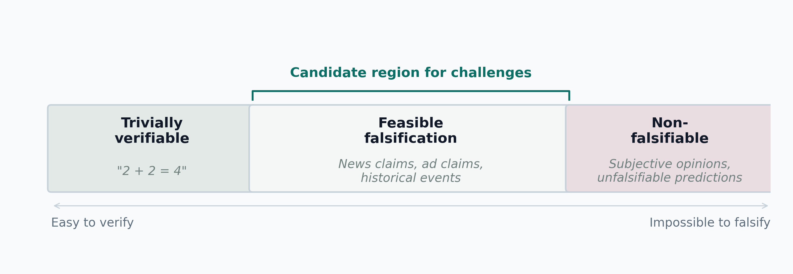
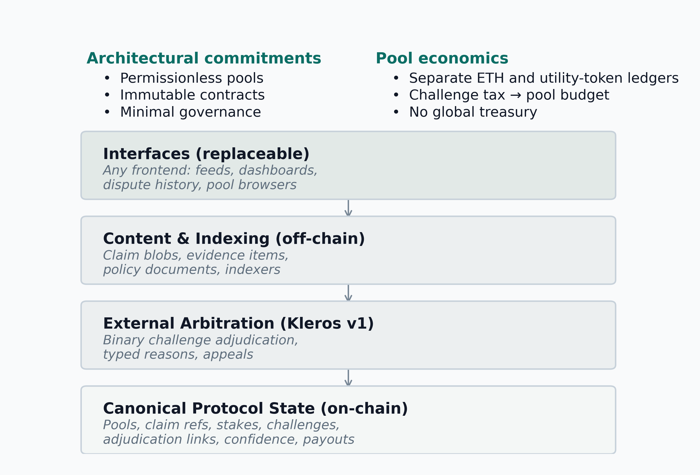
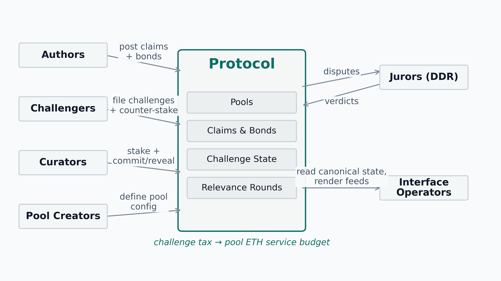

```{=latex}
\newpage
```

::: {.callout-note appearance="minimal"}


:::


# Abstract

This paper investigates the thesis that decentralized curation games can make agents' pursuit of private gain produce public benefit. The intended pathway connects privately rewarding acts of producing, assessing, and correcting information to better individual and collective decisions. A general framework identifies curation problems and relevant quality dimensions, using challenges where falsification is feasible and cheaper than exhaustive verification. Truth Post instantiates it for news.

Truth Post separates **accuracy**, assessed through bonded publication and challenges routed to external decentralized dispute resolution, from **relevance**, scored by drafted curators under a public pool policy. Coherence-based rewards and slashing govern relevance reports. Confidence records accumulated bond-time, and author reputation is a separate non-monetary stock. The architecture combines permissionless pools, immutable contracts, and minimal discretion over protocol execution. Adjudication remains fallible, and faithful assessment under a policy does not establish that policy's public benefit.

Conditional calculations identify settings where challenging false claims has positive expected returns. In simulations with prescribed reports, informative-signal curators accumulate stake under favorable initial conditions, while relevance distortion increases with colluding stake. The incentive analysis exhibits a unilateral reward increase in a single-asset model. That model and the stake-accumulation simulations do not validate the selected two-asset design or its complete appeal payoffs. A toy reputation model separates stipulated publisher types under assigned adjudication outcomes without modeling a behavioral response. These results establish neither truthful best responses nor a safe collusion threshold.

The 2023 Truth Post deployment implemented only the accuracy layer. Its sparse activity informs bootstrapping requirements but does not validate the integrated protocol. The contribution is a design for aligning private incentives with public benefit and a conditional evaluation of its components. Whether strategically chosen behavior improves public outcomes, how affected people shape its purposes, and how close it could come to the best attainable outcome remain open questions.

# Introduction

The central thesis of this paper is that appropriately designed curation games can make agents' pursuit of private gain produce public benefit. Agents choose their own actions and need not pursue the public outcome themselves: the rules should make producing, assessing, and correcting useful information rewarding to them. Truth Post investigates this approach through a decentralized news protocol. Its intended causal pathway runs from private incentives, through accurate and relevant information, to better individual and collective decisions.

Readers already delegate curation when they use newspapers, rankings, reviews, feeds, summaries, and recommendations. These systems select, verify, and contextualize information for decisions. Delegation reduces the burden on individual readers while making their judgments depend on curators' competence and incentives. The design question is how to make privately advantageous participation improve the information available to others. A challenger, for example, may investigate a false claim for its reward, while readers benefit from the correction.

Establishing this alignment requires two links: the rules must motivate productive behavior, and the resulting information must benefit affected people. Positive participant returns alone establish neither link. The paper specifies a protocol and examines selected components through conditional analysis, simulation, and a partial historical deployment. These provide evidence about parts of the pathway; strategic alignment and public benefit remain hypotheses to test.

A supporting diagnostic hypothesis is that **curation is a major source of difficulty in many information-heavy coordination problems.** Distinguishing the information task from the decisions it informs identifies a candidate cause. Testing its relative importance requires a defined set of decisions, measures of evidence quality and coordination outcomes, and comparisons that separate information effects from conflicting interests, resources, and institutional constraints. The paper does not perform that comparative test.

News illustrates the problem. A newspaper selects and contextualizes claims about reality, shaping the evidence available for individual and collective decisions. Selection can reflect institutional incentives as well as factual merit [@chomsky1988manufacturing]; inaccurate reporting and systematic omission can therefore impair public judgment through different causal paths.

Governance failures can consequently contain a neglected curation problem. Reliable shared evidence can help participants identify constraints, compare consequences, and correct mistaken beliefs. It cannot by itself settle conflicting interests, determine legitimate public purposes, or ensure collective action. The curate-then-coordinate decomposition is an analytic distinction, not a claim that knowledge production is completed before politics begins.

The proposed informational contribution concerns disagreement about facts (beliefs); it does not resolve disagreement about values (preferences). Arrow's theorem shows that, with at least two individuals and three or more alternatives, no rule mapping every profile of ordinal preferences to a complete, transitive social ordering satisfies unrestricted domain, weak Pareto, independence of irrelevant alternatives, and non-dictatorship at once [@arrow1963social]. The theorem constrains any rule that must accept every profile, so no improvement in what participants know makes such a rule exist; the protocol does not resolve that residue of value disagreement.

Dewey gives a complementary reason to keep expertise and public purpose distinct. Specialized inquiry requires competence, but affected people contribute knowledge of needs and consequences that specialists may miss. Discussion and consultation can improve the evidence available for judgment as well as express preferences [@dewey1927public, pp. 203–209]. Delegating assessment therefore differs from authorizing assessors to decide whose interests count. In this protocol, the pool creator chooses the relevance policy; publishing that policy establishes neither public authorization nor representation. Dewey's argument motivates this accountability question; it does not endorse the protocol.

## Information abundance, knowledge scarcity

Organization and filtering affect how readers find and use information. Access to information therefore does not by itself establish access to reliable knowledge.

Ackoff distinguishes data, information, knowledge, understanding, and wisdom [@ackoff1989dikw]. Those categories help frame the task but do not supply an operational test that a protocol's output constitutes knowledge. Here, **decision-grade knowledge** is the objective: information sufficiently accurate and relevant to support a specified decision. Whether the proposed procedures produce it requires evidence beyond agreement among participants.

Newspapers, journals, universities, editors, teachers, and peer reviewers perform parts of this work. Their reliability varies, and naming an institution does not make its judgments inspectable. The design question here is how to expose evidence, incentives, and correction procedures when readers cannot directly verify every item.

Fluent presentation has never guaranteed understanding or accuracy. Generative artificial intelligence (AI) makes such presentation easier to produce, increasing the importance of distinguishing stylistic plausibility from evidence. The proposed mechanisms address that distinction through challengeable claims and explicit relevance policies; this paper does not estimate how AI changes the volume or quality of information.

These considerations motivate curation games that reward evidence-based work. Their success depends on whether privately chosen actions improve the information available for individual and collective decisions.

## Contributions

This paper contributes:

- **A framework for aligning private incentives with public benefit through curation.** The framework identifies where curation may improve decisions and assigns mechanisms to the relevant quality dimensions. This paper specifies a news instantiation, evaluates selected components, draws on a partial historical deployment, and sketches a second application to advertising; broader generality and successful incentive alignment remain design goals.
- **A complete end-state protocol architecture for Truth Post.** The design separates accuracy from relevance, distinguishes on-chain canonical state from replaceable interfaces, makes pool creation permissionless, and treats contracts as immutable with cross-version coexistence rather than in-place upgrades.
- **A simulation-based evaluation program.** The experiments evaluate conditional challenge returns, relevance errors and stake redistribution under specified reports, and reputation trajectories under prescribed adjudication outcomes.
- **A deployment retrospective.** Truth Post (2023) produced a live partial deployment of the accuracy layer and informed the current design's bootstrapping requirements.

# A General Framework For Trustless Decentralized Curation

The framework translates the incentive-alignment thesis into four design steps (@fig-framework):

1. **Problem definition.** Determine whether a curation problem contributes to the downstream failure.
2. **Quality identification.** Determine which dimensions of information quality actually matter in the target domain.
3. **Falsifiability requirement.** Use challenge-based mechanisms only where falsification is feasible and cheaper than exhaustive verification.
4. **Mechanism design by dimension.** Design different mechanisms for different quality dimensions instead of forcing all quality into one signal.

For each domain, the intended public benefit guides the quality decomposition and mechanism mix. Evaluation must then ask whether those mechanisms make useful curation privately advantageous and whether the resulting information improves decisions. This paper fully instantiates one domain (news) and sketches a second (advertising). Demonstrated generality requires additional instantiations beyond those presented here.

Step 3 constrains the mechanism mix rather than excluding a domain. Challenge-based accuracy requires feasible falsification and an economic advantage over exhaustive verification; relevance curation requires a policy specific enough to support meaningful scoring. A relevance-only instantiation would need suitable admission, lifecycle, and ranking rules. The present Truth Post design does not implement that mode: a successful `NonFalsifiable` challenge closes the item and removes it from active feeds.

{#fig-framework}

## Step 1: identify the hidden curation problem

Ranking, review, recommendation, and editorial systems perform curation directly. Governance also depends on curation when participants cannot individually verify the evidence needed for decisions. A building association or city council may have aligned incentives yet lack a reliable shared account of the relevant facts. Its coordination rules can operate as designed while inadequate curation impedes action.

Akerlof's "lemons" model shows how quality uncertainty can drive high-quality goods out of a market under adverse selection [@akerlof1970lemons]. An analogous risk arises in information markets when readers cannot distinguish reliable reporting and producers cannot recover the costs of verification. Under those conditions, poor curation can weaken incentives to produce reliable information. The effect depends on production costs, distribution, reputation, and other institutions; it is not an inevitable consequence of information abundance.

Shared knowledge can matter to governance even where values differ, because Arrow's impossibility can fail on suitably restricted domains. If every participant's preferences are single-peaked along one common ordering of the alternatives, pairwise majority among an odd number of voters with strict preferences is transitive and selects the median peak [@black1948rationale]. Deliberation can move preference profiles toward such domains by producing agreement on the dimension of disagreement rather than on outcomes [@dryzek2003socialchoice]; in Deliberative Polls, @list2013deliberation find increased proximity to single-peakedness after deliberation, most clearly on lower-salience issues, while substantive agreement does not generally rise.

This paper conjectures, without testing it here, that curation can play a similar role: a more reliable shared picture of the facts may change which preference profile arises, moving it toward regions where aggregation works.

The protocol aggregates scalar relevance reports on one dimension, not ordinal preferences over alternatives; it does not circumvent Arrow's theorem for the downstream decisions it informs, and curation does not guarantee single-peakedness.

## Step 2: identify the relevant quality dimensions

Information quality is not one thing. Wang and Strong's data-quality work is useful here because it treats quality as multidimensional rather than monolithic [@wang1996beyondaccuracy]. Different domains care about different dimensions: accuracy, relevance, timeliness, interpretability, completeness, accessibility, and so on.

The design implication adopted here is to assess the relevant dimensions separately, so that a high score on one does not obscure a failure on another.

## Step 3: require falsifiability where challenge is the mechanism

Popper treats exposure to potential empirical refutation as a criterion of scientific status, not meaningfulness [@popper1959logic]. Popper's logical asymmetry does not determine whether practical falsification is feasible or inexpensive. Where readers or automated checks can verify claims cheaply, bonded challenge may add little to accuracy assessment. Incentives may still be needed for discovery, attention, and publication of corrections.

If a claim is not falsifiable, challenge cannot adjudicate its truth. Truth Post permits a `NonFalsifiable` challenge to assess compliance with a pool's requirements: an item may enter initially, but a successful challenge ends its active eligibility while preserving its historical record.

Relevance is scored against a published policy rather than adjudicated as true or false. Its conceptual prerequisites therefore differ from those of factual-truth adjudication, although the current design couples their lifecycles.

The relevant region is the middle one (@fig-falsifiability):

- verification is difficult or expensive
- falsification is feasible
- the evidence needed to falsify is publicly accessible

Some suitably scoped news claims can meet these conditions when publicly available counter-evidence is cheaper to assess than exhaustive verification. This must be evaluated for the claim type and evidence policy; a report that an event occurred does not acquire that cost advantage from its form alone. The mechanism depends on making falsehood attackable at an acceptable cost.

{#fig-falsifiability}

## Step 4: design mechanisms dimension by dimension

This design uses different mechanisms for accuracy and relevance. Factual accuracy concerns whether a proposition is true under its stated scope and time, independently of whether a pool finds it relevant. The protocol observes a narrower result: whether a challenge succeeds under the pool's evidence policy. That binary result is fallible and can differ across adjudicators or policies. Relevance is local and scalar: what matters depends on the pool's public policy, scope, and current context.

Keeping these assessments separate lets readers distinguish factual disputes from judgments about what matters under a policy.

Honesty, care and competence are distinct requirements. Honesty means reporting the assessment one actually holds; care means spending effort to obtain and evaluate relevant evidence; competence means being able to interpret that evidence accurately. An honest report can be careless or mistaken, and a competent participant can report strategically. Accuracy bonds put capital at risk conditional on challenge and adjudication. Relevance penalties compare reports with the committee's distribution, while fixed service fees reward valid participation. These mechanisms do not directly observe effort or establish expertise. Their evaluation must therefore distinguish truthful reporting, evidence-gathering effort and assessment quality rather than treating agreement or profitability as evidence of all three.

## A second instantiation: advertising

Advertising provides a possible application beyond journalism: advertisers compete for attention while consumers may struggle to verify product claims.

A different advertising game is possible. Advertisers could express verifiable product statements as claims and post bonds behind them. A successful challenge would transfer the bond to the challenger. This could make some false claims costly, but the effect would depend on detection, reliable adjudication, dispute costs, and the value of deception. Truthful advertisers would still bear capital costs and the risk of erroneous rulings.

This sketch does not constitute a full instantiation: no quality decomposition, simulation, or deployment has been performed for advertising. Advertiser funding for curation is a further possibility to investigate, not an established revenue source.

# Instantiating The Framework For News

The news instantiation applies separate assessments to factual accuracy and policy-relative relevance.

## Accuracy and relevance

Applying the framework to news yields two dominant quality dimensions:

- **Accuracy.** Factual claims should be true under their stated scope and time; public challenge under an explicit evidence standard is the proposed means of assessment.
- **Relevance.** Claims should matter relative to the pool's curation goal.

Accuracy alone is not sufficient. A claim like "one equals one" is accurate, but it is not news. A world-politics pool that publishes accurate football trivia has not solved its curation problem. Relevance is therefore not an optional add-on. It is a separate dimension with different structure and different incentives.

## Falsifiability and claim structure

A **claim blob** is a content-addressed article or item that may contain multiple propositions. A challenger identifies a specific proposition in natural language; if the challenge succeeds, the entire item is debunked.

The protocol tracks procedural outcomes in two state dimensions. These records do not establish truth conclusively. The **operational state** records the claim's lifecycle position:

- `Live`: the item is active, bonded, and challengeable. Confidence accrues.
- `PendingEdit`: the author is preparing a new revision. Confidence is paused. The claim remains challengeable on its last finalized revision.
- `WithdrawPending`: the author has initiated withdrawal. A cooldown period runs during which challenges are still accepted.
- `Challenged`: an active dispute is in progress. Confidence is paused.
- `Closed`: a challenge succeeded; the claim is terminal for feed purposes.
- `Withdrawn`: the author removed the bond after the cooldown; the item remains visible historically with frozen confidence.

The **adjudication outcome** records the result of accuracy disputes separately:

- `Unchallenged`: no challenge has been resolved.
- `ChallengeFailed`: a challenge was resolved in the author's favor.
- `Debunked`: a challenge succeeded, whether by counter-evidence, because the challenged proposition was non-falsifiable, because the claim violated the pool's topic scope, or because the claim failed the pool's template requirements.

These states record procedures and their outcomes. `Debunked` can mean a scope or template violation rather than factual falsity; `ChallengeFailed` does not certify truth. **Credible consensus** means judgments grounded in evidence, assessed relative to an explicit policy, with usable correction paths. Agreement alone establishes none of these properties. The protocol makes parts of that process inspectable and contestable; it does not mechanically establish truth, competence, or beneficial outcomes.

The [public-goods companion](https://github.com/0xferit/manuscript-decentralized-curation/blob/main/projects/rpgf/companion-paper/manuscript.md) develops a separate application: ongoing assessment of contributions, followed by funding when a beneficiary budget is available. Its application rules are distinct from Truth Post.

# Truth Post Protocol Architecture

This paper defines the common protocol and accounting rules. The [Truth Post blueprint](truth-post/blueprint/) develops the reference news application's configuration and implementation requirements under those rules. The 2023 deployment is a partial historical predecessor, not the design source of truth. Remaining implementation and mechanism questions are identified explicitly below.

## Architectural stance

Three architectural commitments anchor the design:

1. **Permissionless pools.** Any address may create a pool with a domain, a claim template, an evidence policy, and a relevance policy. If the pool is bad, interfaces and users can ignore it.
2. **Immutable contracts.** Protocol changes require new deployments and cross-version aggregation, not in-place upgrades.
3. **Minimal governance.** The preference ordering is: eliminating the need for governance is best; good governance is acceptable; bad governance is worse; and no governance at all (ungoverned failure modes) is worst. If a design can eliminate a governance surface, it should.

These commitments limit discretionary control over shared protocol rules. They do not eliminate governance of pool purposes, funding, interfaces, or migration. Here, **trustless** refers to reducing dependence on a single operator through inspectable state and enforceable procedures; readers still depend on evidence producers, adjudicators, and policy choices.

Ostrom's account of durable common-pool institutions emphasizes participation by affected users in rule modification and monitors accountable to users [@ostrom1990commons, pp. 90, 93–94]. Permissionless entry and immutable rules do not supply those arrangements. Pseudonymous pools also differ from the communities she studied, so her findings neither validate this architecture nor establish that exit is superior to collective rule-making. The preference for minimal governance applies to avoidable discretion over protocol execution. It is a design tradeoff, whose costs include limited opportunities to revise a pool's purposes and dependence on coordinated migration when its rules fail.

That dependence on migration is the design's recovery mechanism, not only a cost. No actor can pause, upgrade or redirect a deployment, so when a pool's rules prove inadequate, its contracts contain a defect, or an attacker captures a majority of its stake, recovery means moving activity to a new pool or a new protocol deployment. The specified exits support this: curators can withdraw utility tokens not locked in active rounds at any time, authors can withdraw a claim after a cooldown, a pool creator can mark the pool deprecated or publish a successor reference for interface discovery, and the abandoned deployment's history stays readable to interfaces that aggregate across versions. Migration recovers the curation function, not funds lost to a defect: an attacker who finds a bug in an immutable contract can drain the funds it holds with no recourse [@buterin2026fv], so the commitment relies on hardening contracts before they hold value.

The commitment goes further than Buterin's analysis of rollups, which treats restricting a security council to acting on provable bugs as premature while the underlying proof system is not fully trusted, and warns against making that move at the expense of hardening the system [@buterin2025stages]. Even that most restricted stage keeps a correction path for provable bugs; this design keeps none. Buterin also holds that measurement oracles cannot be secured by cryptoeconomics alone and need at least community forking as a backstop against attacks [@buterin2021limits]. Migration to a new deployment is that backstop for Truth Post's accuracy and relevance signals. The same essay offers an explicit non-financialized mechanism at the center as a valuable alternative for avoiding frequent forks; the minimal-governance commitment declines it and accepts the coordination costs of migration.

## Canonical system boundary

Truth Post is not a single website. The protocol has four layers (@fig-architecture):

- **Canonical protocol state:** pools, claim references, stakes, challenge state, adjudication links, confidence accounting, and payout logic.
- **External decentralized dispute resolution (DDR):** binary challenge adjudication with typed challenge reasons and provider-managed appeals.
- **Content and indexing:** claim blobs, evidence items, policy documents, and indexers that reconstruct feeds and histories from canonical state.
- **Interfaces:** any frontend or application that renders feeds, article pages, pool dashboards, or dispute history.

This split is part of the design, not an implementation detail. A protocol with one fragile frontend is not practically decentralized. The same claim blob content identifier (CID) may be posted to multiple pools as independent claims; each pool instance has independent adjudication, confidence, and relevance.

{#fig-architecture}

## Actors

- **Authors** submit claim blobs, post author bonds, and may later withdraw or amend claims.
- **Challengers** file counter-stake, counter-evidence, and an explicit challenge reason against a challenged proposition.
- **Curators** stake into pools and become eligible for drafted relevance rounds.
- **Jurors** belong to the external decentralized dispute resolution layer and adjudicate only accuracy disputes.
- **Pool creators** define one pool configuration. They do not govern the protocol as a whole.
- **Interface operators** decide what to surface, feature, warn about, or ignore.
- **Readers** consume the outputs and may later become authors, challengers, or curators.

{#fig-actor-flow}

## Accuracy layer

The accuracy mechanism is a bonded publication and challenge system (@fig-claim-states).

1. An author posts a claim blob and locks a bond. Contracts enforce minimal structural field presence at submission (non-empty CIDs, valid version pointers).
2. The item enters `Live` status immediately and remains challengeable while bonded. Authors may adjust their bond while live, subject to a pool-scoped grace period; the old bond rate continues for confidence accrual and challenge pricing until the adjustment takes effect.
3. A challenger may file one active challenge at a time against a specific proposition inside the item, with queued challenges allowed behind it. Challenges may also be filed against claims in `PendingEdit` or `WithdrawPending` states, targeting the last finalized revision.
4. The challenger pays a counter-stake (`max(pool minimum, bond/4)`), a challenge tax (a pool-configurable percentage of the pinned bond), and the external DDR fee. Each challenge is pinned to the challenged revision, manifest CID, and bond at filing time, so later edits or bond changes do not alter the dispute target or payout basis. For queued challenges, the counter-stake, tax, and DDR fee remain in escrow until activation; tax is credited to the pool budget only on activation.
5. The dispute goes to external DDR with a binary question: should the challenge succeed? Appeals, if any, are handled entirely by the external DDR. The protocol does not implement its own escalating-stakes appeal ladder or any protocol-native "lone expert versus herd" jackpot.
6. If the challenge succeeds, the item moves to `Closed` with adjudication outcome `Debunked`. The challenger receives the author's bond and their own counter-stake back; the challenge tax remains in the pool budget. If the challenge fails, the item returns to its pre-challenge operational state. The author keeps the bond; the challenger's counter-stake is split between author reward and pool reward budget at a pool-configurable ratio. The split ratio is a pool parameter, not a protocol constant: too much to the author weakens pool funding; too much to the pool weakens the author's incentive to defend claims. The DDR fee is a sunk challenger cost in both outcomes.

Publication is optimistic: satisfying the structural transaction requirements and posting the bond does not certify a claim's truth, falsifiability or evidential support. Those semantic questions remain open to challenge rather than requiring prior approval. A successful factual-falsification or non-falsifiability challenge debunks the bonded item, forfeits its bond under the rule above and ends that item's beneficiary eligibility in applications that allocate funding. The outcome attaches to the item, not to its author, nominator or beneficiary as a person. The same participant may submit a fresh nomination with its own bond under the pool's ordinary submission rules; a prior debunking alone cannot bar it. The old item remains closed, and a new submission neither overturns that outcome nor inherits its score, funding entitlement or bond. Historical reputation records are distinct from this item-level adjudication and do not create a right to reject the fresh nomination solely because an earlier one was debunked.

The protocol supports four typed challenge reasons, none of which is a separate final verdict. All yield `Debunked` on success:

- `Debunking`: the challenged proposition is factually false.
- `NonFalsifiable`: the challenged proposition fails to instantiate a falsifiable claim under the pool's template and evidence policy.
- `ScopeViolation`: the claim does not belong in the pool's declared topic domain.
- `TemplateViolation`: the claim passes on-chain structural checks but fails the pool's semantic template requirements (e.g., missing required fields or disallowed source classes). On-chain structural validation is enforced at submission; semantic template conformance is enforceable post-publication through this challenge reason.

{#fig-claim-states}

## Relevance layer

The relevance mechanism is a drafted curator coherence game (@fig-relevance-round).

Each pool creator defines the pool's own relevance rubric, with no protocol-wide default curation policy. Where an application allocates funding directly in proportion to curated relevance, the scores express relative funding weights, beyond an ordering of nominations. Scores of 0.75 and 0.25 carry a 3:1 funding-weight ratio before any binding request caps or other application factors. This ratio is an allocation choice under the pool's rubric, not a measured ratio of public benefit, causal impact or the benefit of an additional grant. The rubric should explain its intended numeric meaning. This interpretation concerns beneficiary funding; curator voting weights and appeal-backers' inverse-distance payouts retain their separate rules. It does not turn the news-feed ranking rule into a funding formula.

For direct proportional funding, positive eligible weights divide the entire amount available for allocation. A sole eligible nomination with positive weight therefore receives that whole amount even when its score is low. A requested-weight cap, where used, limits its relative weight rather than placing an absolute ceiling on its payment. This is intended to create an opportunity for other eligible nominations to enter and compete for a share under the pool's ordinary admission rules; it does not establish that entry occurs, that competitors are independent or that allocation improves. Low positive scores alone do not withhold part of the distributable budget. Existing eligibility, holdback, zero-total-weight and funding-availability rules still apply; the rule does not spend reserved or unavailable funds.

Nominations are responsible for having the material required by their pool's policy ready for relevance assessment. This does not introduce a separate evidence-approval or availability gate before drafting. Missing or inaccessible evidence can support a challenge where it establishes a violation of that policy; it does not by itself prove factual falsity or assign a zero relevance score. Absence of a successful challenge likewise does not establish that jurors received sufficient information or that the nomination is accurate. The relevance jury assesses the nomination under the pinned policy and the existing round rules; it does not certify the accuracy layer by completing a score.

1. Curators deposit a dedicated utility token into a pool contract to signal availability for drafting. Let $s_i$ denote curator $i$'s deposited utility-token balance, with both $s_i$ and the seat size $L$ measured in that token's smallest on-chain unit. Ordinary-round rules allow withdrawal of utility tokens outside active-round locks, subject to separately specified penalties. Jury service fees, appeal contributions and other payment flows use ether (ETH), accounted in wei, with the explicit utility-token transfer to successful leak reporters specified below. ETH appeal contributions have their own locks under [Public appeal funding](#sec-appeal-funding); they are not part of $s_i$ and do not reduce utility-token draft availability. Earlier jury service alone does not lock additional ETH. A successful leak reporter receives the confiscated utility tokens and the violator's ETH service fee for that round under the rule below.
2. Ordinary relevance rounds are scheduled for `Live` items at a pool-defined cadence, subject to the per-item filing-window and appeal hold in [Public appeal funding](#sec-appeal-funding). For each item in a pool, at most one ordinary relevance round may be unfinished at a time, across all content revisions. The single-round check, round creation and ordinary jury-budget reservation are atomic when scheduling succeeds. A competing scheduling attempt must defer without creating another round or reserving a second budget. Exclusivity covers scheduled preparation, drafting, commitments, reveals, the proof-opening window and scoring until a valid ruling is issued or the attempt is cancelled. Valid issuance opens its appeal hold in the same transition that completes the ordinary round, leaving no gap for another ordinary round. Cancellation releases ordinary-round exclusivity under the existing cancellation rules; a permitted replacement or retry must acquire it anew and satisfy the applicable cadence, funding and eligibility conditions. Reaching a later scheduled due time, publishing a new revision or using another scheduler does not bypass the guard. Other items and pools remain independent, and appeal juries retain their own shared-group and retry rules.
3. Each seat in the lottery corresponds to $L$ locked tokens (pool-configurable, $L > 0$). Only curators with $s_i \ge L$ are eligible; the draft weight $d_i$ is the integer number of full seat-tickets the curator holds, computed by rounding down:

$$
d_i = \lfloor s_i / L \rfloor
$$

4. The protocol draws seats from the ticket pool. Each drawn ticket locks $L$ tokens from the corresponding curator. A curator may receive at most $d_i$ seats in a single round. Let $n_i$ denote the number of seats drawn for curator $i$. The curator's round weight $w_i$ equals their total locked tokens:

$$
w_i = n_i \cdot L
$$

Ticket eligibility alone does not guarantee that a ticket can be backed. The reference draft separately checks the curator's available deposit, excluding pre-existing locks for other rounds, and skips tickets it cannot fund. Existing collateral cannot back a second round; the blueprint specifies the bounded draft and its cancellation conditions.

Locked tokens are simultaneously the curator's influence on the weighted mean and their maximum loss from ordinary coherence and non-participation penalties. The remainder ($s_i - n_i \cdot L$) stays in the pool contract and is not exposed to this round's coherence or non-participation penalties; other active-round locks and separately specified penalties still apply. A round lock remains active until it is released, including while it awaits appeal-chain finality under step 7. ETH voluntarily committed to an appeal is independently unavailable for withdrawal or reuse under [Public appeal funding](#sec-appeal-funding). Such a contribution does not encumber utility tokens; utility-token balances remain subject to separately specified staking penalties.

5. Each drafted curator commits and reveals a single relevance score in $[0,1]$, weighted by $w_i$. Multiple seats increase the curator's weight on that single score, not the number of independent votes.

6. A relevance round requires valid, timely reveals covering at least 80% of its originally drawn seat weight. Let $W_{\mathrm{draw}}$ be the sum of all curators' original round weights fixed when a nonempty draft succeeds, before any penalties, and let $W$ be the sum of those original weights belonging to valid revealers. Quorum holds exactly when $W_{\mathrm{draw}}>0$ and $5W\ge4W_{\mathrm{draw}}$. Since each drawn seat has the same fixed weight, a draft of $N>0$ seats requires at least $\lceil4N/5\rceil$ seats represented by valid reveals. This fixed rule applies to initial and appeal rounds, with no minimum number of distinct curators. One curator can meet quorum if its valid reveal represents at least 80% of the drawn weight. Later penalties or balance changes cannot reduce the denominator, and a fresh retry uses its own completed draw. This is a participation requirement, not a guarantee of independent or truthful judgments. A drafted round failing quorum completes the proof-opening window below before cancellation: no new score or coherence reward is produced, and any previous relevance score for the same pinned revision remains in force; it cannot substitute for an assessment of a newer revision. Drafted curators who fail to commit or reveal lose their locked tokens as non-participants; valid participants recover their remaining round locks after any applicable leak penalties. A successful leak reporter can still receive confiscated utility tokens under the rule below. This also applies when nobody reveals; an empty draft cannot satisfy quorum. Otherwise, the protocol computes the weighted mean $\mu$ and weighted standard deviation $\sigma$ over valid reveals only, with total weight $W>0$:

$$
\mu = \frac{1}{W}\sum_i w_i \, v_i, \qquad \sigma = \sqrt{\frac{\sum_i w_i (v_i - \mu)^2}{W}}.
$$

Let $\varepsilon_\sigma>0$ be the pool-configured dispersion floor. The mean is accepted as the round's relevance score whatever its dispersion. Step 7 floors the dispersion that scales its coherence band at $\varepsilon_\sigma$, so near-identical reports in the adjudicating round never face a vanishing band. The floor does not distinguish informed agreement from lazy convergence: a low-dispersion committee is penalized only when its reports lie outside the band around a different terminal adjudicated score.

Jury compensation uses two independent asset ledgers. Let $N$ be the number of drawn seat-tickets and $p_{\mathrm{seat}}>0$ the configured ETH service budget per seat. The committed service budget is $R=Np_{\mathrm{seat}}$, in wei, for initial and appeal rounds alike. Ordinary rounds reserve ETH from their pool budget; appeal rounds use [Public appeal funding](#sec-appeal-funding). A fee is earned only when a valid ruling is issued. Each curator who submits a timely, valid reveal generates the normal gross ETH service fee for every originally drawn seat represented by that reveal, regardless of the score, coherence classification or dispersion. That fee belongs to the curator unless a proven leak redirects it to the successful reporter under the rule below. A curator representing several seats earns the corresponding multiple; a missing, late or invalid reveal generates no fee of its own. Let $N_{\mathrm{valid}}$ be the number of originally drawn seats represented by timely, valid reveals. For a valid issued ruling,

$$
\operatorname{fee}_i=n_i p_{\mathrm{seat}}\quad\text{for each timely, valid revealer},\qquad
J=N_{\mathrm{valid}}p_{\mathrm{seat}}\le R.
$$

Other curators generate no normal ETH service fee of their own; a successful reporter can still receive a violator's redirected fee under the rule below. If the round fails quorum or otherwise produces no valid ruling, every service fee is zero, including for valid revealers. Unpaid seat fees are not redistributed to paid jurors. An ordinary round returns its unused pool reservation under the existing finalization or cancellation rule. A quorum-failed appeal attempt instead retains its reservations for the retry. When a valid appeal ruling issues, the pool-first fee accounting below releases unused pool reserves; unused contest reserves remain in the common pot until chain finality. Coherence affects the separate utility-token incentives, not the ETH fee, and no utility-token quantity is added to the ETH budget. The same valid-ruling issuance transition makes each earned ETH fee withdrawable immediately by its assigned recipient, after applying any proven-leak recipient override. Withdrawal does not wait for the appeal window, chain finality, another juror or a backer to claim. A later appeal that changes the score does not reduce or claw back this earned fee. Immediate withdrawability does not require an automatic transfer. The permissionless collection rule below applies to these earned ETH fees; the remaining transfer mechanics are not yet specified. The earned fee is charged once under the applicable funding rule, and an unclaimed fee remains committed to its assigned recipient rather than becoming reusable pool funds or part of the backers' settlement pot. Collecting it satisfies that entitlement without charging the funding source again.

A timely, valid reveal establishes participation, not research effort or accuracy. Fixed ETH fees can make low-effort reporting profitable if expected utility-token losses are too small. Fee and stake calibration must therefore be assessed jointly, including low-value utility tokens and coordinated reports; this eligibility rule does not establish truthful incentives.

When proposing a reference ETH fee default, use a provisional workload assumption of 20–30 minutes of active assessment by a one-seat curator for one item, excluding waiting for protocol phases. This is a planning input, not an empirically measured duration or a required completion time. It adds no timer, effort verification, written report or other condition for earning the fee. The provisional reference rate is 0.005 ETH per seat. Each pool may select a different positive rate when it is created; changing the reference default does not modify an existing pool or its frozen round terms. The existing per-seat payment and valid-ruling conditions still apply. Holding multiple seats multiplies the fee under the existing rule without implying that research effort grows proportionally. Neither this workload assumption nor selecting a default establishes adequate compensation, report quality or truthful incentives.

Utility-token coherence rewards consist solely of redistributed distance-based incoherence penalties under step 7. There is no minted reward or separately funded base token reward. If no such tokens are slashed, the additional utility-token reward is zero, while the valid ruling can still earn its separately accounted ETH service fee. Claim 3 analyzes a single-asset reward model, not an established payoff of this two-asset design.

7. Coherence is graded against the outcome of the round's appeal chain, not the round alone. An ordinary ruling starts a chain, and each appeal ruling joins the chain of the ruling it references ([Public appeal funding](#sec-appeal-funding)). Once the chain is final, its **terminal adjudicated ruling** is its last valid jury ruling. A score set by forfeiture can fix the terminal score for backer settlement, but it is a procedural funding outcome rather than a jury finding, so it never serves as the coherence reference; the terminal adjudicated ruling is then the last jury ruling before the forfeiture. Let $\mu^*$ and $\sigma^*$ be that ruling's weighted mean and dispersion, and let $\tilde\sigma^*=\max(\sigma^*,\varepsilon_\sigma)$. Let $v_i$ denote curator $i$'s revealed score and let $K$ denote the coherence-threshold multiplier ($K > 0$). Every committee in the chain, including the terminal one, is graded against this same reference. Curators inside the coherence band ($|v_i - \mu^*| \le K\tilde\sigma^*$) are not penalized. Curators outside the band lose a fraction of their locked tokens that scales linearly with distance:

$$
p_i = \min\!\Bigl(1,\;\max\!\bigl(0,\;\frac{|v_i - \mu^*|/\tilde\sigma^* - K}{K}\bigr)\Bigr)
$$

At the band boundary, the penalty is zero; at twice the boundary distance ($2K\tilde\sigma^*$ from $\mu^*$), the penalty is total loss of locked tokens. Since $w_i$ is measured in smallest on-chain units (integers), the slashed amount is rounded down:

$$
\delta_i = \lfloor p_i \cdot w_i \rfloor, \qquad q_i = w_i - \delta_i.
$$

The protocol slashes $\delta_i$ utility-token units and returns the remainder $q_i$. This graduated slashing replaces binary slashing: near-boundary deviations incur small losses, while extreme deviations incur total loss. Low dispersion grants no exemption: the floor keeps the band at least $K\varepsilon_\sigma$ wide around $\mu^*$, and reports outside it are penalized. Voluntary appeal contributions retain their separate lock under [Public appeal funding](#sec-appeal-funding). Failed commit or reveal participation remains subject to loss of the non-participant's locked tokens.

Valid revealers' round locks stay locked until the chain reaches finality under [Public appeal funding](#sec-appeal-funding), and this step runs once for every committee in the chain at that event. Without an admitted appeal, a ruling becomes final when its admission window closes, so every valid round lock waits at least $\Delta_{\mathrm{admit}}$ after issuance. An appealed chain keeps the locks of all its committees until its last level settles, with no fixed bound because appeal depth is unlimited. A terminal exit that cancels the initial appeal process fixes the referenced ruling as the terminal adjudicated ruling at that cancellation. Locked collateral cannot back another round, so this hold reduces the stake a curator can offer to other drafts while the chain is open. Non-participation and leak penalties keep their own timing. An appeal ruling that moves the score therefore changes the settlement of earlier committees: a report coherent with its own round's mean is penalized when it lies outside the band around $\mu^*$, and a report its own round's band would have penalized is returned in full when it lies inside.

For each committee in the chain, let $V$ be its valid revealers and $H=\{i\in V:p_i=0\}$ its coherent recipients. Only the actual integer distance-based penalties $S=\sum_{j\in V}\delta_j$ fund coherence rewards. For nonempty $H$, let $W_H=\sum_{j\in H}w_j$. The ideal additional utility-token entitlement is

$$
T_i^*=S\frac{w_i}{W_H}\quad(i\in H),\qquad T_i^*=0\quad(i\notin H).
$$

Each coherent curator receives the floor of its ideal entitlement in the utility token's smallest transferable unit. Count each curator once, using its entire original locked weight, rather than rounding separately for each represented seat:

$$
T_i=\left\lfloor\frac{S w_i}{W_H}\right\rfloor\quad(i\in H),\qquad
T_i=0\quad(i\notin H),\qquad
d_{\mathrm{token}}=S-\sum_{i\in H}T_i.
$$

When the committee's utility rewards are allocated at chain finality, credit $d_{\mathrm{token}}$ exactly once to that same pool's separate utility-token balance. A committee's penalties fund only that committee's coherent curators; no utility tokens move between levels. The conservation identity is $S=\sum_{i\in H}T_i+d_{\mathrm{token}}$, with $0\le d_{\mathrm{token}}\le |H|-1$ when $H$ is nonempty. Evaluate the product and division with exact floor semantics; intermediate overflow or truncation must not add further losses. Unlike the appeal-position bound, this bound depends on the number of coherent curators, not the proposal-grid size. A positive ideal reward may round to zero, and the pool may retain all of a sufficiently small $S$. For example, five smallest token units shared by two equally weighted coherent curators pay two units to each and leave one in the pool; three units shared by four equally weighted coherent curators pay zero to each and leave all three in the pool.

These rewards are additional to returned stake $q_i$ and only redistribute tokens already confiscated. The retained balance does not enter the ETH service budget, convert to ETH or create a base subsidy for future coherence rewards. Allocated but unclaimed integer rewards remain assigned to their recipients and cannot be swept into the retained balance. If $S=0$, every $T_i=0$ and there is no remainder. If $H$ is empty, no denominator is evaluated and all of $S$ goes to the pool's distinct utility-token balance rather than its ETH service budget; the nonempty-set remainder bound does not apply. Non-participation penalties retain their separate pool destination and do not enter $S$. Leak penalties also do not enter $S$. A successful leak reporter receives all utility tokens actually confiscated through the violator's leak penalty, plus the entire normal gross ETH service fee associated with that violator in the affected round. This is an explicit exception to the general ETH payment rule: confiscated utility tokens are transferred directly, without sale or conversion. The reward is funded by punishment of the leaker, with no independent pool subsidy. The ETH component redirects the existing fee rather than creating a second payment. Multiple represented seats redirect their full combined fee. If the violator has no normal fee, including in a quorum-failed round or following a missing, late or invalid reveal, the ETH component is zero; the applicable utility-token penalty and reward remain separate.

Every successfully drafted initial or appeal round has a fixed proof-opening window after its scheduled reveal deadline and before issuance. Let $t_{\mathrm{reveal}}$ be that deadline and $\Delta_{\mathrm{proof}}>0$ the pool-configured proof-opening duration, frozen with the round timetable before reports are accepted. The proof cutoff is

$$
t_{\mathrm{proof}}=t_{\mathrm{reveal}}+\Delta_{\mathrm{proof}}.
$$

The provisional default for $\Delta_{\mathrm{proof}}$ is 48 elapsed hours. It is a design parameter, not an empirically validated safety threshold. The window runs for its full duration even if all curators reveal early or every currently known proof is ready. It is anchored to the scheduled reveal deadline, not the last reveal or a later observer's recognition of closure. Existing admissible proofs opened after the corresponding on-chain reveal but before the reveal deadline remain valid; they need no resubmission. Leak precommits must still be included strictly before the reveal deadline, and the new window does not admit late score reveals or late precommits. Proof openings must be included and validated strictly before $t_{\mathrm{proof}}$, using protocol inclusion time. At or after that cutoff, no new opening is accepted even if a closing transaction has not run. A bare precommit, invalid proof, unresponsive reporter or later submission cannot reset or extend the window.

A valid ruling may be issued only at or after $t_{\mathrm{proof}}$; this permits the transition but does not execute it automatically. The successful reporter is selected from qualifying accepted proofs before fee recipients are assigned. Immediate fee withdrawability and appeal admission begin at actual issuance after this phase. A precommit alone creates no post-issuance claim. Apply the existing earliest-valid-precommit selection rule before assigning the fee recipient. At issuance, the successful reporter replaces the violator as recipient of that fee, at most once for the same violator and round, without changing total $J$, its ceiling or the pool and contest charges. The violator cannot first collect that fee and also leave an entitlement for the reporter. An unclaimed redirected fee stays committed to the reporter outside the backer pot; claiming it does not charge the funding source again. This is a leak-penalty recipient override, not a clawback caused by a later appeal score.

A coordinated leaker and reporter can retain the transferred assets within their coalition; the transfers alone do not establish a net coalition penalty. Using different addresses does not establish independent ownership. A leak penalty may consume only the violator's remaining utility-token collateral for the offending round and currently unlocked utility-token deposits. At enforcement, exclude collateral still locked for every other active round and amounts already confiscated or transferred; count each token once. The requested penalty remains the configured multiplier of the offending round's original locked weight, but actual confiscation is capped by this eligible current balance. A shortfall does not consume other rounds' collateral, create extra debt or require a top-up. Those other rounds keep their collateral and original voting and quorum weights. For example, with 100 tokens locked in the offending round, 100 in another active round and no unlocked deposits, a requested 300-token penalty can confiscate only 100; the other round's 100 remain locked. This rule prohibits removing another round's backing through the leak transfer, while the within-coalition transfer limitation remains. It adds no preventive freeze: withdrawals or new locks permitted by the existing rules may reduce the eligible balance before enforcement. Unclaimed token entitlements are not part of the deposited balance until credited to it. Drafted attempts that fail quorum retain their own round collateral and ordinary-round exclusivity through the same full proof window, then complete the existing cancellation and penalty accounting. They issue no ruling and earn no ETH service fee; valid leak proofs can still receive the actual utility tokens confiscated under the existing cap. Appeal retries retain their level funding reservations and use a fresh round timetable with the same pinned duration. Pre-draw cancellation and an empty draft require no proof window. This rule adds no freeze of otherwise unlocked deposits or other rounds' collateral. The fixed window provides a protocol opportunity to open proof, not a guarantee of network access or transaction inclusion. Other exceptional cancellation rules remain to be specified. No conversion rate, minting, reserve subsidy or token purchase is implied. Utility-token reward rounding follows the rule above; claim execution and numerical representation remain to be specified.


8. Relevance appeals may be filed during the appeal filing window and are open to public crowdfunding. Appeals against the same issued ruling share a committee with a doubled planned seat target under the group timing and funding rules below, to score the same claim under the same pool policy. After admission and funding opportunities end, one fully funded distinct proposal is unopposed and sets the final score by forfeiture, with its contributions returned in full and no jury fee. [Public appeal funding](#sec-appeal-funding) defines participation, score adoption and inverse-distance settlement, including whole-wei position rounding; other integer allocation rules remain open.

Escalation is intended to discipline initial reports through the threat of appeal. Because step 7 grades every committee against the chain's terminal adjudicated score, an appeal ruling that moves the score exposes earlier reports far from it to distance-based penalties. Curators must anticipate both the initial committee and a possible appeal committee; whether this makes policy-faithful reporting a best response depends on the full reward and penalty rules, as discussed in Claim 3. Under a continuous-signal model with unbiased independent signals of uniformly bounded variance, the weighted mean concentrates around the policy-implied target as the normalized voting weights become sufficiently dispersed; a sufficient condition is that the sum of their squares tends to zero. Dependence requires additional control of covariance, and finite variance of each signal alone is insufficient. In the seat-based draft model, increasing seats alone is not sufficient: multiple seats held by one curator still map to a single revealed score. A larger appeal committee can improve precision when it adds independent signals of comparable quality and sufficiently disperses voting weight. A minority can seek correction by appealing. For an adjudicated correction, the appeal must be funded, bring additional information, and satisfy the specified outcome and settlement rules; neither successful correction nor a truthful equilibrium is guaranteed. A win by forfeiture records a procedural funding outcome; it is neither a jury finding nor evidence of consensus.

![Relevance round sequence. Curators deposit into a pool, receive seat-tickets from stake, are drafted by draw-and-lock seat allocation, commit/reveal scores, complete a fixed proof-opening window before ruling issuance, and, once the appeal chain is final, face graduated distance-based slashing against its terminal adjudicated score; non-participation remains slashable. Rounds require the 80% reveal-weight quorum and may also cancel for unavailable randomness or insufficient backing. Public backers may crowdfund an appeal. Opposing funded score proposals go to a committee with a doubled planned seat target after admission and funding outcomes are settled; one unopposed funded score wins by forfeiture without a monetary appeal award.](diagrams/fig-relevance-round.png){#fig-relevance-round width=5in}

### Public appeal funding {#sec-appeal-funding}

A ruling is **issued** when a jury completes a valid relevance round. Issuance opens the appeal filing window and makes the earned ETH jury fees immediately withdrawable under the Relevance layer's fee rule; it does not make the ruling final. Technical round finalization means this completion and issuance event. Ruling finality, which governs appeal backer payouts and the curator coherence settlement in step 7, is separate. The effective relevance score follows the adoption rules below while a challenge remains possible.

Every relevance ruling identifies the item and the content revision it assesses. The initial ordinary round pins that revision and its immutable manifest, body and bundled-evidence references when the round starts, before any curator can submit a report. It also identifies the applicable pool policy versions. An appeal inherits the referenced ruling's target, and every later appeal level and quorum retry keeps that same target. Following the item's current-content pointer must not retarget a running round or an appeal chain. Additional evidence may be admitted under the applicable evidence rules without changing which publication is being assessed. Pinning identifiers does not by itself guarantee that the referenced content remains available.

Where the application permits amendments, an author may publish revision B while a relevance appeal concerning revision A is pending. The appeal continues against A. The edit does not cancel or retarget it, reset its deadlines, change its funded positions or fee terms, refund contributions, release adjudicated capital, or make A's score a judgment of B. A's jury rulings, forfeiture outcomes and zero-funded finality remain attached to A, and A's chain alone determines the associated backer settlement. Revision and ruling history keep the subject of the funded contest fixed: the appellant and opposing score backers committed capital to positions about A, so publishing B cannot change what those positions contest. Settlement allocates the backers' funds according to A's chain-final score. Authorship alone does not make the author a party to that contest or place the author bond at stake; an author who backs a position participates under the same rules as any other backer. The separate accuracy-challenge rules are unchanged. Existing amendment restrictions during accuracy challenges still apply.

Revision B awaits its own revision-bound assessment under the existing ordinary-round hold and resumption rules. A result produced for A after B is published must be recorded in A's history rather than overwrite B's own assessment. Until B receives its own result, it has no adopted relevance score for that revision. B must not inherit any earlier revision's score, even as a labeled provisional proxy. Until B has its own adopted relevance score, it is ineligible for score-dependent ranking and new score-dependent funding; it remains accessible through direct links and pending views. An absent score is not a synthetic score of zero: an assigned 0.00 is a valid assessment outcome. Once a score is adopted for B under the existing rules, ordinary eligibility, funding and any applicable holdback conditions still apply; this rule adds no separate chain-finality wait. This change governs eligibility after the edit; A's appeal settlement remains separate.

Where an application accrues beneficiary funding over time, amounts accrued before an amendment remain attributed to the revision under which they accrued. Publishing B does not erase A's accrued balance, return it to the pool, transfer it to B, or restart its payout conditions merely because the content changed. The same beneficiary, claim, holdback and accuracy-challenge rules continue to govern those amounts; preservation does not make them immediately or unconditionally payable. For example, 100 units accrued under A remain A-attributed after B is published and can be paid only when the conditions already applying to them permit it. This financial balance is distinct from any confidence value reset by the amendment. B receives no new score-dependent funding until it has its own adopted score. The rule concerns funding already accrued under the application's rules, not requested budgets, reservations or provisional allocations; it neither converts those into earned balances nor changes their existing cancellation and redistribution rules. Existing appeal contributions and backer settlements remain separate.

A ruling becomes final at admission closure when no proposal was admitted. Successive appeals form a chain through the rulings they reference. After the earned jury fee is deducted, the remaining adjudicated backer funds stay locked until that chain reaches its ultimate final outcome. That outcome's score determines the backer payouts at every adjudicated level, including earlier levels. Intermediate scores create no fixed or withdrawable backer entitlement. Payouts become claimable immediately at chain finality, without another waiting period or a requirement that other backers collect first. Each level retains its own recorded positions and fee-adjusted funds; a later jury cannot charge an earlier level. The terminal reference is fixed for that chain: later ordinary rounds or separate chains do not reopen its settlements.

Appeals are publicly funded **score positions**. Each position proposes a fixed numeric relevance score for the referenced ruling. A counterparty is another funded position proposing a different score; it need not defend the existing ruling. For example, if the current score is 0.60, funded proposals of 0.20 and 0.90 oppose each other directly. No separately funded defense of 0.60 is required. The existing score may itself be proposed and funded if it lies on the proposal grid; it receives no automatic funded status. Multiple funded proposals with different scores are permitted. Each referenced ruling has at most one position for each numeric proposed score. This uniqueness must hold even under concurrent submissions. Someone supporting an existing score contributes to that position while its funding is open rather than creating another position. Equal numeric scores, such as 0.70 and 0.700, identify the same position. Proposed scores use the fixed 0.01 grid defined below. The existing position retains its funding target, contribution records and deadlines. Another submission of that score creates no additional target, payout weight or funding window and cannot reopen a closed or cancelled position. This uniqueness is local to the referenced ruling, so a later appeal level may have its own position for that score.

Funding is permissionless. Anyone, including the nominator, may contribute to a position without approval or role-based exclusion. Contributing requires neither a curator deposit nor selection for a jury. An appellant or backer selected by the ordinary draw may serve under the same rules as other curators. Initial and appeal juries use the same commitment, reveal, aggregation, reward and penalty rules. Backer settlement is separate from curator compensation.

Every valid issued ruling, including an appeal ruling, can be appealed again with no fixed depth limit. The next level references that ruling, applies the established jury-size doubling rule, and requires fresh voluntary funding. Earlier locked funds cannot also support the next level. A quorum-failed attempt is a retry within its existing level, not another appeal level; it keeps that level's frozen terms and earns no jury fee. Repeated funded appeals or failed-quorum retries can keep capital locked indefinitely. Neither continued funding nor a larger jury guarantees better judgment or eventual completion.

Every issued ruling opens one bounded admission window immediately at its recorded issuance time $t_{\mathrm{issue}}$. Ordinary and appeal rulings use the same positive pool-configured admission duration $\Delta_{\mathrm{admit}}$, which provisionally defaults to 72 elapsed hours. The positive pool-configured shared funding duration $\Delta_{\mathrm{fund}}$ defaults to 72 elapsed hours, giving every admitted proposal that full period after admission closes under the default. This is a provisional design default, not an empirically established optimum. Both durations are frozen for that ruling at issuance. Its admission and common funding deadlines are

$$
t_{\mathrm{admit}}=t_{\mathrm{issue}}+\Delta_{\mathrm{admit}},\qquad
t_{\mathrm{fund}}=t_{\mathrm{admit}}+\Delta_{\mathrm{fund}}.
$$

Both deadlines are exclusive. Using the protocol inclusion timestamp $t$, a new proposal is admissible only when $t_{\mathrm{issue}}\le t<t_{\mathrm{admit}}$. An already admitted position may accept otherwise valid contributions only while $t<t_{\mathrm{fund}}$. At $t\ge t_{\mathrm{admit}}$, admission is closed; at $t\ge t_{\mathrm{fund}}$, funding is closed and its outcomes can be recognized. Signing or broadcasting a transaction before a deadline does not make inclusion at or after it timely. An existing position may still receive funding at the admission cutoff, before its separate funding cutoff. The cutoffs apply even if no transaction has explicitly recorded closure; transaction ordering at the same timestamp cannot extend them. These rules concern appeal admission and crowdfunding only, not juror or external-court deadlines. Later configuration changes cannot shorten, extend or restart either deadline. Opening does not depend on a party action, fee collection, or payout or refund claims. The hold on new ordinary rounds for the item begins with issuance without a gap. Failed-quorum attempts, funding failures and procedural forfeiture outcomes open no new admission window. A new ruling does not reopen an older ruling's closed window.

All proposals admitted against one ruling within the admission window belong to one shared-jury group. A proposal may accept contributions as soon as it is admitted and strictly before the common funding deadline, subject to its cap. Reaching two different fully funded scores makes the group contested, but does not close admission or start the jury early. The admission deadline fixes membership; no new positions enter during the remaining shared funding period. All admitted positions use the same funding deadline. Earlier proposals can fund for longer in total, while every proposal receives the full $\Delta_{\mathrm{fund}}$ after the competing set is fixed. There are no separate appellant-fundraising or counterparty-matching clocks.

The jury waits until admission closes and every admitted funding outcome is determined. Reaching a position's target determines its successful funding outcome immediately. If all admitted positions are fully funded when admission closes, no additional wait for the common funding deadline is required. Subject to the initial-appeal cancellation on accuracy closure or completed voluntary withdrawal below, an underfunded position remains eligible for contributions strictly before that deadline; failure to meet its target does not expire it early. At the deadline, every still-underfunded position is cancelled and its accepted contributions become refundable in full. Recognition of this funding failure does not depend on collecting a refund. Neither new contributions, duplicate submissions, later configuration changes nor quorum-failed retries restart or extend a clock. Under the provisional defaults, admission closes 72 elapsed hours after issuance and the common funding deadline follows 72 elapsed hours later.

Before accepting contributions, each position records its proposed score and the ruling it references. An admissible proposed score is $s=k/100$ for an integer $k\in\{0,1,\ldots,100\}$: 0.00, 0.01, and so on through 1.00. Scores outside this grid, such as 0.599 or 0.705, are rejected before contributions are accepted; they are not silently rounded to a different proposal. Together with one position per score, this permits at most 101 positions against a ruling. Opposing positions have distinct grid values, separated by at least 0.01. The proposed score cannot be edited after funding starts; a different permitted score requires a different position. Its recorded value remains fixed even if the effective score changes. The grid restricts funded proposals only: it does not change the permitted precision of juror reports or round the jury's aggregate score. Settlement compares the fixed proposals with the actual ultimate final score of the same appeal chain.

Each position has the common positive ETH funding target $C=\kappa J_{\max}$, where $J_{\max}>0$ is the maximum shared-jury fee and the pool's contribution multiplier $\kappa$ defaults to 2. The default therefore asks each position for twice the maximum jury fee. Alternative multipliers and asset-unit rounding must preserve $2C>J_{\max}$; in the unrounded model this requires $\kappa>1/2$. Two fully funded positions are sufficient to cover the maximum fee without exhausting their combined capital. This is a financial-capacity condition, not a guarantee of principal recovery, useful participation or successful correction.

One pinned pool rule and input snapshot, established before filing opens, determines the common target for the referenced ruling. Proposer, proposed score, filing time, extra contributions and later rule changes cannot alter it. The snapshot also fixes the planned jury size $N_{\mathrm{plan}}>0$, base pay per seat $p_{\mathrm{seat}}>0$, and fee ceiling $J_{\max}=N_{\mathrm{plan}}p_{\mathrm{seat}}$. The next appeal's planned seat target is $N_{\mathrm{plan}}=2N_{\mathrm{plan}}^{\mathrm{ref}}$, where $N_{\mathrm{plan}}^{\mathrm{ref}}$ is the planned target of the valid round that issued the referenced ruling. A smaller actual draw does not reduce this baseline. For example, a referenced round planned for 20 seats but drawing 12 gives the next appeal a target of 40 seats. Additional proposals and failed-quorum retries do not multiply that level's frozen target again. This rule sets capacity; it does not guarantee that all planned seats can be filled or that different seats represent independent curators. With actual drawn count $N\le N_{\mathrm{plan}}$, the base reward budget is $R=Np_{\mathrm{seat}}$. Unused seat capacity is not an earned fee. Only the actual jury fee $J$ defined by the Relevance layer's timely-valid-reveal rule, bounded by $0\le J\le J_{\max}$, is charged when a valid ruling is issued. Non-participant seat fees remain unearned rather than increasing other jurors' payments. Returned utility-token principal and redistributed utility-token penalties are existing capital in a separate asset, not additional ETH jury fees. All service budgets, fee ceilings, pool contributions, common-pot deductions and backer payouts in this section are ETH amounts in wei.

A position accepts only the funding still needed to reach $C$. Given offered amount $x\ge0$ and current accepted funding $F$ with $0\le F\le C$, acceptance is $\min(x,C-F)$. Excess remains with the backer or returns immediately, never becomes locked, and is not refunded again at settlement. A fully funded position accepts zero. Acceptance and the funding-balance update are atomic. Only accepted contributions count toward the target, pro rata payouts or principal refunds. For example, if 90 of a target of 100 is funded, an offer of 50 contributes 10 and leaves or returns the remaining 40. This cap does not reopen a closed funding phase.

Accepted contributions are locked immediately until the applicable refund or chain-final settlement. They cannot be withdrawn during fundraising, jury preparation or adjudication, or reused for another position or appeal level. They remain separate from the utility-token deposits used for ordinary-round seats. Penalties outside this appeal cannot consume these accepted contributions. The lock survives curator exit and covers only voluntary contributions, not unrelated curator balances. A lock does not guarantee return of principal. A position that fails its funding deadline is cancelled and its accepted contributions are refunded in full, without a jury fee or score-setting right. Every admitted position keeps the common funding deadline; its admission time does not shorten the shared period after admission closes.

At least two distinct fully funded proposed scores require one shared jury. That jury scores the underlying item over the full relevance scale; it is not restricted to choosing one submitted proposal. Funding an additional proposal does not add an independent juror or prove that the proposal is well informed. All fully funded positions in that contested group contribute to one common pot for the referenced ruling. The pot covers the single shared-jury fee shortfall after available pool funds are used. Contribution records remain separate by position and backer, but capital is not divided into pairwise contests or counted more than once. Pots from different appeal levels remain separate. The scalar payout rule below divides the common pot among all included positions by inverse distance to the ultimate final score.

If one or more proposals were admitted but none is fully funded at the common funding deadline, no appeal jury is drawn. The referenced ruling becomes final at $t_{\mathrm{fund}}$, and its issued score is the terminal score for that chain. All accepted contributions to those underfunded proposals become refundable in full, with no jury fee for the failed funding group. Fees already earned by earlier juries remain charged. Earlier adjudicated pots settle against this terminal score under the existing payout formula, and those payouts become claimable at this finality. Neither recording closure nor collecting a refund or payout is a prerequisite for finality. This outcome creates no new ruling or appeal window. It ends this group's hold; any other applicable admission window or active appeal continues to block new ordinary rounds. Failed fundraising is not additional evidence that the referenced ruling is correct.

If only one distinct proposed score is fully funded after admission closes and all applicable funding outcomes are known, it is unopposed. That proposed score becomes the chain's final score by forfeiture, with its procedural origin recorded. It is not a jury finding or evidence of consensus and opens no new appeal window. Its own accepted contributions are returned in full without a jury fee or profit on that position. The resulting terminal score can nevertheless change the backer's payouts from earlier adjudicated levels. Two different fully funded scores cannot both be described as unopposed: they are each other's counterparties and require adjudication.

An issued shared-jury score becomes the effective relevance score of its pinned revision, subject to further appeal. Until either a valid new jury score or the qualifying final score by forfeiture exists for that revision, its previous score retains its funding role under the applicable revision policy. This retention does not transfer an old revision's assessment to newer content. Mere score retention does not finalize the chain, release locked adjudicated funds or supply a substitute terminal reference for settlement; the explicit finality conditions above govern, including the zero-funded outcome. Independent accuracy decisions, eligibility rules, withdrawals and other funding inputs retain their own effects. New ordinary rounds for the item remain blocked while an applicable admission window or active appeal exists; appeal juries and other items remain permitted. An appeal ending early does not waive the rest of its admission window. An already-started ordinary round is not cancelled by this hold; this does not permit admitting a second ordinary round for the same item and pool.

If a nonempty ordinary jury draw completed before final accuracy closure or completion of an otherwise permitted voluntary author withdrawal, that already-drawn attempt continues against its pinned revision and policy. The exit does not discard votes, shorten commitment, reveal or proof-opening deadlines, release its active collateral or jury-fee reservation, or waive ordinary participation and coherence rules. Protocol execution order determines whether the completed draw preceded the exit; scheduled preparation, an incomplete draw or an empty draw does not qualify for this continuation permission.

A valid ruling from that surviving attempt earns the normal ETH service fee and opens its normal first appeal admission and funding windows, even though the item is inactive. The earlier exit is not replayed to cancel this newly opened process merely because no positions were funded before the exit. Its subsequent zero-funded, unopposed and contested outcomes, fees, appeals and settlement follow the common rules. This is a specific permission for the appeal chain originating from the already-drawn attempt, not permission for unrelated chains or later independent ordinary rounds. All resulting scores remain historical assessments of the pinned revision: neither the ordinary ruling nor a later relevance outcome restores active status, feed eligibility, beneficiary funding or a returned author bond. Authorship alone does not make the author a party. Withdrawal eligibility and timing remain unchanged.

If that ordinary attempt fails quorum, it completes the ordinary proof-opening and failure-settlement rules without a new score, ETH fee or appeal window. Settle its utility-token collateral and penalties normally, and return only its unused ordinary jury-fee reservation through the existing cancellation path. Existing historical scores and previously earned entitlements remain unchanged. No fresh ordinary retry may be drawn for the inactive item, even if the application's ordinary retry allowance has not been exhausted. This does not cancel a retry whose own nonempty draw already completed before the exit: that attempt qualifies under the same drawn-jury continuation rule. Still-active items retain their ordinary retry rules, and protected appeal chains retain their separate retry rules.

The following appeal-continuation and cancellation rules apply both when a separate accuracy decision finally closes or debunks an item and when an otherwise permitted voluntary author withdrawal completes. A withdrawal request or an unfinished cooldown alone does not trigger these rules. Withdrawal eligibility, cooldowns, author-bond return and the application's existing status and funding consequences remain unchanged; a relevance appeal does not add a wait for chain finality to an otherwise permitted withdrawal. This provision creates no withdrawal right in an application that does not already permit one.

If at least one level of the same ongoing relevance-appeal chain became contested through two or more fully funded distinct positions before either event, that existing funded chain continues under its agreed rules. This applies even when a later level in the same chain is still admitting or funding proposals at the time of closure or completed withdrawal. The pinned revision and policy, score proposals, deadlines, reservations, jury rules and fee terms remain in force. Neither event cancels an in-progress appeal jury, stops its quorum retries, shortens its admission or funding window, or prevents further appeals of rulings in that same chain using fresh funding under the existing rules. No party is compelled to fund a further level, and the ordinary zero-funded, unopposed and contested outcomes still determine how that chain proceeds and ends.

For a chain protected by prior contested funding, neither event forces a zero relevance score, creates early finality, refunds accepted contributions or releases reserved fees. The chain's own terminal score determines its backer settlements, including earlier adjudicated pots; earned jury fees remain earned, and additional valid appeal rulings incur only their normally defined fees. Failed-quorum attempts remain fee-free under the existing rule. This preserves the funded contest even though continued adjudication may cost ETH and repeated appeals or failed quorum can prolong the capital lock.

Accuracy closure and completed withdrawal retain their respective effects on feed eligibility, confidence and beneficiary funding under the applicable policy. A later relevance ruling is recorded for the historical item's pinned revision and settles the existing contest; it cannot reopen the item, restore feed eligibility or restart beneficiary funding. Apart from the first appeal process arising from the surviving ordinary attempt described above, this continuation rule does not authorize new ordinary rounds or unrelated appeal chains for an item closed or withdrawn under its existing rules. If either event instead becomes effective while the initial appeal process is still open and no level in that same chain has ever had two fully funded distinct positions, cancel that initial appeal process. Stop proposal admission and contributions immediately, without waiting for the scheduled cutoffs. The already-issued relevance score remains the terminal score; no proposed score wins by forfeiture, no zero score is substituted, and no appeal jury or appeal jury fee is created. Every accepted contribution becomes refundable in full, including contributions to a lone fully funded position. Refunds use the existing permissionless collection and standing receiving-address rules and do not undergo payout rounding. They become claimable at that event without waiting for another contributor to collect.

Before applying this cancellation, respect any finality already established under the existing deadlines or outcome rules. A completed or logically final chain is not reopened merely because its finality has not yet been recorded by a later transaction. In particular, a forfeiture score that became final before either event remains final. This cancellation is a specific exception to the initial admission and funding windows, not a general power to alter their duration. It ends only this process's hold; other holds and the item's resulting ordinary eligibility restrictions remain in force.

At the effective accuracy-closure or completed-withdrawal transition, the decision between cancellation and protected continuation must use one atomic view of that chain's funding history. A valid contribution that completes the second distinct position before that event protects the funded chain, even if its jury has not yet started. If the event occurs first while no contested level has ever funded, later proposals and contributions are rejected and cannot revive the process. Existing deadline validation still applies to the contribution; signing or broadcasting earlier does not make an otherwise late contribution eligible.

Only unused reservations belonging to the cancelled appeal process are unwound. Return any unused pool reservation to that pool; keep accepted contributions reserved for their backers' refunds rather than crediting them to the pool or releasing them twice. Other groups' reserves remain untouched. The cancellation does not reclaim or repay already-earned jury fees, including unpaid fees still assigned to their recipients. No earlier contested pot exists in this branch. An author who also backs a position remains subject to these same backer rules; returning the author bond does not by itself release separately committed appeal funds. For example, with a target of 100 per position, contributions of 100 and 90 before either event become refunds of 100 and 90. If both positions reached 100 before the event, the funded-chain continuation rule applies instead.

For pools with recurring ordinary reassessment, let $t_{\mathrm{clear}}$ be the protocol timestamp at which the last applicable admission window or active appeal stops holding the item, and let $\Delta_{\mathrm{ordinary}}$ be the pool's ordinary cadence. The next ordinary round becomes eligible at $t_{\mathrm{clear}}+\Delta_{\mathrm{ordinary}}$, after one full cadence. For example, if a weekly round was due on day 7 but the last hold ends on day 10, its next eligibility is day 17. The old calendar phase and missed occurrences do not create a catch-up backlog; a previously due but unstarted round cannot begin before the new eligibility time. Eligibility still requires the ordinary item, funding and scheduling conditions and does not guarantee execution at that timestamp. If another applicable hold begins before the round starts, it blocks that start; the next eligibility is recomputed from the end of the last such hold. Ending one group while another hold remains does not start the interval. The anchor is the protocol's hold-end time, not when a scheduler notices it or someone records closure or collects a refund or payout. This timing rule does not cancel an already-started ordinary round, permit overlapping ordinary rounds, delay an appeal jury or change failed-appeal retry timing. Later ordinary rounds do not reopen completed appeal settlements.

A shared-jury attempt that fails the 80% reveal-weight quorum is cancelled without a new score, jury fee or curator reward subsidy. The contested level remains active and retries at the existing cadence without a retry-count limit or elapsed-time cancellation. Each retry uses its own completed draw for quorum coverage but retains the level's recorded positions, contribution target, planned jury size, pay rate, fee ceiling and funding reservations. It neither reopens funding nor requires top-ups. Existing non-participation penalties, leak-report transfers and release of valid participants' round locks still apply. Accepted contributions and fee reserves stay unavailable for reuse; failed quorum neither spends nor releases them. The previous effective score and ordinary-round hold persist.

#### Common-pot fee accounting

Fresh eligible jury-fee reservations use a pool's unencumbered ETH service budget in successful protocol execution order. Each commitment atomically reads the available balance and reserves the amount permitted by its funding rule. The first successful commitment therefore takes precedence over a later one, including at the same timestamp. Earlier filing, becoming ready, an ordinary round becoming due, signing or broadcasting does not itself reserve funds. Rejected or ineligible attempts acquire no reservation. Existing reservations, earned but unclaimed fees, accepted backer contributions and funds committed to other obligations cannot be counted as available service-budget ETH or taken by a later round. Pools do not compete for one another's funds.

This rule governs competition between fresh appeal commitments and otherwise eligible ordinary commitments; it does not override the application's order among ordinary rounds or any round's eligibility, scheduling and funding conditions. In particular, it does not let an appeal reserve early while admission or unresolved funding outcomes still require it to wait. Ordinary rounds retain their existing full-reservation requirement. An eligible appeal instead uses available pool funding and reserves the shortfall from its own common pot without waiting for the pool to replenish. A commitment keeps its recorded funding split: later deposits or returned reserves become available to later commitments, not a retroactive subsidy for an earlier one. Existing appeal retries retain their original reservations and do not compete again. Releases continue to follow the existing issuance or cancellation rules.

For example, two eligible appeals for different items in the same pool each have two positions contributing 0.20 ETH and each earn a jury fee of 0.10 ETH. With only 0.10 ETH unencumbered in the service budget, the first reservation funds its fee from the pool and leaves 0.40 ETH in its backer pot. The second funds its fee from its own pot and leaves 0.30 ETH. Both appeals proceed. Execution order determines the subsidy recipient; it is not a fairness guarantee. Faster inclusion can obtain the subsidy, and an appeal can consume funds before an ordinary round reserves them, leaving that ordinary round awaiting funding.

For a contested group of $m\ge2$ fully funded positions with distinct recorded scores, each position contributes $C$ to a common pot of $mC$. Let $B\ge0$ be the unencumbered ETH service-budget balance recorded at this successful fee commitment. Before drawing or seating the jury, reserve $U_{\max}=\min(B,J_{\max})$ from the pool and $D_{\max}=J_{\max}-U_{\max}$ from the common pot. The same money cannot support another reservation or payout. A pool shortfall does not impose a replenishment wait: the contest funds cover it under the frozen ceiling.

At valid-ruling issuance, charge the earned fee $J$ to the pool as $U=\min(B,J)$ and to the contest only as $D=J-U$, once. The resulting juror fee entitlements are immediately withdrawable under the Relevance layer's rule, even while the remaining backer pot stays locked. Unclaimed service fees, including fees redirected to successful leak reporters, remain committed to their assigned recipients; later collection must not charge the pool or contest again. The unused pool reserve $U_{\max}-U$ returns to the pool. The contest's unused reserve $D_{\max}-D$ stays in its locked funds until chain finality. Releasing a pool reserve does not release the backers' capital. A later appeal jury has its own fee commitment and cannot charge this earlier contest. The net settlement pot is

$$
Q=mC-D>0.
$$

Since $0\le D\le J\le J_{\max}<2C\le mC$, this pot stays positive even when the pool contributes nothing. The single fee shortfall reduces the common pot once, regardless of how many positions fund. The ceiling is binding; unused capacity cannot be charged as a fee. With no contested jury, no jury fee is incurred. For example, three positions contributing 200 each create a gross pot of 600; an actual fee of 100 with no pool contribution leaves 500 for eventual distribution. The inverse-distance rule below determines each included position's share at chain finality.

#### Inverse-distance scalar payout

Let $s_i$ be position $i$'s fixed proposed score and $r$ the ultimate final score of the same appeal chain. Define its absolute distance as $e_i=|s_i-r|$. When every included position has $e_i>0$, its ideal total payout, including any returned principal, is

$$
P_i^*=Q\frac{1/e_i}{\sum_{j=1}^{m}1/e_j}.
$$

The ideal payouts sum to the net common pot $Q$. Every positive-distance position has a positive ideal share. A closer position has a larger ideal share; halving the distance doubles its ideal payout relative to a position whose distance is unchanged. Adding another positive-distance position changes the common pot and normalization, but not the ratio between two existing positive-distance ideal payouts at a fixed terminal score. These comparisons precede integer rounding and do not establish neutrality to additional proposals or a truthful-reporting incentive.

If exactly one included position has $e_i=0$, its ideal payout is all of $Q$ and the others' ideal payouts are zero. This explicit exact-match branch agrees with the limit as that position's distance tends to zero while the others remain positive; no positive tolerance is substituted for zero. The one-position-per-score rule permits at most one exact-match position for this ruling. Its backers share that position's payout through their contribution records; supporting the same exact score does not create another winning position.

Express $Q$ and all ETH payouts in integer wei. Each position's payable allocation is the floor of its ideal share:

$$
P_i=\lfloor P_i^*\rfloor,\qquad
d_{\mathrm{dust}}=Q-\sum_{i=1}^{m}P_i.
$$

At chain finality, credit the rounding remainder $d_{\mathrm{dust}}$ exactly once to the same pool's ETH jury-service budget and reserve each $P_i$ for that position's backers. The accounting identity is $Q=\sum_iP_i+d_{\mathrm{dust}}$. Since $d_{\mathrm{dust}}$ is an integer sum of $m$ fractional parts, $0\le d_{\mathrm{dust}}\le m-1$; the proposal grid therefore bounds it by 100 wei per adjudicated level. The exact-match branch has $d_{\mathrm{dust}}=0$. This bound requires the floor of the intended ideal share, without extra losses from intermediate truncation or approximate reciprocal weights. Positive ideal shares can round to zero, and unequal ideal shares can round to the same integer. Unclaimed allocations remain assigned to their backers; they are not rounding remainders and cannot be swept into the service budget. This credit neither changes an already earned jury fee nor reuses a reserved balance.

Each position distributes its whole-wei allocation among its accepted contributions using the cumulative rule below. It leaves no second backer-level remainder for the pool. A closer position can still lose principal after fees. Target and other fee rounding remain to be specified.

For exactly two opposing positions A and B with distinct proposed scores $a$ and $b$, the rule reduces to the established comparison

$$
P_A^*=Q\frac{e_B}{e_A+e_B},\qquad
P_B^*=Q\frac{e_A}{e_A+e_B}.
$$

Equal positive distances give equal ideal payouts and equal floored allocations. Distinct opposing scores ensure $e_A+e_B\ge|a-b|>0$ in this two-position form. Neither position is required to be the previous ruling's score, and the jury may issue a score different from every proposal.

With three positions at 0.20, 0.60 and 0.90 and a terminal score of 0.70, distances are 0.50, 0.10 and 0.20. Their reciprocal weights are 2, 10 and 5. A net pot of 500 has ideal payouts $1000/17$, $5000/17$ and $2500/17$, approximately 58.82, 294.12 and 147.06 before asset-unit rounding. If this illustrative pot is 500 wei, the payable allocations are 58, 294 and 147 wei, and the pool's ETH jury-service budget receives the remaining 1 wei at chain finality. These are total allocations, not profits.

For example, $a=0.80$, $b=0.20$ and terminal score $r=0.70$ produce a 5:1 ratio of ideal shares. With 100 contributed to each position and no fee charged to the contest, the ideal payouts are $166\tfrac{2}{3}$ and $33\tfrac{1}{3}$. A fee deduction of 20 leaves a pot of 180 and payouts of 150 and 30. If an intermediate score is 0.70 but the ultimate final score is 0.30, that same net pot instead pays 30 and 150; the intermediate calculation was never claimable. Neither position is required to be the previous ruling's score, and the jury may issue a score different from both proposals.

Under the default multiplier, a maximum fee of 100 requires 200 from each of two positions. With no pool contribution and an actual fee of 100, $Q=300$. A unique exact prediction earns 300 on its position's 200 contribution. This does not guarantee profit for a closer but inexact prediction or establish an optimal multiplier.

#### Cumulative allocation to backers

Within a fully funded position $i$, number its positive accepted contributions in the order they are applied to the protocol's state. Let $c_{i,\ell}$ be contribution $\ell$ in integer wei, and define cumulative accepted funding by $F_{i,0}=0$ and $F_{i,\ell}=F_{i,\ell-1}+c_{i,\ell}$. The final cumulative amount equals the frozen position target $C>0$. Acceptance must atomically fix each contribution's amount, recorded backer and interval $[F_{i,\ell-1},F_{i,\ell})$ together with the funded balance. A timestamp alone does not determine this order. Rejected offers, excess above the cap and zero accepted amounts create no interval. Multiple accepted contributions from the same backer retain separate intervals; later contributions or claims cannot reorder or merge the intervals used for allocation.

Once the chain is final and position allocation $P_i$ is fixed, the contribution's payable entitlement is

$$
A_{i,\ell}=
\left\lfloor\frac{P_iF_{i,\ell}}{C}\right\rfloor-
\left\lfloor\frac{P_iF_{i,\ell-1}}{C}\right\rfloor.
$$

The recorded backer's total is the sum over its contributions. Evaluate each product and quotient with exact floor semantics; intermediate overflow or early truncation must not change the mathematical result. Claims may arrive in any order without changing allocations, and a contribution's entitlement may be collected at most once. The amount is claimable under the existing chain-finality rule and the permissionless collection rule below; aggregation and the remaining transfer mechanics remain to be specified. Computing one contribution's entitlement requires no ranking or traversal of other backers, but collecting an address's many contributions is not thereby guaranteed a bounded cost.

The interval allocations telescope to $P_i$, including when $P_i=0$, so all of the position's allocation remains assigned to its backers. There is no backer-rounding residue to credit to the pool. An unclaimed entitlement remains reserved; it is not reassigned to the last claimant or swept into the jury-service budget. This rule applies to adjudicated payouts only. Full-principal refunds for underfunded or unopposed positions still return each accepted contribution $c_{i,\ell}$ exactly.

For four contributions of 1 wei to a target of 4 wei, a position payout of 2 wei produces entitlements of 0, 1, 0 and 1 wei in acceptance order. Each contribution's entitlement differs from its ideal proportional amount $P_i c_{i,\ell}/C$ by less than 1 wei, because its error is the difference between two rounding errors. Splitting a contribution into adjacent intervals leaves its combined entitlement unchanged. This is a per-contribution bound, not a bound per backer or economic actor. Interleaving contributions can change the allocation: with ten 1-wei contributions sharing 3 wei, the fourth, seventh and tenth contributions receive 1 wei each. An actor occupying those three intervals receives 3 wei despite supplying only three-tenths of the funding. Rounding differences can accumulate across many contributions. This conditional example does not establish a profitable strategy, and the rule does not establish neutrality to funding order or identity splitting.

#### Permissionless collection of internal ETH entitlements

Each original recorded recipient has one standing receiving-address setting in each paying contract for its internal ETH jury-service fees, appeal payouts and contribution refunds. This includes fees assigned to a successful leak reporter. The setting defaults to the original recipient. Only that original recipient may change the receiving address or reset it to itself. A change applies to all its unpaid entitlements in this scope, including amounts accrued before the change, and to future entitlements from that paying contract. It remains effective until another authorized change; no approval per payment is required.

The original recipient remains the entitlement owner. The receiving address gains no right to change the setting or to authorize another receiver merely by receiving funds. A caller, funder or protocol operator cannot change it on the recipient's behalf without valid authorization. For a contract recipient, the authority must come from that contract through its own supported mechanism, not from an assumed human controller. If the original recipient cannot authorize an update, appointing a receiving address does not create a recovery administrator or restore that lost authority.

Once an entitlement is claimable, anyone may trigger payment to the original recipient's current receiving address without a separate recipient signature or participation role. The caller cannot choose a different destination, change the amount or advance eligibility, and receives no reward or reimbursement entitlement from triggering. Existing records determine ownership and amount; the existing issuance, finality or refund rule determines claimability. The original recipient and its current receiving address may also trigger collection. No automatic payment is required, and collection is not a prerequisite for issuance, finality or another claimant's eligibility.

Resolve the receiving address from current authorized state when each payment executes, rather than fixing it at accrual or accepting a caller's stale destination instruction. The setting lookup, transfer and successful entitlement settlement must behave as one atomic operation. If a payment executes before a receiving-address update, it uses the then-current address and remains final. If the update executes first, a subsequent payment must use the new address. Broadcast or signing time does not override execution order. Completed payments are not reopened or clawed back by a later update. There is no parallel per-payment authorization route that can bypass the current setting.

A successful transfer satisfies the same entitlement once, regardless of the caller or current receiving address. Collection cannot charge the original funding source again, modify another owner's entitlement or reuse an already-paid amount. A failed transfer leaves the unpaid entitlement and its reserve intact and retryable; it does not count as collection. Unclaimed balances remain reserved under their existing accounting rules. Changing the receiving address does not itself pay a claim, require an earlier failed transfer, create a fresh balance or release a reserve.

Receiving-address updates must be authenticated as instructions of the original recipient and valid for the relevant chain and paying contract. If signed update instructions are supported, their validation must prevent forgery, cross-deployment reuse and a superseded instruction restoring an old address after a later authorized update. The update interface, credential format and replay-protection representation remain implementation work; no signature scheme is selected here. Transfer-failure isolation and batching also remain to be specified. This rule does not extend to author bonds, beneficiary-registry payments, utility-token rewards or utility-stake withdrawals.

The unresolved specification includes non-default multiplier calibration, proof validation, payout-claim mechanics, target and other fee rounding, and other cancellation outcomes. The execution priority and reservation of ordinary penalties relative to same-round leak confiscation also remain unspecified: the original-weight penalty formulas and capped leak transfer must not spend the same collateral twice. Selecting the reference per-seat rate does not resolve its empirical adequacy or joint calibration with utility-token exposure. These choices are not established by the inverse-distance formula.

The proposal grid prevents arbitrarily close distinct positions, but adjacent values such as 0.59 and 0.60 can still be funded separately. It does not establish neutrality to additional positions or resistance to capital concentration. Crowdfunding can assemble capital from several backers, but opposition still needs sufficient funding in time. An unopposed proposal can prevail by forfeiture independently of its merits. A bounded admission window gives later contributors a predictable opportunity to enter; it does not establish truthful reporting or independent judgment. Neither sufficient funds nor a larger jury guarantees correction. Stake determines influence and exposure, not expertise or distinct identity.

## Confidence

Confidence is not a truth label. It is accumulated bond-time. Let $C$ denote the resulting confidence score, let $B_t$ denote the bond active during interval $\Delta t$, and let the summation run over the item's bonded history:

$$
C = \sum_t B_t \cdot \Delta t
$$

The semantics are simple:

- larger bond means more capital at risk
- longer survival means longer exposure to challenge
- challenge pauses accumulation; a successful defense resumes accrual from the paused integral
- amendment (`PendingEdit -> Live`) resets confidence to zero, since the content has changed
- withdrawal freezes the score permanently

An interface may use confidence for ranking or display, but it must not conflate confidence with a universal truth claim. Confidence measures accumulated capital exposure over time, not community validation or endorsement. A failed challenge supplies evidence about the challenged proposition only to the extent that the evidence and adjudication were reliable; it does not validate every proposition in the item. Bond-time can grow without scrutiny. @fig-confidence-reputation illustrates the accounting dynamics.

There is therefore no protocol-level dollar cutoff at which a claim becomes "noise." Confidence is continuous. A low bond supplies little capital exposure; whether it deters deception depends on the benefit of surviving falsehood and the detection and adjudication probabilities in Claim 1. Interfaces may impose visibility thresholds, but those thresholds are product policy rather than validated protocol constants.

## Reputation

The current design uses a single reputation system:

- **Author reputation** is a pool-scoped, slowly decaying credibility stock. It is not escrowed per claim, but every new claim exposes the author's standing reputation to large downside if the claim is debunked. Reputation gains follow a final `ChallengeFailed` ruling, not survival without a challenge; decay follows calendar epochs. A reputation update caused by one claim does not affect the confidence or relevance of the author's other claims; each claim continues under its own bond-time history.

The design deliberately avoids any reputation-weighted mechanism for curation. An earlier iteration allowed reputation to directly increase curation weight; the current design rejects that entirely because it grants influence not fully backed by slashable capital. Curation drafting and voting are both purely stake-driven.

{#fig-confidence-reputation}

## Local pool economics

Each pool has its own ETH service budget (@fig-pool-economics), separate from utility-token deposits and penalty balances. The pool creator or any sponsor can top it up. Ordinary scheduled relevance-round service fees are paid from that local ETH budget. If it runs dry, those scheduled rounds pause; the canonical record remains challengeable. For contested appeals, available pool funds pay first and contest funds cover only the shared-jury fee shortfall under [Public appeal funding](#sec-appeal-funding). Two funded positions provide more than the frozen maximum fee, so a depleted pool does not impose a replenishment wait. The shortfall is charged once to their common pot. The remaining pot follows the inverse-distance payout rule at chain finality.

Challenge tax is paid by the challenger and routed to the challenged pool's reward budget. For immediately active challenges, the tax credits at filing; for queued challenges, the tax remains in escrow until activation and is refunded if the challenge is cancelled or mooted by an earlier debunking. On a failed challenge, the pool-budget share of the challenger's counter-stake (determined by the pool's payout-split ratio) also credits the pool. Both inflows are dispute-dependent: a peaceful pool generates zero endogenous revenue. This makes pool economics local rather than governance-allocated, but also makes peacetime ordinary-round funding entirely sponsor-dependent.

{#fig-pool-economics}

# Equilibrium Analysis

This section examines how private returns could support the intended public outcome, deriving participation thresholds in simplified expected-value models and testing a truthful-reporting claim. The labeled claims are not formal theorems with full proofs. Claim 3 identifies a unilateral reward increase in a single-asset analytical model; it does not calculate two-asset payoffs or net returns after appeals. The participation conditions do not establish equilibrium.

## Author's strategy

An author who publishes a false claim derives value $V$ if the claim survives (attention, reputational gain, advertising revenue from a false ad). The author posts bond $B$. Let $p_{\text{detect}}$ denote the probability that the false claim is detected and challenged in the modeled window, and let $P_{\text{maj}}(p, N)$ denote majority correctness for an odd-sized jury of $N$ independent jurors, each correct with probability $p$. The expected value (EV) of publishing a false claim is:

$$
\text{EV}_{\text{false author}} = (1 - p_{\text{detect}} \cdot P_{\text{maj}}) \cdot V - p_{\text{detect}} \cdot P_{\text{maj}} \cdot B
$$

Setting $\text{EV}_{\text{false author}} < 0$ and solving for $B$ yields a bond threshold $B^*$ above which false publication has negative expected value:

$$
B^* = V \cdot \frac{1 - p_{\text{detect}} \cdot P_{\text{maj}}}{p_{\text{detect}} \cdot P_{\text{maj}}}
$$

**Claim 1.** *When $p_{\text{detect}}P_{\text{maj}}>0$, false publication has negative expected value in this model if $B>B^*$. Holding jury quality fixed at $P_{\text{maj}}(0.80, 5) \approx 0.94$, $B^*/V$ falls from roughly $20$ at $p_{\text{detect}}=0.05$ to $9.6$ at $0.10$, $2.0$ at $0.35$, $1.1$ at $0.50$, and $0.3$ at $0.80$. If detection or correct adjudication has zero probability, no finite bond deters a positive benefit $V$. The reference point ($p_{\text{detect}}=0.35$, $B^* \approx 2.0V$) is illustrative, not a calibrated prediction.*

This comparison is against abstention with zero payoff. It omits publication costs, capital opportunity costs, and author rewards from failed challenges. It does not establish a preference for honest publication, whose payoff is not modeled, or deter attackers whose external benefits exceed the assumed $V$.

Within this model, a bond below $B^*$ does not deter the assumed deception. Accumulated bond-time does not change that instantaneous deterrence threshold.

This paper does not estimate $p_{\text{detect}}$ empirically. Rather than arguing for a single point value, we report the deterrence threshold as a function of detection coverage across the range $p_{\text{detect}} \in [0.05, 0.80]$, holding jury quality fixed at $p=0.80$ and $N=5$. The threshold is first-order sensitive to this parameter: $B^*/V \approx 20$ at $p_{\text{detect}}=0.05$, $9.6$ at $0.10$, $4.3$ at $0.20$, $2.0$ at $0.35$, $1.1$ at $0.50$, and $0.3$ at $0.80$ (see @fig-e1-detect-sensitivity). Detection coverage is therefore a first-order viability condition for the accuracy layer, not a secondary nuisance parameter. The $p_{\text{detect}}=0.35$ anchor used elsewhere in the paper sits near the middle of this range and serves as an illustrative reference point, not a calibrated forecast.

## Challenger's entry decision

A challenger does not arrive with a known false claim. They must search. Let $e$ denote the effort cost of examining one claim, let $\beta$ denote the base rate of false claims in the pool, let $p_{\text{detect|examined}}$ denote the probability that examination reveals falsity, and let $\text{EV}_{\text{false}}$ denote the challenger's expected value on a known false claim from the accuracy layer. The expected value of examining one claim is:

$$
\text{EV}_{\text{search}} = \beta \cdot p_{\text{detect|examined}} \cdot \text{EV}_{\text{false}} - e
$$

Searching is profitable when:

$$
\beta > \beta^* = \frac{e}{p_{\text{detect|examined}} \cdot \text{EV}_{\text{false}}}
$$

**Claim 2.** *For a challenger with the specified costs, $p_{\text{detect|examined}}>0$ and $\text{EV}_{\text{false}}>0$, search has positive expected value when $\beta>\beta^*$. Below that threshold, this model favors abstention. Heterogeneous costs, private information, or external rewards can support search outside that condition. Low search activity can reflect either few false claims or inadequate incentives to detect them; it is not evidence of accuracy.*

The free-rider dimension compounds this problem [@groves1977freeriderproblem]. A challenger who debunks a false claim can benefit all readers while bearing search costs privately. Challenge rewards provide a private return, but whether they induce adequate search depends on costs, competing investigators, and detection coverage. The model does not solve that strategic entry problem.

## Curator voting strategy

The coherence game asks curators to report relevance scores in $[0, 1]$. On-chain commitments conceal reports until revelation; they do not prevent private disclosure or prior coordination. The model assumes each curator $i$ has a private signal $\theta_i$ about the policy-implied relevance $r$ and forms a belief about the distribution of others' signals. Here $r$ denotes the latent relevance value implied by the pool policy, $\theta_i$ denotes curator $i$'s noisy private estimate of that value, and $K$ is the coherence-threshold multiplier from the slashing rule. The collusion sweeps describe outcomes at selected stake fractions; they do not estimate an equilibrium or incentive-compatibility threshold.

**Claim 3 (single-asset model).** *A dispersion-scaled single-asset reward can permit a unilateral report to increase the reporter's payout without distance-based slashing. This is not a payoff result for the two-asset design, which pays a fixed ETH fee per timely, validly revealed seat.*

Consider an analytical model with base reward $R$, minimum reward fraction $\rho\in[0,1]$, and positive reference dispersion $\sigma_{\mathrm{ref}}$. It distributes $f_{\mathrm{reward}}R$ among coherent revealers in proportion to locked weight, where

$$
f_{\mathrm{reward}}=\rho+(1-\rho)\min(1,\sigma/\sigma_{\mathrm{ref}}).
$$

For 15 equal-weight curators who all observe $r=0.5$ without noise, set $K=1.25$, $\varepsilon_\sigma=\sigma_{\mathrm{ref}}=0.02$, $\rho=0.1$, and an illustrative $R=0.01$ ETH. All reports of $0.5$ give each curator $0.000066667$ ETH. One report of $0.51$ instead gives $\mu=0.5006667$ and $\sigma\approx0.00249444$, still below the dispersion floor, and increases every curator's modeled reward, including the deviator's, to approximately $0.000141500$ ETH. These numbers follow from that single-asset formula; they are not rewards under the selected two-asset rule. Commit-reveal does not prevent the preplanned report. Contributions, counterparty awards, service costs and later penalties are absent from the calculation.

Under the selected two-asset rule, both report profiles in this example have no distance-based slashing and therefore yield zero additional utility tokens. All 15 timely, valid revealers earn the same fixed per-seat ETH fee under either profile, assuming a valid ruling is issued. The modeled deviation therefore increases neither ETH fees nor additional utility-token rewards under the selected rule. Removing this particular token-reward channel does not establish truthful incentives or eliminate manipulation of the mean, the slashing band or appeal outcomes.

A public policy supplies a possible coordination focal point, but signal accuracy and limited collusion do not establish truthful best responses. Even equilibrium existence would not determine which equilibrium participants select [@kong2016peerprediction]. Claim 3 identifies a specific incentive problem in the single-asset analytical rule; the two-asset design and its interaction with appeal settlement remain open in the [blueprint's Open Questions](truth-post/blueprint/#open-questions).

This defect distinguishes exact truthful reporting from the broader objective of public benefit. Claim 3 shows why the modeled single-asset reward rule alone cannot justify a general truthful-reporting guarantee. It establishes neither net returns under the complete appeal mechanism nor effects on readers or collective decisions. A system with some strategic distortion could still improve on available alternatives; establishing that would require comparing information quality, participation costs, and downstream consequences. The present analysis establishes neither that improvement nor its absence.

Coalitions create an additional failure mode: coordinated biased reports can move the weighted mean toward the coalition's target, leaving honest reporters outside the coherence band. The simulations examine this distortion under specified reporting strategies; they do not solve for strategic best responses.

The collusion results depend on committee size, the coherence threshold $K$, honest curator noise $\sigma_{\text{honest}}$, and the reporting strategy. E2-Adv uses the predecessor mechanism with fixed-rate binary slashing and no draw-and-lock; E2' repeats the sweep with draw-and-lock, graduated slashing, and simulation-only ambiguity-driven abstention. In both 15-seat configurations at $K=1.25$, mean terminal colluder stake share is below its initial share at 0.15 and above it at 0.20. This comparison of selected grid points does not identify a breakpoint in relevance error, a safe collusion level, or a bound on profitable deviations. The noise sweep and delayed-onset experiment below examine additional dependencies under prescribed strategies.

George studies manipulation resistance in games where participants rank three or more alternatives under minimal attack-resistance assumptions [@george2023strategic]. This mechanism instead asks for scalar reports and applies a weighted-mean deviation penalty. Direct application of George's theorem would require a formal mapping between the settings; their difference alone does not establish incentive compatibility or an escape from manipulation. Claim 3 supplies a direct counterexample to truthful best response in its single-asset model; it is not a result for the two-asset mechanism or complete crowdfunded appeal payoffs.

Scalar relevance reports do not themselves establish strategyproofness. Generalized median mechanisms are strategyproof for single-peaked preferences: no voter benefits from misreporting [@moulin1980strategy]. That comparison is relevant if curators' preferences are single-peaked around their true signals, but the coherence game uses a stake-weighted mean rather than a median. An individual can move this mean through an extreme report, several times further than a median or a trimmed mean in simulated rounds; @sec-e2-prime-aggregation evaluates both alternatives and explains why the mean is kept. Where distance-based slashing applies, reports outside the graduated $K\sigma$ band can incur losses, but no claim of truthful reporting follows. Claim 3's specific reward gain applies to its single-asset model.

A coalition can also move the mean so that its members remain inside the coherence band while honest reporters fall outside it, as E2-Adv illustrates. A median would not remove this failure mode: a coalition holding a majority of the revealed weight places the median within the range of its own reports. Appeal committees may reduce distortion from chance overrepresentation when they bring more independent observations and less concentrated weights; they do not remove a pool-wide biased majority. Any additional deterrence from competitive exit depends on users recognizing degraded quality, viable alternatives, and migration reducing the attacker's expected returns. Neither scalar reporting nor the difference from George's setting establishes strategyproofness. Weighted-mean manipulation, model-dependent reward padding, and coalition coordination remain distinct risks, and the collusion sweeps do not bound all profitable deviations.

The precision assumptions for larger appeal committees are stated in [the relevance-layer description](#relevance-layer). They do not determine whether a deviation improves expected scalar appeal payouts or remains profitable after the full settlement process. The public crowdfunding rule requires the additional choices in [Public appeal funding](#sec-appeal-funding). Whether escalation raises the colluding stake needed for a given amount of distortion remains open because escalation dynamics are not simulated here. A possible refinement is to ask curators to predict dispersion and score that prediction with a proper scoring rule; whether this separates informed agreement from lazy convergence or resists collusion remains untested.

The specified stake-based mechanism does not prevent an actor from acquiring majority influence. Acquisition costs depend on market depth, existing holdings, and the means of obtaining stake. Buying a large platform-token position into limited liquidity can incur increasing slippage and produce observable market activity, but superlinear cost and timely detection are not guaranteed. Depreciation could deter capture if the token's value depends on the affected pool, users recognize degraded curation and migrate, and the attacker's expected loss exceeds the external benefit of capture. Its strength depends on the dedicated utility token's external uses and market; ETH service fees and appeal funding do not establish the acquisition cost or capture resistance of utility-token staking.

Separate pool accounting prevents one pool's adjudication from automatically changing another pool's state. It does not guarantee independent security when pools share curators, capital, dispute providers, or interfaces, nor does permissionless creation ensure that a funded migration destination exists. Externally motivated attackers may accept losses as an operational expense. The present design provides no general resolution of majority-stake capture; stronger defenses would require additional mechanisms and assumptions beyond those evaluated here.

## Participation conditions

The system requires authors, challengers, and curators. Each faces a participation decision against an outside option of doing nothing.

**Claim 4.** *Sustained voluntary participation requires each role's expected return to cover its outside option. The following are candidate participation conditions, not sufficient conditions for equilibrium existence:*

*(i) Author entry: the value honest authors assign to expected confidence, reputation and external benefits covers publication effort and the opportunity cost of bonded capital.*

*(ii) Challenger entry: search has non-negative expected value at the challenger's costs and available rewards, as in Claim 2.*

*(iii) Curator entry: expected service fees, token rewards and other benefits, net of expected token losses and assessment costs, cover the opportunity cost of committed capital. Comparing the two assets requires an explicit valuation; raw token and ETH quantities cannot be added.*

*These conditions are interdependent: entry changes detection, reward competition, stake distribution, and funding demand. Checking them separately does not establish mutually consistent best responses or dynamic stability.*

Challenger exit could allow false claims to accumulate and renew incentives to search, but no entry-exit dynamics are simulated here. Journalistic reputation, ideological commitment, or interface-level bounties may change participation incentives; they do not supply an established bound on this risk. Claim 3 further prevents inferring truthful equilibrium from positive participation returns.

# Related Work

This work sits at the intersection of information quality, dispute systems, and cryptoeconomic coordination.

**Data quality.** Wang and Strong's multidimensional treatment of data quality is the main conceptual anchor for the quality-identification step [@wang1996beyondaccuracy]. The methodological lesson adopted here is to identify the relevant quality dimensions before choosing mechanisms.

**Falsifiability.** Popper motivates exposing claims to potential empirical refutation [@popper1959logic, secs. 6, 15]. His logical asymmetry does not establish a cost advantage for challenging bounded news claims; the mechanism requires that separate economic condition.

**Schelling-style coordination and decentralized courts.** Buterin's SchellingCoin proposal describes an early cryptoeconomic oracle built on Schelling-point coordination: participants commit to and then reveal a value, and those whose values fall between the 25th and 75th percentiles are paid, on the premise that the truth is "arguably the most powerful Schelling point" [@buterin2014schellingcoin]. The proposal grants that a majority coalition sets the median and that a 49% coalition likely can break the scheme. It also considers a 1% entity that announces a false value and pays a nominal reward to those who report it, but judges that such an entity would fail in practice because unseating the dominant focal point is a massive coordination problem. The $p+\varepsilon$ attack, conceived by Andrew Miller and described by Buterin, needs no such coordination: a briber who credibly commits to pay each reporter of the false value the reward $p$ for matching the majority plus a margin $\varepsilon$, if that value loses, makes the false report a dominant strategy and pays nothing when the attack succeeds [@buterin2015pepsilon]. Kleros and related systems carry the pattern into decentralized adjudication, showing how stake, commit-reveal, and appeals can implement it [@kleros2019shortpaper; @kleros2024yellowpaper]. The modeled Truth Post design assumes Kleros v1 as the external DDR provider, with the challenge manager implementing the `IArbitrable` interface. The mechanism is a deliberate Keynesian beauty contest: participants coordinate on expected consensus rather than on truth directly [@bergolla2022kleros; @kleros2021cryptoeconomics]. This structure is intended to aggregate information by anchoring coordination to a substantive standard: in Kleros, the legally correct answer is the intended focal point. The coherence game in this paper adopts that design intention, substituting a public curation policy for the legal standard. An arbitrary or self-referential focal point can undermine this aim; a public standard alone does not establish informed reporting or equilibrium selection [@schelling1960strategy; @rojoarjona2021focalpoints; @george2023strategic]. George and Lesaege catalogue concrete $p+\varepsilon$ attack variants on Schelling-game-based systems [@george2021ppsilon], and George separately analyzes griefing factors that arise in Schelling-based mechanisms [@george2023griefing]. Ast et al. survey the state of decentralized justice more broadly, cataloguing recurring criticisms and next-generation research directions [@ast2023decentralized]. Random drafting makes advance identification of committee members harder, but does not prevent bribes conditional on selection. Graduated slashing can increase the cost of deviations that incur a penalty; a coherent coalition may avoid that penalty. Neither feature removes the coordination risk.

**Oracle and dispute prior art.** Reality.eth and UMA demonstrate optimistic, escalation-based dispute flows for on-chain questions [@realityeth2023; @umaOptimisticOracleDocs; @umaWhitepaperRepo]. Their importance here is not that they solve curation, but that they demonstrate dispute resolution patterns the accuracy layer can reuse.

**Token-curated registries (TCRs).** TCRs propose coordinating on list membership through stake, challenge, and voting primitives [@goldin2017tcr]. The closest formal game-theoretic analysis of this class derives challenge-occurrence conditions and identifies multi-equilibrium regions [@asgaonkar2018tcrgame]; the incentive analysis here addresses related participation questions, but under a mechanism that separates accuracy from relevance rather than compressing admission into one vote. Deployed TCRs exhibit engagement failures, for which Wang and Krishnamachari propose a token-inflation remedy [@wang2018tcrinflation]. Truth Post's bootstrap failure is architecturally different (disputes route to Kleros, not to a native token electorate) but sits in the same failure family.

**TCR variants and related constructions.** Ito and Tanaka use PageRank over a citation graph as a centrality-based alternative to random curator assignment [@ito2019tcrcitation]; stake-weighted random drafting avoids the pre-existing-topology requirement at the cost of weaker competence targeting. Kosmarski and Gordiychuk apply TCRs to scholarly journal curation [@kosmarski2020tcrjournal]; their instantiation retains the single-dimension compression Truth Post avoids, but the pattern of repurposing TCRs for an editorial context is the nearest prior art. Crites, Maller, Meiklejohn, and Mercer give the first provably secure TCR construction with cryptographic vote privacy [@crites2020reputable]; "trustless" here is cryptoeconomic (no single operational point of control, bonded incentives, decentralized dispute resolution), not the cryptographic-secrecy sense their construction targets. Truth Post differs from the TCR line overall by treating the unit as claims plus evidence plus disputes, and by separating accuracy from relevance instead of compressing everything into one registry.

**Peer prediction and decentralized peer review.** Peer-prediction schemes seek to elicit informative reports under assumptions about signals and beliefs, using payments contingent on others' reports [@miller2005peerprediction; @prelec2004bts]. The commit-reveal coherence game here shares the same incentive pattern but anchors the focal point to a public policy document rather than to eliciting beliefs. Beyond news, a systematic survey of blockchain-based peer review [@favaro2024peerreview] and a recent open-science peer-review mechanism [@finke2024peerreview] use an adjacent family of primitives (remuneration, disclosure, reputation, certificates). Their domain differs from news, but their decomposition into separable quality dimensions is consistent with the framework used here.

**Prediction markets and governance.** Prediction markets and futarchy are related attempts to aggregate dispersed information [@hanson2013futarchy]. They differ in operating cost and question structure. This paper does not use continuous trading markets because the target domains involve high-dimensional claim spaces and semantic disputes rather than a small number of liquid future-event questions.

**Public inquiry and commons governance.** Dewey treats public discussion as a source of knowledge about social needs, while Ostrom studies arrangements through which users participate in rules and hold monitors accountable [@dewey1927public, pp. 206–209; @ostrom1990commons, pp. 90, 93–94]. These works expose requirements that open access to protocol transactions alone does not meet. The architectural tradeoff is discussed above; the implications for pool policy and public benefit are developed below.

# Threat Model

The protocol assumes adversaries can be rational, coordinated, well-funded, and persistent. The table below summarizes the principal attacks and their design responses; the paragraphs that follow explain each response's intended effect and limitations.

| Attack | Design response |
|---|---|
| False claims survive because challenging is uneconomic | Bonded publication plus debunking rewards |
| Colluding curators try to bend relevance | Drafted committees, draw-and-lock with graduated slashing, relevance-round escalation |
| Non-falsifiable or vague claims exploit semantic ambiguity | Structured claim templates plus `NonFalsifiable` challenge reason |
| Off-topic claims pollute a pool | `ScopeViolation` challenge reason for topic mismatch |
| Claims bypass template rules via direct contract interaction | On-chain structural validation at submission; `TemplateViolation` challenge reason for semantic non-conformance |
| Bad pools set degenerate policies or parameters | Permissionless competition plus interface filtering rather than governance veto |
| A dominant frontend recentralizes discovery | Canonical protocol state and replaceable interfaces |
| Reputation creates unbonded influence | No reputation-weighted curation mechanism exists; author reputation is a separate standing bond only |
| Low-participation pools fail to bootstrap | Pool creators seed local reward budgets; interfaces can ignore inactive pools |
| Stale claims linger forever | Confidence only accumulates while bonded; withdrawn claims remain historical rather than active |
| Permissionless publishing surfaces harmful or illegal content | Protocol is content-neutral; interfaces filter according to local norms and legal requirements |
| An ideological pool curates biased content under a permissive policy | Each bonded claim remains challengeable under its pool's evidence policy; biased relevance may motivate competitive exit |
| Curators converge on conventional wisdom, suppressing nuanced truth | Utility-token penalties and appeals are proposed mitigations; truthful reporting is not established |

**False-claim survival.** Bonded publication forces the author to lock capital that a successful challenger captures. Claim 1 derives the bond threshold $B^*$ above which false publication has negative expected value in its reduced-form model; E1 evaluates conditional challenger returns and survival across selected parameters. The deterrence calculation depends on detection coverage and adjudication accuracy rather than a fixed bond multiple.

**Curator collusion.** A colluding bloc that coordinates scores can shift the weighted mean and slash honest reporters who fall outside the coherence band. Commit-reveal prevents copying unrevealed votes, and draw-and-lock makes committee membership uncertain in advance. Bribes conditional on selection remain possible, and graduated slashing increases deviation costs only when it imposes a penalty. Claim 3 separates this coalition risk from individual incentive compatibility. A weighted median or trimmed mean would not remove it (@sec-e2-prime-aggregation). E2-Adv and @sec-e2-prime show increasing distortion across the tested colluding fractions; they do not establish a safe fraction or a breakpoint in error.

**Non-falsifiable claims.** A vague or unfalsifiable claim is harder to catch through binary `Debunking` adjudication because jurors have weaker grounds to rule against a proposition that is not clearly false, only ill-posed. The `NonFalsifiable` challenge reason routes such claims to adjudication on falsifiability rather than truth, where the question is whether the proposition meets the pool's template and evidence-policy requirements. E3 quantifies the retention-cost reduction as a function of prevalence and the adjudication-accuracy gap between dedicated falsifiability review and forced-binary truth adjudication.

**Off-topic claims.** A claim may be well-formed and factually defensible but belong to the wrong topic domain. The `ScopeViolation` challenge reason lets any participant flag domain mismatch post-publication, routing adjudication to the question of whether the claim falls within the pool's declared scope rather than whether it is true.

**Template-violating claims.** On-chain structural validation at submission enforces minimal field presence (non-empty CIDs, valid version pointers), but a claim can pass those checks while still violating the pool's semantic template requirements: disallowed source classes, missing required evidence fields, or incorrect formatting. The `TemplateViolation` challenge reason enforces these semantic constraints post-publication without requiring computationally expensive on-chain content analysis at submission time.

**Bad pools.** Permissionless pool creation means degenerate policies cannot be prevented at the protocol level. Trivial relevance policies may produce undifferentiated scores, and adversarial templates may discourage authors from publishing. Competitive correction requires users to recognize quality differences, funded alternatives to exist, and authors, curators, and sponsors to coordinate migration. Interface filtering may reduce exposure, but neither response guarantees that bad pools disappear.

**Frontend recentralization.** An interface cannot change canonical on-chain state, but it can omit records or display false outputs. Public state makes independent verification and competing interfaces possible; it does not ensure that readers verify displays or discover alternatives. Effective competition still requires usable indexing, distribution, and reader adoption.

**Reputation as unbonded influence.** An earlier design allowed accumulated curator reputation to increase curation weight, granting influence not backed by slashable capital. The current design eliminates reputation-weighted curation entirely. Drafting and voting are purely stake-driven: influence requires locking capital at risk, and there is no mechanism through which historical performance translates into unslashable voting power.

**Bootstrap failure.** A new pool needs authors, challengers, curators, and a reward budget. Pool creators seed local reward budgets to attract curators, and bonded claims remain challengeable before relevance rounds run. Claim 4 identifies interdependent participation requirements; it does not establish equilibrium or stable entry dynamics.

**Stale claims.** Confidence keeps accumulating while a claim remains bonded and `Live`. Capital opportunity cost may encourage withdrawal, and new evidence can support a challenge. But subsequent events need not falsify a time-scoped historical claim: it can remain accurate while losing relevance. Bond-time does not measure freshness and can favor older claims. Relevance updates and interface ranking must address this distinction; withdrawal alone is not an established remedy.

**Harmful content.** The protocol does not perform content moderation because it has no content-level semantics: canonical state records bonds, challenges, and scores, not rendered text. Interfaces, which do render content, filter according to their own policies and local legal requirements. This is the same separation that operates in other permissionless systems: the transport layer is neutral, and the application layer applies editorial judgment. The limitation is that the defense depends on interface-level action; a negligent or complicit interface can surface harmful content without violating any protocol rule.

**Ideological echo chambers.** A pool whose policy favors a viewpoint can reward agreement around biased relevance judgments. Even faithful policy enforcement would preserve that bias. Any bonded claim remains challengeable under its pool's evidence policy, but adjudication is pool-specific; common DDR access does not guarantee that different policies yield the same outcome. Relevance scores are local to the pool, while their effects on readers and public decisions need not be. User exit is a proposed defense whose informational and funding preconditions are discussed below.

**Lazy-consensus convergence.** The coherence game rewards agreement with the terminal adjudicated mean, which can reward convergence on conventional wisdom even when the crowd is systematically wrong. This is distinct from active collusion: curators can independently anchor on a lazy prior. A low-dispersion committee is penalized only when an appeal moves the terminal adjudicated score outside its band. Without an appeal, reports near the committee's own mean are coherent, and no distance-based penalty means no additional utility-token reward. This treats unchallenged lazy consensus and informed agreement alike; both earn the same fixed ETH fee per timely, validly revealed seat when a valid ruling is issued. Claim 3 demonstrates artificial-dispersion rewards only in its single-asset analytical model. Appeals may discipline sufficiently large errors when the appeal committee brings additional independent information. They do not guarantee truthful best responses, and a uniformly biased pool can produce the same bias in larger committees.

Several threats remain partially unresolved: off-chain collusion, legal pressure against visible participants, pool-policy degeneracy, coordinated capture above a sufficiently large colluding bloc, lazy-consensus convergence when the crowd is systematically wrong, and free-rider extraction of canonical on-chain state by third-party aggregators.

# Evaluation

Evaluating the central thesis requires testing both whether private incentives induce productive curation and whether its outputs benefit affected people. This suite examines components of that pathway through a conditional viability analysis. It measures outcomes under stipulated strategies and selected parameter settings, rather than predicting where a live deployment will land. The behavioral parameters are not empirically calibrated; the reported sweeps vary selected inputs while others remain fixed. The results identify configurations with favorable modeled challenger returns, relevance errors, or stake trajectories. They do not prove that the stipulated strategies are best responses, that truthful reporting is an equilibrium, or that a deployment will occupy those configurations.

Routine activity logs alone would not identify the behavioral parameters. Estimating $p_{\text{detect}}$ requires an independently examined sample that includes unchallenged claims. Estimating $p_{\text{juror}}$ requires reference assessments independent of the court's own outcomes. Estimating $\sigma_{\text{honest}}$ requires benchmark tasks and an explicit model separating signal error from bias, strategic reports, and legitimate policy disagreement. Each reference assessment carries uncertainty that calibration must report.

The suite focuses on four questions:

- When is it economically rational to challenge false claims?
- How robust is drafted-curator relevance curation to noise and collusion?
- What follows if a dedicated `NonFalsifiable` challenge reason materially improves adjudication accuracy on otherwise non-falsifiable claims?
- How do reputation stocks separate under prescribed outcome probabilities, and how does pool scoping affect cross-pool carryover?

| Parameter | Value | Role | Source | Calibration status |
|---|---|---|---|---|
| $p_{\text{juror}}$ | 0.80 (E1 sweep 0.50--0.99) | Per-juror accuracy in DDR panels | Assumed | Unvalidated; swept |
| $p_{\text{detect}}$ | 0.35 anchor (swept 0.05--0.80) | Probability a false claim is discovered and challenged | Illustrative anchor | Unvalidated; swept |
| $K$ | 1.25 baseline; E2/E2' sweep 0.8, 1.0, 1.25, 1.5 | Coherence-band multiplier ($K\sigma$) | Reference parameter | Unvalidated; swept |
| $\sigma_{\text{honest}}$ | 0.08 (swept 0.05--0.20) | Standard deviation of honest signal noise before clipping | Assumed moderate noise | Unvalidated; swept |
| $\delta$ | 0.01/round | Author reputation decay rate | Assumed | Unvalidated; fixed |
| $f$ | 0.25 | Non-falsifiable share of adjudicated bad items (E3 only) | Assumed | Unvalidated; scenario input |
| $p_{\text{nf}}$ | 0.85 | Juror accuracy on NonFalsifiable challenges (E3 only) | Assumed | Unvalidated; scenario input |
| $N$ | 5 | Jurors per modeled dispute panel | Assumed | Fixed scenario input |

: Key parameters and calibration status. Stochastic experiments use 100 Monte Carlo seeds, except E4d, which uses 200; the single-round aggregation-rule comparison in @tbl-e2-prime-aggregation draws independent rounds instead. Reported 95% confidence intervals quantify sampling variation conditional on the model, not uncertainty in its assumptions. E3 and the E1 detection-sensitivity sweep are closed-form calculations. {#tbl-param-assumptions}

::: {#para-quorum-simulation-scope}
The E2' experiment family retains the earlier minimum of five distinct valid revealers, including its pre-draft eligible-curator check. These runs have not been rerun with the current 80% drawn-weight quorum and do not establish that rule's availability or adversarial robustness. The scope limitation applies to E2', E2'-Adv and their noise, delayed-onset and aggregation-rule variants.
:::



## Deployment evidence (Truth Post 2023)

Truth Post launched in 2023 as a partial instantiation implementing the accuracy layer only: bonded publication, challenge filing, and Kleros-routed dispute resolution. It omitted the relevance layer, curator pools, local reward budgets, multi-interface architecture, and the full confidence and reputation system. The deployment retrospective reports that, as of April 9, 2026, the contract had recorded 16 external transactions (five article initializations, three bounty increases, six withdrawal-related transactions, one ownership transfer, one admin change) and no visible challenge transaction.

The deployment demonstrates that a bonded-publication contract was launched and used on existing infrastructure. The reported absence of challenge transactions means this record does not establish that the deployed Kleros dispute path worked end to end. The minimum viable product omitted too much of the design to test the full thesis, and its frontend failure illustrates a separate operational dependency. The retrospective supports a diagnosis of unsuccessful bootstrapping, not validation of the integrated protocol or identification of a single cause.

## E1: Accuracy challenge economics

The accuracy layer is economically useful only if challenging false claims can be rational. We model a challenger who pays counter-stake $S = \max(\text{pool minimum}, B/4)$, challenge tax $\tau$ (a pool-configurable percentage of the pinned bond), and DDR fee $f$ to attack an item with author bond $B$. All challenge economics reference the bond at filing time, so later bond adjustments do not alter the dispute's economic basis. Let $P_{\mathrm{maj}}(p, N)$ be the probability that a jury of size $N$ returns the correct binary outcome when each juror is correct with probability $p$. Challenger expected value on a false claim is:

$$
\mathrm{EV}_{\mathrm{false}} = P_{\mathrm{maj}}(p, N)\cdot(B - \tau - f) + (1-P_{\mathrm{maj}}(p, N))\cdot(-S - \tau - f)
$$

This quantity is conditional on a challenger having already found a false claim worth disputing. In the present reduced-form model, $p_{\text{detect}}$ does not enter $\mathrm{EV}_{\mathrm{false}}$ directly because detection determines whether a challenge opportunity materializes at all, not the payoff of a known debunking case once filed.

@fig-e1-ev shows that conditional challenger EV becomes strongly positive across the tested stake-to-bounty ratios at higher assumed juror accuracy. The ratios $S/B=0.05$ and $0.10$ are counterfactual sensitivity cases below the specified counter-stake floor of $0.25B$; only ratios at or above that floor can satisfy the current rule. @fig-e1-detect-sensitivity reports the headline accuracy-layer result: single-window false-claim survival as a function of detection coverage $p_{\text{detect}} \in [0.05, 0.80]$, holding $p=0.80$ and $N=5$ fixed. @fig-e1-survival then holds $p_{\text{detect}}=0.35$ fixed as an illustrative anchor and varies juror accuracy to show the residual dependence on $p$; each plotted point is estimated from 100 seeded batches of repeated challenge windows, so the bands quantify stochastic execution noise in the simulated challenge process, not uncertainty about the closed-form incentive equations themselves.

{#fig-e1-ev}

{#fig-e1-detect-sensitivity}

{#fig-e1-survival}

@fig-e1-detect-sensitivity reports the primary accuracy-layer finding directly. At $p=0.80$ and $N=5$, single-window false-claim survival falls monotonically from about $0.95$ at $p_{\text{detect}}=0.05$ to $0.91$ at $0.10$, $0.67$ at $0.35$, $0.53$ at $0.50$, and $0.25$ at $0.80$. Over the same range, the deterrence threshold $B^*/V$ falls from roughly $20$ to $0.3$. The accuracy layer therefore does not bind the paper to any single survival estimate; it binds detection coverage to a well-defined tradeoff curve with the author bond. At the illustrative $p_{\text{detect}}=0.35$ anchor, a challenge at $S/B=0.25$ yields roughly $0.87\times$ bounty expected value for the challenger while false-claim survival is approximately $0.67$ after one window; this point is used for cross-referencing later claims, not as the result the paper argues for. Detection coverage, not jury math alone, is the first-order viability condition.

```{=latex}
\begin{samepage}
```

In practice, $p$ can vary by claim difficulty. Commit-reveal prevents direct copying of unrevealed votes, but jurors may share sources or coordinate off-chain. The $P_{\text{maj}}$ formula assumes independent, equally accurate jurors; correlated errors can change panel correctness even at the same individual accuracy. Sweeping $p$ under independence does not model that dependence. Correlated-signal regimes require a separate model.

```{=latex}
\end{samepage}
```

Larger bonds can increase the return to a successful challenge, but their effect on scrutiny also depends on investigation costs and expected adjudication. This paper does not model that relationship: $p_{\text{detect}}$ is a reduced-form coverage parameter. Bond-time can accumulate even when nobody examines a claim, so confidence and actual scrutiny need not move together.

### E1-Adv: repeated false-claim attacks

Single-claim economics are insufficient. A real adversary can submit many false claims. E1-Adv therefore simulates a well-funded attacker submitting 50 false items under varying juror accuracy, holding $p_{\text{detect}}=0.35$ fixed as an illustrative anchor so the adversarial result is directly comparable to the single-window point at the same anchor; the detection-coverage sweep in @fig-e1-detect-sensitivity remains the primary first-order result.

{#fig-e1-adv}

The survival calculation repeats the assumed detection and adjudication process. The code also exports a balance diagnostic that deducts challenger-paid tax and dispute fees from the author, credits the full counter-stake rather than the author's share, and omits the benefit $V$ from surviving falsehoods. That diagnostic is excluded from the figure and summary because it is not a protocol-consistent attacker payoff. Correcting the accounting and modeling external benefits is required before drawing repeated-attack profitability conclusions; Claim 1 remains a separate reduced-form calculation.

## E2: Relevance with drafted curators

E2 evaluates the relevance layer under a simplified predecessor model: curators are drafted into committees from a larger pool using purely stake-weighted selection with the per-identity weight cap disabled. The current design replaces weight caps with draw-and-lock seat allocation and graduated slashing; E2 retains the predecessor model for comparison, and E2' (below) re-runs the same sweeps with draw-and-lock and graduated slashing. Here $\mu$ denotes the weighted mean of committee scores, $\sigma$ denotes the weighted standard deviation, and $K$ denotes the coherence-threshold multiplier used in the slashing rule. In the E2 simulation, degenerate rounds ($\sigma$ below `flat_round_stddev_min`) are treated as cancelled and excluded from scoring; the current design instead accepts the mean as a valid score, skips graduated slashing only when $\sigma < \varepsilon_\sigma$, and separates ETH service fees from redistribution of slashed utility tokens. This is a simulation-versus-design gap: E2 results reflect the cancellation model, not the current two-asset rule.

{#fig-e2-error}

{#fig-e2-filter}

In these runs, relevance error falls and informative-signal curators accumulate stake when their initial share is high. Here, competence is a stipulated signal distribution, not measured expertise: informative reports are compared with random reports against an assigned relevance target. The confidence intervals describe variation over 100 seeds. The results do not show that staking selects competent assessors in a live pool.

### E2-Adv: colluding curators

E2-Adv introduces a colluding bloc of competent-but-biased curators. They vote coherently, but in the wrong direction, and try to survive by redefining the apparent consensus.

{#fig-e2-adv}

These runs illustrate coalition-induced relevance distortion under the tested reporting strategy. Keeping curation stake-driven removes the reputation-weighted influence considered in E4b; it does not eliminate this coalition risk.

## E2': Relevance with draw-and-lock and graduated slashing {#sec-e2-prime}

E2 and E2-Adv use fixed-rate binary slashing without seat-ticket draw-and-lock. E2' re-runs the same sweeps with selected draw-and-lock and graduated-slashing rules from `projects/truth-post/blueprint.md` §Flow F, subject to the [quorum scope limitation](#para-quorum-simulation-scope): each curator receives seat-tickets, the scheduler draws seats without replacement, and each drawn ticket locks capital. These experiments prescribe reporting strategies; they do not search for deviations such as Claim 3's reward padding, model appeals, or constrain rewards by a cross-round pool budget. Their single-balance stake-and-reward accounting does not model the separate utility-token and ETH ledgers or validate stake accumulation under redistribution-only utility rewards. A new economic evaluation must implement fixed ETH fees for timely, valid reveals and explicit asset valuations; raw quantities of different assets cannot be added as a payoff.

E2' also adds a simulation-only ambiguity process: a hidden per-round flag influences curators' noisy signals and abstention. If more than half of distinct drafted curators abstain, the simulation cancels the round even if the reveal quorum is met. This additional cancellation rule is absent from the specified protocol, whose relevant cancellation condition is insufficient valid revealed weight. Abstainers lose their round locks in the simulation. Results therefore evaluate selected protocol rules combined with an additional behavioral scenario, not the complete protocol.

{#fig-e2-prime-error}

{#fig-e2-prime-filter}

{#fig-e2-prime-adv}

At $K=1.25$ with 15-seat committees, E2'-Adv mean relevance error rises from 0.081 at $\phi=0$ to 0.104 at $\phi=0.15$, 0.113 at $\phi=0.20$, and 0.137 at $\phi=0.30$. Error increases across the tested colluding fractions without identifying a breakpoint. Terminal colluder stake is higher than under E2-Adv at the same $\phi$ (0.226 versus 0.203 at $\phi=0.20$), while mean error is slightly lower at every tested $\phi$.

With the simulation-only ambiguity process enabled, roughly 15 percent of rounds cancel through the strict-majority abstention threshold. Error is computed only for non-cancelled rounds, so it does not measure output quality or coverage for all submitted items.

These are outcomes under prescribed reporting strategies, not equilibrium results. The comparison changes several mechanisms together and does not isolate the effects of reward dynamics or slashing. Partial loss for near-boundary deviations may contribute to the stake difference, but its effect has not been separated from the other changes. A direct ablation comparing runs with and without ambiguity remains future work.

### E2'-Adv $\sigma$ sweep: sensitivity to honest curator noise

The preceding collusion sweeps fix $\sigma_{\text{honest}} = 0.08$. The coherence penalty depends on the gap between honest noise and colluder deviation: at low $\sigma_{\text{honest}}$, a +0.30 bias stands out sharply; at high $\sigma_{\text{honest}}$, honest disagreement overlaps with colluder bias, making collusion harder to distinguish. To characterize this dependence, we repeat the full E2'-Adv collusion sweep at $\sigma_{\text{honest}} \in \{0.05, 0.08, 0.10, 0.12, 0.15, 0.20\}$.

{#fig-e2-prime-sigma-sweep}

At $\phi = 0.15$, mean relevance error ranges from 0.099 at $\sigma_{\text{honest}} = 0.05$ to 0.123 at $\sigma_{\text{honest}} = 0.20$, a 24% increase. The baseline error (no collusion) rises from 0.076 to 0.107 over the same range, so the *incremental* error from a 15% colluding bloc shrinks from 0.024 to 0.016. At $\phi = 0.30$, final colluder stake shares lie near 0.38--0.39 across the tested noise values. Similar terminal shares do not establish that slashing is insensitive to noise or that there is a robust breakpoint in colluding stake. In these runs, higher honest noise raises baseline error and reduces the incremental separation between colluding and honest conditions.

### E2'-Adv Trojan accumulation: delayed-onset collusion

The constant-bias collusion model assumes colluders attack from round 1. A more strategic adversary might behave honestly for $T$ rounds to accumulate stake through coherence rewards, then switch to biased reporting. To hold the number of attack rounds fixed, total simulation length is $T + 200$: every delay value gets 200 attack rounds, and only the honest lead-in varies. We test at $\phi = 0.15$ with delays $T \in \{0, 25, 50, 100\}$.

{#fig-e2-prime-trojan}

Final colluder stake share decreases with longer delay (0.148 at $T = 0$ versus 0.100 at $T = 100$), measured after 200 attack rounds in each case. The lead-in also changes the stake distribution and other pool state at attack onset, so this comparison does not isolate stake accumulation as the cause. Whole-run mean error falls from 0.104 to 0.080, but it averages different mixtures of honest and attack rounds and cannot establish whether attack-phase error is unchanged. Under these parameters, delayed onset leaves colluders with less terminal stake. Higher collusion fractions and adaptive reporting strategies remain untested.

### E2'-Adv aggregation rules: weighted median and trimmed mean {#sec-e2-prime-aggregation}

Step 6 aggregates revealed reports into the round's relevance score with a stake-weighted mean, and step 7 centers the coherence band on the terminal round's score. The weighted median and the trimmed mean are two standard alternatives that discount reports far from the bulk, and rank-based rewards have precedent in Schelling oracles: SchellingCoin pays reports between the 25th and 75th percentiles [@buterin2014schellingcoin]. This variant replaces the mean with each alternative and leaves the rest of the mechanism unchanged. The coherence band remains $K$ times the weighted root-mean-square distance of reports from the score, which equals $\sigma$ when the score is the mean. Single rounds of equal-weight seats isolate accuracy under honest, careless and coordinated reports (@tbl-e2-prime-aggregation), and the E2'-Adv collusion sweep then runs under each rule (@fig-e2-prime-aggregation). Colluders follow the same prescribed biased strategy under every rule; a coalition that adapts its reports to the aggregation rule is untested.



With honest noise alone, the median is the least accurate of the three rules, and the trimmed mean matches the mean to three decimals. Careless reports change the order: the mean is the least accurate rule at every tested careless share, the trimmed mean is the most accurate at the lowest share, and the median at the higher ones. One report moved to the far end of the scale shifts the median and the trimmed mean several times less than the mean. Against a coalition reporting above the true score, the median has the smallest bias of the three while the coalition holds a minority of the seats. A majority changes this. Reports at or below the weighted median carry at least half of the weight, and so do reports at or above it, so a coalition holding more than half of the weight cannot lie entirely on one side: the median falls within the range of the coalition's own reports. In the simulated rounds, a colluding seat majority raises the median's bias above the mean's and places most honest reports outside the band. The mean's displacement from the other reports' mean is instead the coalition's weight share times the gap between the two groups' mean reports, at every coalition size. The trimmed mean's advantage shrinks as a coalition grows past its trimmed share, and against coalitions approaching a majority its bias slightly exceeds the mean's.

{#fig-e2-prime-aggregation}

Every E2'-Adv population starts with 40% of curators reporting at random, and the repeated sweep follows the careless-report pattern: the median has the lowest relevance error at every colluding fraction below 0.30, and the trimmed mean's error is below the mean's at every tested fraction. At $\phi=0.30$, where colluders match the honest informative curators in number, the median's error advantage disappears and it leaves colluders more terminal stake than the mean; below that fraction it leaves them less. The trimmed mean leaves colluders about as much terminal stake as the mean below $\phi=0.30$ and more at $\phi=0.30$.

Neither alternative improves on the mean in every tested condition, so the protocol keeps the stake-weighted mean. Both alternatives gain by discounting reports far from the bulk, and both lose that advantage when a coherent coalition becomes the bulk. The mean's distortion grows in proportion to coalition weight at every size; under honest noise alone it matches the trimmed mean to three decimals and is more accurate than the median. Its cost is the sensitivity measured here: careless and extreme reports move it further than either alternative, so its accuracy relies on slashing to shrink careless reporters' weight over repeated rounds. The trimmed mean comes closest to replacing it: it tied the mean under honest noise at that precision and trailed it only against coalitions, by small margins in these runs. Deployment evidence that careless reporting, rather than coalitions, dominates relevance error would favor it.

## E3: Dedicated `NonFalsifiable` challenges

The design handles non-falsifiability through a challenge reason rather than an additional truth-status output. A successful `NonFalsifiable` challenge closes the item with outcome `Debunked`; that label records noncompliance without establishing factual falsity.

E3 is not a stochastic simulation like E1, E2, or E4. It is a closed-form scenario analysis that isolates one design question: what happens if non-falsifiable bad items are forced through ordinary binary adjudication rather than given a dedicated `NonFalsifiable` challenge reason?

Let $f$ denote the share of bad items that are non-falsifiable, let $P_{\mathrm{maj}}(p, N)$ denote majority correctness for a jury of size $N$ with per-juror correctness $p$, let $p_{\mathrm{false}}$ denote juror accuracy on ordinary false claims, let $p_{\mathrm{binary}}$ denote juror accuracy when a non-falsifiable proposition is nevertheless forced into binary adjudication, and let $p_{\mathrm{NF}}$ denote juror accuracy when the same proposition can be challenged under a dedicated `NonFalsifiable` reason. Conditional on every item receiving the modeled adjudication, bad-item retention is:

$$
R_{\mathrm{binary}}(f) = (1-f)\left[1 - P_{\mathrm{maj}}(p_{\mathrm{false}}, N)\right] + f\left[1 - P_{\mathrm{maj}}(p_{\mathrm{binary}}, N)\right]
$$

$$
R_{\mathrm{NF}}(f) = (1-f)\left[1 - P_{\mathrm{maj}}(p_{\mathrm{false}}, N)\right] + f\left[1 - P_{\mathrm{maj}}(p_{\mathrm{NF}}, N)\right]
$$

The retention reduction is therefore:

$$
R_{\mathrm{binary}}(f) - R_{\mathrm{NF}}(f) = f \left[P_{\mathrm{maj}}(p_{\mathrm{NF}}, N) - P_{\mathrm{maj}}(p_{\mathrm{binary}}, N)\right]
$$

E3 omits detection, challenge arrival, and items that never reach adjudication. Its retention measures are therefore conditional on adjudication, not estimates for the full submitted population. The benefit scales linearly with two assumptions: how often bad items are non-falsifiable, and how much a dedicated challenge reason improves adjudication accuracy on that subset.

{#fig-e3}

@fig-e3 makes the what-if nature explicit. The defended line fixes $p_{\mathrm{false}} = p_{\mathrm{NF}} = 0.85$ and then varies the forced-binary assumption for the non-falsifiable subset. At 25% non-falsifiable prevalence, bad-item retention is 0.12 under the pessimistic illustrative case $p_{\mathrm{binary}} = 0.55$, 0.08 at $p_{\mathrm{binary}} = 0.65$, and 0.05 at $p_{\mathrm{binary}} = 0.75$, versus 0.03 with the dedicated reason. If forced binary adjudication were already as accurate as the dedicated reason, the benefit would collapse to zero.

E3 does not establish that the true accuracy gap is 0.30, or even that a gap of this magnitude exists in practice. It shows the consequence of such a gap if it exists. The empirical size of the gap remains uncertain and requires independently benchmarked case assessments or a dedicated adjudication experiment; court outcomes alone do not identify adjudication accuracy. The design claim defended here is therefore narrower: forcing non-falsifiable propositions into a binary court can be costly, and the cost grows directly with both prevalence and adjudication difficulty.

## E4: Author reputation after the redesign

The design retains author reputation as a standing non-monetary bond and excludes reputation from curator drafting and voting weights. The experiments examine that distinction; E4b is a counterfactual reputation-weighted curation model.

### E4a: author reputation as a standing bond

E4a is a toy model of reputation updates under prescribed adjudication outcomes. Every simulated round assigns each author either a positive outcome, which adds reputation, or an adverse outcome, which slashes it, followed by decay. There is no unchallenged-publication case. The canonical rule instead rewards a final `ChallengeFailed` ruling and applies decay per 30-day epoch; the simulation supplies no mapping from event rounds to that calendar schedule. The evaluation averages 100 seeds and varies the dishonest author's probability of a positive outcome as a limited sensitivity check.

{#fig-e4a}

By round 120, the two stipulated publisher types separate because their assigned outcome probabilities differ. Increasing the dishonest type's positive-outcome probability from 0.20 to 0.60 raises its reputation materially, but a substantial gap from the honest type remains over the tested range. This sensitivity check holds the event schedule, claim selection, reward size, slash rate, and honest type's outcome probability fixed. It assesses the reputation recurrence under those inputs, not strategic adaptation or a live dispute schedule. Neither publisher choice nor reader behavior is modeled, so the results establish neither deterrence of dishonest publication nor reader trust in the reputation stock.

### E4b: counterfactual single-attacker reputation gaming

The current protocol has no curator-reputation path to attack: drafting and voting are purely stake-driven. But the discarded reputation-weighted design is still worth stress-testing, because it clarifies why that design was removed. E4b therefore evaluates a counterfactual legacy committee in which one attacker begins with high inherited reputation (`rep_0 = 200`), twice each honest curator's initial reputation. The attacker then votes for 300 rounds under three behaviors: uniform random voting, a small coherent upward bias (`+0.15`), and a larger coherent upward bias (`+0.30`). Reputation decays at rate $\delta$ each round, and only votes that remain inside the same $K\sigma$ coherence band used elsewhere in the paper replenish reputation.

E4b measures the number of rounds in which the attacker retains above-median committee weight and the mean directional shift relative to the honest-only committee. It examines a single attacker with inherited reputation, whereas E2-Adv examines coalition manipulation under stake-only curation.

{#fig-e4b}

Faster decay reduces the number of above-median-weight rounds across the tested variants. This count does not measure time to permanent loss of influence. A small coherent bias produces more above-median-weight rounds than random reporting while still inducing directional distortion; reports inside the coherence band continue to earn reputation in this counterfactual model. A larger bias shifts the signal more aggressively but falls outside the coherence band more often, producing fewer above-median-weight rounds than the subtler attacker. These results illustrate a vulnerability of the counterfactual reputation-weighted model and support the decision to exclude curator reputation from drafting and voting.

### E4d: cross-domain reputation scoping

The current design has no reputation-weighted curation. E4d examines whether a reputation stock accumulated under favorable outcomes in one pool can be imported into another. It uses the same event-based simplification as E4a: each round assigns an outcome and applies decay, without modeling publication, challenge arrival, or calendar time. In Pool L, the attacker receives a high positive-outcome probability for 80 rounds. In Pool H, the attacker receives a lower positive-outcome probability for 40 rounds while local authors retain their favorable probabilities. The scoped condition starts the attacker's Pool H reputation at zero; the unscoped condition imports the Pool L stock unchanged. How interfaces display that stock, and how readers respond, are not modeled.

{#fig-e4d}

Pool scoping eliminates author-reputation carryover by construction. In the simulation, the scoped attacker enters Pool H with no imported reputation; the unscoped attacker begins with the accumulated Pool L stock. The first 10 attack rounds show a substantial difference between those stocks, which repeated adverse outcomes and decay then reduce. This is an event-count result, not an estimate of how quickly a live pool erases imported reputation or of its effect on visibility or trust. Other interface-level signals, such as cross-pool publishing history, remain outside the protocol's reputation accounting. In both conditions, favorable Pool H outcomes can still add local reputation to the stipulated dishonest type.

# Boundary Conditions And Open Problems

This paper establishes an end-state protocol architecture, a mechanism decomposition by quality dimension, and a simulation-based evaluation program grounded in a partial historical deployment. Its claims are bounded by explicit empirical and operational conditions: the evaluation is design-analytic and simulation-based, not a report from live deployment at scale.

## Empirical boundary

No live deployment validates the complete design. Truth Post deployed a partial predecessor; the reported activity does not establish end-to-end dispute execution. Results concerning modeled payoffs, competence filtering, and falsifiability defense hold under the analyzed assumptions, not as evidence of field performance at scale. Claim 3's low-dispersion reward defect belongs to its single-asset analytical model. Truthful incentive compatibility under the selected two-asset rules and complete appeal payoffs remains unestablished.

Testing private-to-public incentive alignment requires examining the strategies participants choose when investigation costs, alternative uses of capital, and opportunities for manipulation are available. It also requires comparing the resulting information and decisions with feasible alternatives. The stronger ambition is the best attainable public benefit under an explicit, justified objective and stated constraints. The present work specifies no public-welfare objective function and establishes no optimum. Policy fidelity, participant profits, or equilibrium alone would not establish that outcome.

## Consistency across claims

Per-item contestability does not ensure a consistent body of knowledge. List and Pettit show that propositionwise majority judgments can be jointly inconsistent even when each participant's judgments are consistent [@list2002aggregating, pp. 97–100]. Their impossibility theorem does not directly apply here: this protocol does not collect complete individual judgment sets under the theorem's assumptions. The relevant gap is architectural. Separate challenge outcomes do not establish that retained claims about the same circumstances can all be true together, even within one pool. Different panels, evidence policies, or assessment times can compound that problem. The protocol specifies no cross-item consistency test; a collection of surviving claims therefore cannot be treated as a globally consistent shared account without further assessment.

## Inherited dependencies

The protocol delegates accuracy adjudication to an external DDR layer. That is a deliberate modular choice: the design reuses an existing court rather than solving decentralized dispute resolution from first principles inside the protocol itself. The tradeoff is direct. If the external court is captured, lazy, or inaccurate, the accuracy layer inherits that degradation.

This paper does not model the token-market cost of capturing the external court or the economics of forking away from a captured court. Any claim that external DDR capture is uneconomic depends on provider-specific market capitalization, circulating float, liquidity, and attacker budget, and is therefore outside the paper's validated claims.

The relevance layer has a parallel boundary. Drafting uncertainty, draw-and-lock staking, graduated slashing, and appeals are intended to increase the difficulty or cost of some collusive distortions. Public crowdfunding and proportional counterparty awards are intended to make corrective appeals financeable without requiring one backer to supply all the capital; their effectiveness depends on the settlement rules and funding participation. Their effects depend on stake distribution, signals, and appeal participation. These effects do not establish a general attack-cost bound; neither the single-asset reward-padding calculation nor the simulations establish two-asset incentives or complete appeal returns. Coordinated blocs can still bend relevance signals.

## Pool quality, interface burden, and cold start

Permissionless pool creation keeps each policy's authority over protocol state local to its pool. The pool creator defines what "relevant" means. Slashing and rewards are intended to coordinate curators around that definition, but publishing the policy establishes neither truthful reporting nor public authorization. Even accurate assessment under a faithfully enforced policy need not serve affected people's interests. Public benefit is an objective whose realization requires evidence about coverage, excluded needs, and consequences for users and non-users; it is not an additional quality score in this design.

Competitive pool selection is an untested, conditional defense against bad policy. It requires recognizable quality differences, funded alternatives, and coordinated migration. Poor curation does not automatically reduce readership: as the lemons argument illustrates, users may be unable to assess quality. Permissionless pool creation is intended to support competition but does not establish low migration costs. The blueprint identifies reputation lock-in, funder coordination, and round-cycle capital commitment as switching frictions.

Public records improve inspectability without resolving this recognition problem. Pool-policy documents reside in content storage with on-chain hashes and version pointers; challenge histories, adjudication outcomes, and confidence accounting are public protocol records. Comparing pools requires attention to their policies, challenge coverage, court reliability, and capital exposure. Bond-time is not a calibrated quality score, and few adverse outcomes can reflect little scrutiny. Interfaces still choose which pools to feature, warn about, or ignore, and remain responsible for cross-pool aggregation.

The same locality applies to policy quality and bootstrap. A specific relevance policy is a prerequisite for assessing policy-faithful scoring, not a sufficient condition for incentive compatibility, and new pools still need readers, challengers, curators, and budget. The current design makes these requirements explicit instead of hiding them behind protocol-wide governance, but it does not remove them.

Dewey's requirement that affected people can inform and contest the purposes served by expertise raises a further limitation [@dewey1927public, pp. 206–209]. Permissionless pools offer transactional access and the possibility of exit. Effective public participation also requires people to articulate neglected needs and have those needs considered in policy choices. Recognizing poor policy, finding funded alternatives, and coordinating a move are substantive conditions; people affected by a pool's outputs may lack stake or be absent from its readership. Exit has not been shown equivalent to effective public participation. Minimizing discretion over protocol execution therefore cannot substitute for accountability over public purposes.

Canonical protocol state is public and on-chain. Third-party aggregators can read curation outputs without participating in or funding the protocol. Open read access supports independent inspection and reuse. The tradeoff is that pools depend on sponsor funding and dispute-dependent inflows, with no mechanism capturing value from downstream consumers. Neither openness nor enforceable accounting establishes the accuracy of those outputs.

## Operational deployment constraints

Immutable contracts avoid one class of governance risk, but they require explicit migration discipline. New versions must coexist with old ones, and interfaces must aggregate across versions when continuity matters. Because migration is the only recovery from failed rules or code, this discipline belongs to the security design: an interface that cannot follow a successor reference keeps its users on a deployment that participants have abandoned.

Scalability, structured claim authoring, challenge participation, legal exposure, and interface discoverability are practical deployment constraints. Pooled staking and random drafting do not establish immunity from targeted legal action. They do not undercut the conceptual framework, but they do determine whether a specified protocol becomes a robust live system.

# Conclusion

The central thesis is that curation games can turn agents' pursuit of private gain into public benefit by making useful information production, assessment, and correction rewarding. The framework first asks whether curation contributes to a coordination problem, then identifies the information required, relevant quality dimensions, and suitable assessment mechanisms. Truth Post instantiates it for news through bonded publication and open challenges for accuracy, and drafted curator rounds for policy-relative relevance.

The evaluation supports conditional conclusions. Challenging false claims can be economically rational under the assumed detection, adjudication, and cost parameters. Relevance simulations show competence filtering under prescribed strategies and increasing distortion with colluding stake, while Claim 3 identifies a unilateral reward increase in its single-asset analytical model. Neither calculation validates incentives under the selected two-asset rule or complete appeal settlement. Dedicated `NonFalsifiable` challenges reduce modeled bad-item retention if they improve adjudication accuracy over forced binary treatment. Reputation simulations separate stipulated types under assigned outcomes; they do not establish deterrence or reader trust. Pool scoping prevents author-reputation carryover by construction.

The 2023 deployment supplies limited experience with the accuracy layer, not validation of the integrated design. Further evaluation must establish whether participants obtain and use evidence, correction is affordable, funding is sustainable, and separately assessed claims form a consistent account. It must also examine whether pool policies and participation serve affected people's needs. Permissionless access and exit leave those questions open.

The supporting hypothesis, that curation is a major source of difficulty in many information-heavy coordination problems, remains untested against competing explanations. Better evidence may support collective decisions, but it does not settle value conflict or authorize public purposes. The next test of the central thesis is whether agents pursuing private rewards choose behavior that improves information and decisions for affected people. Approaching the best attainable public outcome remains a further ambition, requiring a justified objective and comparison with feasible alternatives.

# Disclosure

The author has multi-year engineering experience with Kleros, a deployed decentralized dispute resolution system. That experience informs the design choices and threat model but does not constitute empirical validation. No deployment data from Kleros is used in this paper. The author does not hold Pinakion tokens and has no ongoing financial relationship with Kleros.

Critical-appraisal and editorial guidance from Scientific Agent Skills informed the review and revision of this manuscript [@kassis2026scientificagentskills]. Protocol claims were checked against the cited primary literature, canonical design, equations, and simulation code.

# References {.unnumbered}
