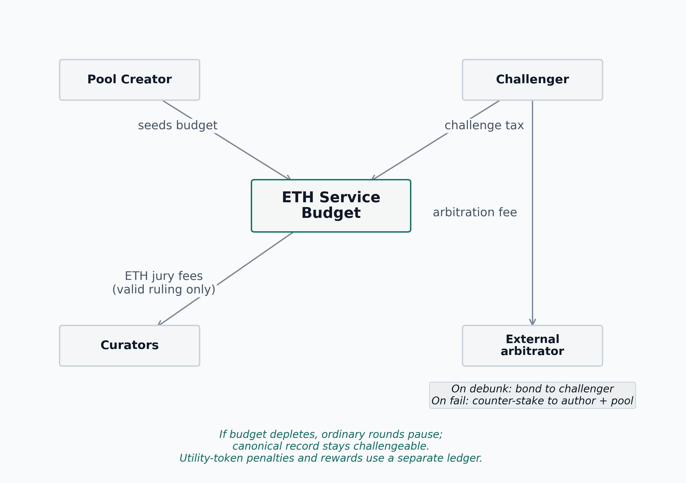

::: {.callout-note appearance="minimal"}


:::

# Abstract

This paper investigates the thesis that decentralized curation games can make agents' pursuit of private gain produce public benefit. The intended pathway connects privately rewarding acts of producing, assessing, and correcting information to better individual and collective decisions. A general framework identifies curation problems and relevant quality dimensions, using challenges where falsification is feasible and cheaper than exhaustive verification. Truth Post instantiates it for news.

Truth Post separates **accuracy**, assessed through bonded publication and challenges routed to external decentralized dispute resolution, from **relevance**, scored by drafted curators under a public pool policy. Coherence-based rewards and slashing govern relevance reports. Confidence records accumulated bond-time, and author reputation is a separate non-monetary stock. The architecture combines permissionless pools, immutable contracts, and minimal discretion over protocol execution. Adjudication remains fallible, and faithful assessment under a policy does not establish that policy's public benefit.

Conditional calculations identify settings where challenging false claims has positive expected returns. In simulations with prescribed reports, informative-signal curators accumulate stake under favorable initial conditions, while relevance distortion increases with colluding stake. The incentive analysis also exhibits a unilateral report that increases the single-round reward under permitted parameters; its return after appeal settlement remains unresolved. A toy reputation model separates stipulated publisher types under assigned adjudication outcomes without modeling a behavioral response. These results establish neither truthful best responses nor a safe collusion threshold.

The 2023 Truth Post deployment implemented only the accuracy layer. Its sparse activity informs bootstrapping requirements but does not validate the integrated protocol. The contribution is a design for aligning private incentives with public benefit and a conditional evaluation of its components. Whether strategically chosen behavior improves public outcomes, how affected people shape its purposes, and how close it could come to the best attainable outcome remain open questions.

# Introduction

The central thesis of this paper is that appropriately designed curation games can make agents' pursuit of private gain produce public benefit. Agents choose their own actions and need not pursue the public outcome themselves: the rules should make producing, assessing, and correcting useful information rewarding to them. Truth Post investigates this approach through a decentralized news protocol. Its intended causal pathway runs from private incentives, through accurate and relevant information, to better individual and collective decisions.

Readers already delegate curation when they use newspapers, rankings, reviews, feeds, summaries, and recommendations. These systems select, verify, and contextualize information for decisions. Delegation reduces the burden on individual readers while making their judgments depend on curators' competence and incentives. The design question is how to make privately advantageous participation improve the information available to others. A challenger, for example, may investigate a false claim for its reward, while readers benefit from the correction.

Establishing this alignment requires two links: the rules must motivate productive behavior, and the resulting information must benefit affected people. Positive participant returns alone establish neither link. The paper specifies a protocol and examines selected components through conditional analysis, simulation, and a partial historical deployment. These provide evidence about parts of the pathway; strategic alignment and public benefit remain hypotheses to test.

A supporting diagnostic hypothesis is that **curation is a major source of difficulty in many information-heavy coordination problems.** Distinguishing the information task from the decisions it informs identifies a candidate cause. Testing its relative importance requires a defined set of decisions, measures of evidence quality and coordination outcomes, and comparisons that separate information effects from conflicting interests, resources, and institutional constraints. The paper does not perform that comparative test.

News illustrates the problem. A newspaper selects and contextualizes claims about reality, shaping the evidence available for individual and collective decisions. Selection can reflect institutional incentives as well as factual merit [@chomsky1988manufacturing]; inaccurate reporting and systematic omission can therefore impair public judgment through different causal paths.

Governance failures can consequently contain a neglected curation problem. Reliable shared evidence can help participants identify constraints, compare consequences, and correct mistaken beliefs. It cannot by itself settle conflicting interests, determine legitimate public purposes, or ensure collective action. The curate-then-coordinate decomposition is an analytic distinction, not a claim that knowledge production is completed before politics begins.

The proposed informational contribution concerns disagreement about facts (beliefs); it does not resolve disagreement about values (preferences). Arrow's theorem shows that, with at least two individuals and three or more alternatives, no rule mapping every profile of ordinal preferences to a complete, transitive social ordering satisfies unrestricted domain, weak Pareto, independence of irrelevant alternatives, and non-dictatorship at once [@arrow1963social]. The theorem constrains any rule that must accept every profile, so no improvement in what participants know makes such a rule exist; the protocol does not resolve that residue of value disagreement.

Dewey gives a complementary reason to keep expertise and public purpose distinct. Specialized inquiry requires competence, but affected people contribute knowledge of needs and consequences that specialists may miss. Discussion and consultation can improve the evidence available for judgment as well as express preferences [@dewey1927public, pp. 203–209]. Delegating assessment therefore differs from authorizing assessors to decide whose interests count. In this protocol, the pool creator chooses the relevance policy; publishing that policy establishes neither public authorization nor representation. Dewey's argument motivates this accountability question; it does not endorse the protocol.

## Information abundance, knowledge scarcity

Organization and filtering affect how readers find and use information. Access to information therefore does not by itself establish access to reliable knowledge.

Ackoff distinguishes data, information, knowledge, understanding, and wisdom [@ackoff1989dikw]. Those categories help frame the task but do not supply an operational test that a protocol's output constitutes knowledge. Here, **decision-grade knowledge** is the objective: information sufficiently accurate and relevant to support a specified decision. Whether the proposed procedures produce it requires evidence beyond agreement among participants.

Newspapers, journals, universities, editors, teachers, and peer reviewers perform parts of this work. Their reliability varies, and naming an institution does not make its judgments inspectable. The design question here is how to expose evidence, incentives, and correction procedures when readers cannot directly verify every item.

Fluent presentation has never guaranteed understanding or accuracy. Generative artificial intelligence (AI) makes such presentation easier to produce, increasing the importance of distinguishing stylistic plausibility from evidence. The proposed mechanisms address that distinction through challengeable claims and explicit relevance policies; this paper does not estimate how AI changes the volume or quality of information.

These considerations motivate curation games that reward evidence-based work. Their success depends on whether privately chosen actions improve the information available for individual and collective decisions.

## Contributions

This paper contributes:

- **A framework for aligning private incentives with public benefit through curation.** The framework identifies where curation may improve decisions and assigns mechanisms to the relevant quality dimensions. This paper specifies a news instantiation, evaluates selected components, draws on a partial historical deployment, and sketches a second application to advertising; broader generality and successful incentive alignment remain design goals.
- **A complete end-state protocol architecture for Truth Post.** The design separates accuracy from relevance, distinguishes on-chain canonical state from replaceable interfaces, makes pool creation permissionless, and treats contracts as immutable with cross-version coexistence rather than in-place upgrades.
- **A simulation-based evaluation program.** The experiments evaluate conditional challenge returns, relevance errors and stake redistribution under specified reports, and reputation trajectories under prescribed adjudication outcomes.
- **A deployment retrospective.** Truth Post (2023) produced a live partial deployment of the accuracy layer and informed the current design's bootstrapping requirements.

# A General Framework For Trustless Decentralized Curation

The framework translates the incentive-alignment thesis into four design steps (@fig-framework):

1. **Problem definition.** Determine whether a curation problem contributes to the downstream failure.
2. **Quality identification.** Determine which dimensions of information quality actually matter in the target domain.
3. **Falsifiability requirement.** Use challenge-based mechanisms only where falsification is feasible and cheaper than exhaustive verification.
4. **Mechanism design by dimension.** Design different mechanisms for different quality dimensions instead of forcing all quality into one signal.

For each domain, the intended public benefit guides the quality decomposition and mechanism mix. Evaluation must then ask whether those mechanisms make useful curation privately advantageous and whether the resulting information improves decisions. This paper fully instantiates one domain (news) and sketches a second (advertising). Demonstrated generality requires additional instantiations beyond those presented here.

Step 3 constrains the mechanism mix rather than excluding a domain. Challenge-based accuracy requires feasible falsification and an economic advantage over exhaustive verification; relevance curation requires a policy specific enough to support meaningful scoring. A relevance-only instantiation would need suitable admission, lifecycle, and ranking rules. The present Truth Post design does not implement that mode: a successful `NonFalsifiable` challenge closes the item and removes it from active feeds.

{#fig-framework}

## Step 1: identify the hidden curation problem

Ranking, review, recommendation, and editorial systems perform curation directly. Governance also depends on curation when participants cannot individually verify the evidence needed for decisions. A building association or city council may have aligned incentives yet lack a reliable shared account of the relevant facts. Its coordination rules can operate as designed while inadequate curation impedes action.

Akerlof's "lemons" model shows how quality uncertainty can drive high-quality goods out of a market under adverse selection [@akerlof1970lemons]. An analogous risk arises in information markets when readers cannot distinguish reliable reporting and producers cannot recover the costs of verification. Under those conditions, poor curation can weaken incentives to produce reliable information. The effect depends on production costs, distribution, reputation, and other institutions; it is not an inevitable consequence of information abundance.

Shared knowledge can matter to governance even where values differ, because Arrow's impossibility can fail on suitably restricted domains. If every participant's preferences are single-peaked along one common ordering of the alternatives, pairwise majority among an odd number of voters with strict preferences is transitive and selects the median peak [@black1948rationale]. Deliberation can move preference profiles toward such domains by producing agreement on the dimension of disagreement rather than on outcomes [@dryzek2003socialchoice]; in Deliberative Polls, @list2013deliberation find increased proximity to single-peakedness after deliberation, most clearly on lower-salience issues, while substantive agreement does not generally rise.

This paper conjectures, without testing it here, that curation can play a similar role: a more reliable shared picture of the facts may change which preference profile arises, moving it toward regions where aggregation works.

The protocol aggregates scalar relevance reports on one dimension, not ordinal preferences over alternatives; it does not circumvent Arrow's theorem for the downstream decisions it informs, and curation does not guarantee single-peakedness.

## Step 2: identify the relevant quality dimensions

Information quality is not one thing. Wang and Strong's data-quality work is useful here because it treats quality as multidimensional rather than monolithic [@wang1996beyondaccuracy]. Different domains care about different dimensions: accuracy, relevance, timeliness, interpretability, completeness, accessibility, and so on.

The design implication adopted here is to assess the relevant dimensions separately, so that a high score on one does not obscure a failure on another.

## Step 3: require falsifiability where challenge is the mechanism

Popper treats exposure to potential empirical refutation as a criterion of scientific status, not meaningfulness [@popper1959logic]. Popper's logical asymmetry does not determine whether practical falsification is feasible or inexpensive. Where readers or automated checks can verify claims cheaply, bonded challenge may add little to accuracy assessment. Incentives may still be needed for discovery, attention, and publication of corrections.

If a claim is not falsifiable, challenge cannot adjudicate its truth. Truth Post permits a `NonFalsifiable` challenge to assess compliance with a pool's requirements: an item may enter initially, but a successful challenge ends its active eligibility while preserving its historical record.

Relevance is scored against a published policy rather than adjudicated as true or false. Its conceptual prerequisites therefore differ from those of factual-truth adjudication, although the current design couples their lifecycles.

The relevant region is the middle one (@fig-falsifiability):

- verification is difficult or expensive
- falsification is feasible
- the evidence needed to falsify is publicly accessible

Some suitably scoped news claims can meet these conditions when publicly available counter-evidence is cheaper to assess than exhaustive verification. This must be evaluated for the claim type and evidence policy; a report that an event occurred does not acquire that cost advantage from its form alone. The mechanism depends on making falsehood attackable at an acceptable cost.

{#fig-falsifiability}

## Step 4: design mechanisms dimension by dimension

This design uses different mechanisms for accuracy and relevance. Factual accuracy concerns whether a proposition is true under its stated scope and time, independently of whether a pool finds it relevant. The protocol observes a narrower result: whether a challenge succeeds under the pool's evidence policy. That binary result is fallible and can differ across adjudicators or policies. Relevance is local and scalar: what matters depends on the pool's public policy, scope, and current context.

Keeping these assessments separate lets readers distinguish factual disputes from judgments about what matters under a policy.

## A second instantiation: advertising

Advertising provides a possible application beyond journalism: advertisers compete for attention while consumers may struggle to verify product claims.

A different advertising game is possible. Advertisers could express verifiable product statements as claims and post bonds behind them. A successful challenge would transfer the bond to the challenger. This could make some false claims costly, but the effect would depend on detection, reliable adjudication, dispute costs, and the value of deception. Truthful advertisers would still bear capital costs and the risk of erroneous rulings.

This sketch does not constitute a full instantiation: no quality decomposition, simulation, or deployment has been performed for advertising. Advertiser funding for curation is a further possibility to investigate, not an established revenue source.

# Instantiating The Framework For News

The news instantiation applies separate assessments to factual accuracy and policy-relative relevance.

## Accuracy and relevance

Applying the framework to news yields two dominant quality dimensions:

- **Accuracy.** Factual claims should be true under their stated scope and time; public challenge under an explicit evidence standard is the proposed means of assessment.
- **Relevance.** Claims should matter relative to the pool's curation goal.

Accuracy alone is not sufficient. A claim like "one equals one" is accurate, but it is not news. A world-politics pool that publishes accurate football trivia has not solved its curation problem. Relevance is therefore not an optional add-on. It is a separate dimension with different structure and different incentives.

## Falsifiability and claim structure

A **claim blob** is a content-addressed article or item that may contain multiple propositions. A challenger identifies a specific proposition in natural language; if the challenge succeeds, the entire item is debunked.

The protocol tracks procedural outcomes in two state dimensions. These records do not establish truth conclusively. The **operational state** records the claim's lifecycle position:

- `Live`: the item is active, bonded, and challengeable. Confidence accrues.
- `PendingEdit`: the author is preparing a new revision. Confidence is paused. The claim remains challengeable on its last finalized revision.
- `WithdrawPending`: the author has initiated withdrawal. A cooldown period runs during which challenges are still accepted.
- `Challenged`: an active dispute is in progress. Confidence is paused.
- `Closed`: a challenge succeeded; the claim is terminal for feed purposes.
- `Withdrawn`: the author removed the bond after the cooldown; the item remains visible historically with frozen confidence.

The **adjudication outcome** records the result of accuracy disputes separately:

- `Unchallenged`: no challenge has been resolved.
- `ChallengeFailed`: a challenge was resolved in the author's favor.
- `Debunked`: a challenge succeeded, whether by counter-evidence, because the challenged proposition was non-falsifiable, because the claim violated the pool's topic scope, or because the claim failed the pool's template requirements.

These states record procedures and their outcomes. `Debunked` can mean a scope or template violation rather than factual falsity; `ChallengeFailed` does not certify truth. **Credible consensus** means judgments grounded in evidence, assessed relative to an explicit policy, with usable correction paths. Agreement alone establishes none of these properties. The protocol makes parts of that process inspectable and contestable; it does not mechanically establish truth, competence, or beneficial outcomes.

# Complete Truth Post Design

This section treats the current Truth Post blueprint as the canonical design. The 2023 deployment is not the design source of truth; it is a partial historical predecessor.

## Architectural stance

Three architectural commitments anchor the design:

1. **Permissionless pools.** Any address may create a pool with a domain, a claim template, an evidence policy, and a relevance policy. If the pool is bad, interfaces and users can ignore it.
2. **Immutable contracts.** Protocol changes require new deployments and cross-version aggregation, not in-place upgrades.
3. **Minimal governance.** The preference ordering is: eliminating the need for governance is best; good governance is acceptable; bad governance is worse; and no governance at all (ungoverned failure modes) is worst. If a design can eliminate a governance surface, it should.

These commitments limit discretionary control over shared protocol rules. They do not eliminate governance of pool purposes, funding, interfaces, or migration. Here, **trustless** refers to reducing dependence on a single operator through inspectable state and enforceable procedures; readers still depend on evidence producers, adjudicators, and policy choices.

Ostrom's account of durable common-pool institutions emphasizes participation by affected users in rule modification and monitors accountable to users [@ostrom1990commons, pp. 90, 93–94]. Permissionless entry and immutable rules do not supply those arrangements. Pseudonymous pools also differ from the communities she studied, so her findings neither validate this architecture nor establish that exit is superior to collective rule-making. The preference for minimal governance applies to avoidable discretion over protocol execution. It is a design tradeoff, whose costs include limited opportunities to revise a pool's purposes and dependence on coordinated migration when its rules fail.

## Canonical system boundary

Truth Post is not a single website. The protocol has four layers (@fig-architecture):

- **Canonical protocol state:** pools, claim references, stakes, challenge state, adjudication links, confidence accounting, and payout logic.
- **External decentralized dispute resolution (DDR):** binary challenge adjudication with typed challenge reasons and provider-managed appeals.
- **Content and indexing:** claim blobs, evidence items, policy documents, and indexers that reconstruct feeds and histories from canonical state.
- **Interfaces:** any frontend or application that renders feeds, article pages, pool dashboards, or dispute history.

This split is part of the design, not an implementation detail. A protocol with one fragile frontend is not practically decentralized. The same claim blob content identifier (CID) may be posted to multiple pools as independent claims; each pool instance has independent adjudication, confidence, and relevance.

{#fig-architecture}

## Actors

- **Authors** submit claim blobs, post author bonds, and may later withdraw or amend claims.
- **Challengers** file counter-stake, counter-evidence, and an explicit challenge reason against a challenged proposition.
- **Curators** stake into pools and become eligible for drafted relevance rounds.
- **Jurors** belong to the external decentralized dispute resolution layer and adjudicate only accuracy disputes.
- **Pool creators** define one pool configuration. They do not govern the protocol as a whole.
- **Interface operators** decide what to surface, feature, warn about, or ignore.
- **Readers** consume the outputs and may later become authors, challengers, or curators.

{#fig-actor-flow}

## Accuracy layer

The accuracy mechanism is a bonded publication and challenge system (@fig-claim-states).

1. An author posts a claim blob and locks a bond. Contracts enforce minimal structural field presence at submission (non-empty CIDs, valid version pointers).
2. The item enters `Live` status immediately and remains challengeable while bonded. Authors may adjust their bond while live, subject to a pool-scoped grace period; the old bond rate continues for confidence accrual and challenge pricing until the adjustment takes effect.
3. A challenger may file one active challenge at a time against a specific proposition inside the item, with queued challenges allowed behind it. Challenges may also be filed against claims in `PendingEdit` or `WithdrawPending` states, targeting the last finalized revision.
4. The challenger pays a counter-stake (`max(pool minimum, bond/4)`), a challenge tax (a pool-configurable percentage of the pinned bond), and the external DDR fee. Each challenge is pinned to the challenged revision, manifest CID, and bond at filing time, so later edits or bond changes do not alter the dispute target or payout basis. For queued challenges, the counter-stake, tax, and DDR fee remain in escrow until activation; tax is credited to the pool budget only on activation.
5. The dispute goes to external DDR with a binary question: should the challenge succeed? Appeals, if any, are handled entirely by the external DDR. The protocol does not implement its own escalating-stakes appeal ladder or any protocol-native "lone expert versus herd" jackpot.
6. If the challenge succeeds, the item moves to `Closed` with adjudication outcome `Debunked`. The challenger receives the author's bond and their own counter-stake back; the challenge tax remains in the pool budget. If the challenge fails, the item returns to its pre-challenge operational state. The author keeps the bond; the challenger's counter-stake is split between author reward and pool reward budget at a pool-configurable ratio. The split ratio is a pool parameter, not a protocol constant: too much to the author weakens pool funding; too much to the pool weakens the author's incentive to defend claims. The DDR fee is a sunk challenger cost in both outcomes.

The protocol supports four typed challenge reasons, none of which is a separate final verdict. All yield `Debunked` on success:

- `Debunking`: the challenged proposition is factually false.
- `NonFalsifiable`: the challenged proposition fails to instantiate a falsifiable claim under the pool's template and evidence policy.
- `ScopeViolation`: the claim does not belong in the pool's declared topic domain.
- `TemplateViolation`: the claim passes on-chain structural checks but fails the pool's semantic template requirements (e.g., missing required fields or disallowed source classes). On-chain structural validation is enforced at submission; semantic template conformance is enforceable post-publication through this challenge reason.

{#fig-claim-states}

## Relevance layer

The relevance mechanism is a drafted curator coherence game (@fig-relevance-round).

1. Curators deposit tokens into a pool contract. Let $s_i$ denote curator $i$'s deposited balance, with both $s_i$ and the seat size $L$ measured in the token's smallest on-chain unit. The deposited balance is the curator's total capital in the pool. Ordinary-round rules allow withdrawal of uncommitted portions outside active-round locks. Voluntary appeal contributions remain locked under [Public appeal funding](#sec-appeal-funding), independently of curator status; earlier jury service alone does not lock additional funds.
2. Ordinary relevance rounds are scheduled for `Live` items at a pool-defined cadence, subject to the per-item filing-window and appeal hold in [Public appeal funding](#sec-appeal-funding).
3. Each seat in the lottery corresponds to $L$ locked tokens (pool-configurable, $L > 0$). Only curators with $s_i \ge L$ are eligible; the draft weight $d_i$ is the integer number of full seat-tickets the curator holds, computed by rounding down:

$$
d_i = \lfloor s_i / L \rfloor
$$

4. The protocol draws seats from the ticket pool. Each drawn ticket locks $L$ tokens from the corresponding curator. A curator may receive at most $d_i$ seats in a single round. Let $n_i$ denote the number of seats drawn for curator $i$. The curator's round weight $w_i$ equals their total locked tokens:

$$
w_i = n_i \cdot L
$$

Locked tokens are simultaneously the curator's influence on the weighted mean and their maximum loss from ordinary coherence and non-participation penalties. The unlocked remainder ($s_i - n_i \cdot L$) stays in the pool contract and is not exposed to those penalties. Any part voluntarily committed to an appeal is unavailable for withdrawal or another round lock under [Public appeal funding](#sec-appeal-funding); the remaining balance remains subject to separately specified penalties.

5. Each drafted curator commits and reveals a single relevance score in $[0,1]$, weighted by $w_i$. Multiple seats increase the curator's weight on that single score, not the number of independent votes.

6. Following the canonical blueprint, a round with fewer valid reveals than the configured quorum is cancelled: no new score or curator reward is produced, and any previous relevance score remains in force. Drafted curators who fail to commit or reveal lose their locked tokens as non-participants; valid participants recover their round locks. This also applies when nobody reveals. Otherwise, the protocol computes the weighted mean $\mu$ and weighted standard deviation $\sigma$ over valid reveals only. Let $W = \sum_i w_i > 0$ denote their total round weight:

$$
\mu = \frac{1}{W}\sum_i w_i \, v_i, \qquad \sigma = \sqrt{\frac{\sum_i w_i (v_i - \mu)^2}{W}}.
$$

Round rewards scale linearly with $\sigma$ rather than switching at a threshold. Let $\varepsilon_\sigma > 0$ denote a pool-configurable dispersion floor, and define the reference dispersion level using an exponential moving average (EMA):

$$
\sigma_{\mathrm{ref}} := \max\!\bigl(\varepsilon_\sigma,\;\operatorname{EMA}_{\mathrm{past}}(\sigma)\bigr),
$$

where the average uses the pool-configured smoothing factor and is initialized to zero, as specified by the canonical blueprint. The current round updates this reference after its reward factor is computed. This preserves adaptation without governance while guaranteeing $\sigma_{\mathrm{ref}} > 0$ even during sustained consensus. Let $R$ denote the base round reward drawn from the pool's local reward budget, and let $\rho \in [0, 1]$ denote the minimum reward fraction for zero-dispersion rounds. The reward factor is:

$$
f_{\mathrm{reward}} = \rho + (1 - \rho) \cdot \min\!\Bigl(1,\;\frac{\sigma}{\sigma_{\mathrm{ref}}}\Bigr)
$$

At $\sigma = 0$, the reward is $\rho R$ (minimum); at $\sigma \ge \sigma_{\mathrm{ref}}$, the reward is full $R$; between them the transition is linear. This avoids the cliff that a hard threshold would create: a step function that switched from reduced to full rewards at a fixed cutoff would incentivize curators to inject artificial variance (score 0.87 instead of 0.90) to cross the threshold, producing systematic bias. The smooth curve removes that discontinuity, but for $\sigma < \sigma_{\mathrm{ref}}$ rewards still increase monotonically with $\sigma$. The protocol therefore does not rely on the reward curve alone to eliminate variance-padding incentives: lazy convergence and genuine consensus appear structurally indistinguishable under the observables available to the protocol at the single-round level, so reward scaling alone does not establish truthful incentives. Claim 3 isolates a reward-padding incentive within one round; its net return after crowdfunded appeals requires the additional settlement analysis below. When $\sigma < \varepsilon_\sigma$, distance-based graduated slashing for valid revealers (step 7) is skipped at finalization; non-participation penalties still apply. For valid revealers, the mean is accepted as a relevance score and round locks are released back into their deposited balances. Any additional exposure of curator balances to appeal settlement must be defined with the counterparty and payout rules in [Public appeal funding](#sec-appeal-funding); it does not follow from the single-round penalty formula.

7. If $\sigma \ge \varepsilon_\sigma$ (the same dispersion floor used in $\sigma_{\mathrm{ref}}$), graduated slashing applies. Let $v_i$ denote curator $i$'s revealed score and let $K$ denote the coherence-threshold multiplier ($K > 0$). Curators inside the coherence band ($|v_i - \mu| \le K\sigma$) are not penalized. Curators outside the band lose a fraction of their locked tokens that scales linearly with distance:

$$
p_i = \min\!\Bigl(1,\;\max\!\bigl(0,\;\frac{|v_i - \mu|/\sigma - K}{K}\bigr)\Bigr)
$$

At the band boundary, the penalty is zero; at twice the boundary distance ($2K\sigma$ from the mean), the penalty is total loss of locked tokens. Since $w_i$ is measured in smallest on-chain units (integers), the slashed amount is rounded down:

$$
\delta_i = \lfloor p_i \cdot w_i \rfloor, \qquad q_i = w_i - \delta_i.
$$

The protocol slashes $\delta_i$ tokens and returns the remainder $q_i$. This graduated slashing replaces binary slashing: near-boundary deviations incur small losses, while extreme deviations incur total loss. If $\sigma < \varepsilon_\sigma$, distance-based slashing is skipped for valid revealers: their $p_i = 0$ and $\delta_i = 0$, and their round locks are released. Voluntary appeal contributions retain their separate lock under [Public appeal funding](#sec-appeal-funding). Failed commit or reveal participation remains subject to loss of the non-participant's locked tokens.

8. Relevance appeals may be filed during the appeal filing window and are open to public crowdfunding. Appeals against the same finalized round share a larger drafted committee under the group timing and funding rules below, to score the same claim under the same pool policy. If the appellant is fully funded and the counterparty has not matched when its full matching period expires, the appellant side receives a procedural win by forfeiture without a monetary appeal award. [Public appeal funding](#sec-appeal-funding) defines the matching period, participation and scalar division of the combined matched pot; score adoption and the remaining settlement rules must be specified separately.

Escalation is intended to discipline initial reports through the threat of appeal. Curators must anticipate both the initial committee and a possible appeal committee; whether this makes policy-faithful reporting a best response depends on the full reward and penalty rules, as discussed in Claim 3. Under a continuous-signal model with unbiased independent signals of uniformly bounded variance, the weighted mean concentrates around the policy-implied target as the normalized voting weights become sufficiently dispersed; a sufficient condition is that the sum of their squares tends to zero. Dependence requires additional control of covariance, and finite variance of each signal alone is insufficient. In the seat-based draft model, increasing seats alone is not sufficient: multiple seats held by one curator still map to a single revealed score. A larger appeal committee can improve precision when it adds independent signals of comparable quality and sufficiently disperses voting weight. A minority can seek correction by appealing. For an adjudicated correction, the appeal must be funded, bring additional information, and satisfy the specified outcome and settlement rules; neither successful correction nor a truthful equilibrium is guaranteed. A win by forfeiture records a procedural funding outcome; it is neither a jury finding nor evidence of consensus.

![Relevance round sequence. Curators deposit into a pool, receive seat-tickets from stake, are drafted by draw-and-lock seat allocation, commit/reveal scores, and face graduated distance-based slashing when dispersion meets the floor; non-participation remains slashable. Rounds require the configured reveal quorum and may also cancel for insufficient eligible curators, unavailable randomness, or insufficient backing. Public backers may crowdfund an appeal. A matched appeal goes to a larger committee; an unmatched appeal is won by forfeiture without a monetary appeal award.](diagrams/fig-relevance-round.png){#fig-relevance-round width=5in}

### Public appeal funding {#sec-appeal-funding}

Appeals have two publicly crowdfunded positions: the appellant position seeks to change the current outcome, and the counterparty position defends it. Funding either position is permissionless: anyone, including the nominator, may contribute, with no approval or role-based exclusion. A contribution requires neither a curator deposit nor selection for the jury. An appellant or backer selected by the ordinary curator draw may serve under the same juror rules as any other selected curator.

Before crowdfunding opens, the appeal records the appellant's proposed score and the score defended by the counterparty. If those numeric values are equal, the appeal is rejected before either position can accept contributions. Both scores are fixed for that appeal; a different proposed or defended score requires a new appeal. Settlement uses the recorded scores rather than a later current score. The filing-window and active-appeal hold below prevents a later ordinary round from starting during that period; competing appeals use the shared-jury grouping rule below, while subsequent appeal rounds remain to be specified. No minimum nonzero score gap is imposed.

The required contribution target $C>0$ is determined once for the referenced finalized round using one common, pinned pool rule and input snapshot established before appeal filing. Every appeal against that round uses the same target on both positions, regardless of proposer, proposed score or filing time. The common target is recorded and frozen before any appeal against that round accepts contributions. Neither party may override it. Later pool-rule changes, changes to the underlying inputs and additional contributions cannot alter the target for that appeal. Additional contributions and pool-budget top-ups do not restart its funding clocks. The sizing rule must make each fully matched combined pot greater than the full shared-jury fee, with the amounts measured in the same asset. Because the target is frozen, sizing must use a binding fee or fee ceiling that preserves this inequality through jury funding. The concrete sizing formula, fee schedule, parameters and accepted assets remain to be specified.

Only the amount still needed by a position may be accepted. For a contribution offered while that position's funding is open, let $x\ge 0$ be the offered amount and $F$ its current total accepted funding, with $0\le F\le C$. The accepted amount is $\min(x,C-F)$. Any excess stays with the contributor or is returned immediately; it never becomes a locked appeal contribution. A position already at its target accepts zero. Acceptance and the funding-balance update must be atomic, so competing offers cannot overfund the position. Only accepted amounts count toward the target, pro rata payouts and later principal refunds. Unaccepted excess is not refunded a second time at settlement. For example, with a target of 100 and 90 already accepted, an offer of 50 contributes 10; the remaining 40 stays with or immediately returns to the backer. This cap does not reopen a closed funding phase.

Every accepted contribution is immediately locked to its appeal until settlement or an applicable refund. Backers cannot withdraw accepted contributions during fundraising, matching, jury funding or adjudication, and the same funds cannot back another appeal or an ordinary-round seat, or be consumed by penalties outside that appeal. Settlement determines the payout; this lock does not guarantee return of principal in an adjudicated appeal. The full-refund outcomes defined below remain applicable. Only voluntarily contributed funds receive this lock: nominator or juror participation alone does not lock additional funds, and unrelated curator balances retain their existing withdrawal rules. Leaving the curator role does not release an appeal contribution.

No new ordinary relevance round may be scheduled or started for an item while any applicable appeal filing window is open, even if no appeal has been filed, or while any appeal for the item is fundraising, waiting for jury funding or being adjudicated. The appeal's own jury remains permitted, and other items may continue their rounds. Ordinary scheduling becomes eligible again only when all applicable filing windows have closed and no appeal for the item remains active. An appeal ending before its filing window closes does not release the hold. This rule does not cancel or suspend an ordinary round that had already started. Appeals validly filed against the same finalized round within its original filing window form one shared-jury group. Closing that window fixes membership; later activity does not reopen it. Each appeal retains its own recorded scores, backers and settlement pot, while using the common target for the referenced round. The shared jury is neither drawn nor seated until the original filing window has closed and every admitted appeal's funding outcome is determined. A funding outcome is determined when both positions have reached their targets, the appellant fundraising deadline has expired without sufficient funding, or the counterparty matching deadline has expired without a match. Both positions reaching their targets ends funding early; unused time need not elapse. Every unresolved funding opportunity otherwise keeps its full existing deadline, including a matching period extending beyond filing closure.

This group condition does not require matched appeals to settle before the jury, nor does it require a participant's cooperation or collection of a refund to recognize a funding timeout. Once the group condition is satisfied, eligible matched appeals fund one shared jury under the fee rule below and use its score as the reference for their separate scalar settlements. Their pots are not combined: after the shared fee allocation, each pot settles independently and cannot fund another pot's payouts. If no appeal requires adjudication, the grouping rule does not itself require a jury. If the shared jury produces a valid finalized relevance score, that score determines the group's adopted outcome. An unmatched appeal's procedural win cannot replace or override that score, even if its proposed score differs. Procedural wins do not count as votes or evidence of consensus, and unmatched pots retain their full-refund outcome rather than acquiring scalar payouts from another appeal's adjudication. An appeal group changes the adopted relevance score only through a valid finalized jury score. While the group is pending, the currently effective jury-derived score retains its existing role in funding calculations. If the group ends without a valid new jury score, including when every appeal is unmatched, the existing score and its role remain unchanged. The fallback does not restore the group's recorded defended score over a newer valid score. Procedural forfeiture neither changes the score nor suspends score-based funding by itself. Independent accuracy decisions, eligibility requirements, withdrawals and other funding inputs retain their own effects. Score retention neither terminates an open appeal nor releases its contribution locks or scheduling hold, and it does not substitute the old score for a missing adjudication when settling appeal pots. Refunds and cancellation still follow their separately specified rules.

Each admitted appeal has a fixed appellant fundraising period starting at filing. If the appellant fails to reach its required contribution target by that deadline, the appeal is cancelled and all contributions to both positions are returned in full, with no opposing-stake award. This ends that appeal's active hold; any still-open filing window or other active appeal continues to block ordinary rounds under the scheduling rule above. Either position may receive contributions before the appellant reaches its target. Once the appellant reaches that target within its fundraising period, the counterparty receives its full matching period, measured from that funding event. Earlier counterparty contributions count toward its target. Neither the appeal filing deadline nor the appellant fundraising deadline shortens this matching period. A fully matched appeal has a determined funding outcome without waiting for this period to expire, but it cannot start the shared jury before the group condition is satisfied. The durations of the appellant fundraising period and counterparty matching period remain to be specified.

No particular participant is obliged to fund the counterparty position; one participant's refusal does not prevent others from contributing. If the appellant is fully funded and the counterparty has not matched the appeal stake when its matching period expires, the appellant side receives a procedural win by forfeiture, but backers receive no monetary appeal award because there is no matched opposing stake to distribute. Every backer receives their contributed principal in full. No costs are incurred in this unmatched-appeal branch, so the backer receives exactly their contribution and makes neither a monetary profit nor a monetary loss.

A group with at least one fully matched appeal funds its jury when the group is ready, without an additional pool-replenishment waiting period. Let $J\ge 0$ be the full shared-jury fee and $B\ge 0$ the pool budget available to commit to it. The pool pays $U=\min(B,J)$; the crowdfunding shortfall is $D=J-U$. Let $n\ge 1$ be the number of fully matched appeals entering that jury. Each has the same gross pot $T=2C$, so splitting the shortfall equally between these pots is also proportional to their gross sizes. Each pot pays $D/n$ once and has net settlement funds

$$
Q=2C-\frac{D}{n}>0.
$$

The sizing invariant is $2C>J$. Since $0\le D\le J$ and $n\ge 1$, it ensures every matched pot remains positive even if the pool contributes nothing. This is a capacity guarantee, not a guarantee that backers recover their principal. The fee is committed before the jury is drawn or seated. Underfunded and unmatched appeals do not pay this fee and retain their full-refund outcomes. If no appeal needs adjudication, no jury fee is incurred and no division by $n$ is evaluated. This fee rule does not add a waiting period or cancel an otherwise funded appeal because the pool alone lacks funds.

An adjudicated matched appeal uses scalar settlement based on closeness to the appeal jury's final relevance score. Let $a$ be the appellant's proposed score, $d$ the defended score, and $r$ the jury's score. The absolute errors are $e_A = |a-r|$ and $e_D = |d-r|$. The total payouts from that appeal's net settlement funds are

$$
P_A = Q\frac{e_D}{e_A+e_D}, \qquad
P_D = Q\frac{e_A}{e_A+e_D}.
$$

The closer position receives the larger share, and each position distributes its payout among its backers in proportion to their accepted contributions. These are total payouts, including any returned principal, not profit added on top of principal. Equal positive errors pay $Q/2$ to each position; they return the original contribution $C$ only when no fee is deducted. A unique exact prediction receives all of $Q$. The closer position can still lose money relative to its contribution because the jury fee reduces the settlement funds. The distinct-score admission rule ensures $e_A+e_D \ge |a-d|>0$, so admitted appeals never reach a zero denominator. The full-refund convention for both-zero errors is outside this admitted-appeal domain and does not authorize refunding jury fees already spent.

For example, with 100 units contributed to each position, an appellant score of 0.80, a defended score of 0.20 and a jury score of 0.70 give errors of 0.10 and 0.50. With no crowdfunding fee deduction, the pot is divided in the ratio 5:1, returning $166\tfrac{2}{3}$ units to the appellant position and $33\tfrac{1}{3}$ units to the defending position. If that pot instead pays 20 units toward the shared jury, its net 180 units split into 150 and 30. The payout rule uses the jury score as its reference; it does not replace that score with either party's proposal. No minimum prediction gap or error floor is added by this formula. Close predictions can therefore produce large changes in payouts when the jury score moves over a small interval. Integer fee allocation and payout rounding remain to be specified; an implementation must conserve the committed fee and each pot's remaining funds.

The counterparty stake consists of voluntary contributions to the position defending the current outcome. The mechanism must still specify the target-sizing formula, fee schedule, parameters and accepted assets, the counterparty matching-period duration, the appellant fundraising-period duration, treatment of superseded appeals, payout-claim mechanics, integer rounding, and settlement for other cancellations. These settlement choices remain open. Serving on an earlier jury does not itself make a curator's deposit part of the counterparty stake; jurors may voluntarily contribute under the same rules as anyone else.

Crowdfunding allows several backers to finance an appeal that none could fund alone. The prospect of gaining opposing stake can make support financially attractive, but sufficient capital must be mobilized before the deadline and expected proceeds must justify the risk and costs. This is a proposed defense against an opponent exhausting one participant's ability to fund appeals, not a guarantee against wealth-based attacks. A counterparty unable to fund matching can lose by forfeiture independently of the merits, so crowdfunding does not remove all financing pressure. Access to financing also does not establish the quality or independence of the larger jury.

This design keeps curation entirely stake-driven: no reputation-weighted mechanism influences either drafting or voting. Stake determines exposure to rewards and losses; it certifies neither expertise nor distinct identity, independence, or representation of affected people.

## Confidence

Confidence is not a truth label. It is accumulated bond-time. Let $C$ denote the resulting confidence score, let $B_t$ denote the bond active during interval $\Delta t$, and let the summation run over the item's bonded history:

$$
C = \sum_t B_t \cdot \Delta t
$$

The semantics are simple:

- larger bond means more capital at risk
- longer survival means longer exposure to challenge
- challenge pauses accumulation; a successful defense resumes accrual from the paused integral
- amendment (`PendingEdit -> Live`) resets confidence to zero, since the content has changed
- withdrawal freezes the score permanently

An interface may use confidence for ranking or display, but it must not conflate confidence with a universal truth claim. Confidence measures accumulated capital exposure over time, not community validation or endorsement. A failed challenge supplies evidence about the challenged proposition only to the extent that the evidence and adjudication were reliable; it does not validate every proposition in the item. Bond-time can grow without scrutiny. @fig-confidence-reputation illustrates the accounting dynamics.

There is therefore no protocol-level dollar cutoff at which a claim becomes "noise." Confidence is continuous. A low bond supplies little capital exposure; whether it deters deception depends on the benefit of surviving falsehood and the detection and adjudication probabilities in Claim 1. Interfaces may impose visibility thresholds, but those thresholds are product policy rather than validated protocol constants.

## Reputation

The current design uses a single reputation system:

- **Author reputation** is a pool-scoped, slowly decaying credibility stock. It is not escrowed per claim, but every new claim exposes the author's standing reputation to large downside if the claim is debunked. Reputation gains follow a final `ChallengeFailed` ruling, not survival without a challenge; decay follows calendar epochs. A reputation update caused by one claim does not affect the confidence or relevance of the author's other claims; each claim continues under its own bond-time history.

The design deliberately avoids any reputation-weighted mechanism for curation. An earlier iteration allowed reputation to directly increase curation weight; the current design rejects that entirely because it grants influence not fully backed by slashable capital. Curation drafting and voting are both purely stake-driven.

{#fig-confidence-reputation}

## Local pool economics

Each pool has its own reward budget (@fig-pool-economics). The pool creator or any sponsor can top it up. Ordinary scheduled relevance-round rewards are paid from that local budget. If it runs dry, those scheduled rounds pause; the canonical record remains challengeable. For matched appeals, available pool funds pay first and eligible matched pots cover only the shared-jury fee shortfall under [Public appeal funding](#sec-appeal-funding). Those pots are sized to exceed the full fee, so a depleted pool does not add a replenishment wait or a budget-shortfall cancellation to their appeal process.

Challenge tax is paid by the challenger and routed to the challenged pool's reward budget. For immediately active challenges, the tax credits at filing; for queued challenges, the tax remains in escrow until activation and is refunded if the challenge is cancelled or mooted by an earlier debunking. On a failed challenge, the pool-budget share of the challenger's counter-stake (determined by the pool's payout-split ratio) also credits the pool. Both inflows are dispute-dependent: a peaceful pool generates zero endogenous revenue. This makes pool economics local rather than governance-allocated, but also makes peacetime ordinary-round funding entirely sponsor-dependent.

{#fig-pool-economics}

# Equilibrium Analysis

This section examines how private returns could support the intended public outcome, deriving participation thresholds in simplified expected-value models and testing a truthful-reporting claim. The labeled claims are not formal theorems with full proofs. Claim 3 identifies a unilateral increase in the single-round reward under permitted parameters; it does not calculate net returns after appeals. The participation conditions do not establish equilibrium.

## Author's strategy

An author who publishes a false claim derives value $V$ if the claim survives (attention, reputational gain, advertising revenue from a false ad). The author posts bond $B$. Let $p_{\text{detect}}$ denote the probability that the false claim is detected, and let $P_{\text{maj}}(p, N)$ denote the probability that a jury of size $N$ reaches the correct binary outcome when each juror is individually correct with probability $p$. The expected value (EV) of publishing a false claim is:

$$
\text{EV}_{\text{false author}} = (1 - p_{\text{detect}} \cdot P_{\text{maj}}) \cdot V - p_{\text{detect}} \cdot P_{\text{maj}} \cdot B
$$

Setting $\text{EV}_{\text{false author}} < 0$ and solving for $B$ yields a bond threshold $B^*$ above which false publication has negative expected value:

$$
B^* = V \cdot \frac{1 - p_{\text{detect}} \cdot P_{\text{maj}}}{p_{\text{detect}} \cdot P_{\text{maj}}}
$$

**Claim 1.** *When $p_{\text{detect}}P_{\text{maj}}>0$, false publication has negative expected value in this model if $B>B^*$. Holding jury quality fixed at $P_{\text{maj}}(0.80, 5) \approx 0.94$, $B^*/V$ falls from roughly $20$ at $p_{\text{detect}}=0.05$ to $9.6$ at $0.10$, $2.0$ at $0.35$, $1.1$ at $0.50$, and $0.3$ at $0.80$. If detection or correct adjudication has zero probability, no finite bond deters a positive benefit $V$. The reference point ($p_{\text{detect}}=0.35$, $B^* \approx 2.0V$) is illustrative, not a calibrated prediction.*

This comparison is against abstention with zero payoff. It omits publication costs, capital opportunity costs, and author rewards from failed challenges. It does not establish a preference for honest publication, whose payoff is not modeled, or deter attackers whose external benefits exceed the assumed $V$.

Within this model, a bond below $B^*$ does not deter the assumed deception. Accumulated bond-time does not change that instantaneous deterrence threshold.

This paper does not estimate $p_{\text{detect}}$ empirically. Rather than arguing for a single point value, we report the deterrence threshold as a function of detection coverage across the range $p_{\text{detect}} \in [0.05, 0.80]$, holding jury quality fixed at $p=0.80$ and $N=5$. The threshold is first-order sensitive to this parameter: $B^*/V \approx 20$ at $p_{\text{detect}}=0.05$, $9.6$ at $0.10$, $4.3$ at $0.20$, $2.0$ at $0.35$, $1.1$ at $0.50$, and $0.3$ at $0.80$ (see @fig-e1-detect-sensitivity). Detection coverage is therefore a first-order viability condition for the accuracy layer, not a secondary nuisance parameter. The $p_{\text{detect}}=0.35$ anchor used elsewhere in the paper sits near the middle of this range and serves as an illustrative reference point, not a calibrated forecast.

## Challenger's entry decision

A challenger does not arrive with a known false claim. They must search. Let $e$ denote the effort cost of examining one claim, let $\beta$ denote the base rate of false claims in the pool, let $p_{\text{detect|examined}}$ denote the probability that examination reveals falsity, and let $\text{EV}_{\text{false}}$ denote the challenger's expected value on a known false claim from the accuracy layer. The expected value of examining one claim is:

$$
\text{EV}_{\text{search}} = \beta \cdot p_{\text{detect|examined}} \cdot \text{EV}_{\text{false}} - e
$$

Searching is profitable when:

$$
\beta > \beta^* = \frac{e}{p_{\text{detect|examined}} \cdot \text{EV}_{\text{false}}}
$$

**Claim 2.** *For a challenger with the specified costs and $\text{EV}_{\text{false}}>0$, search has positive expected value when $\beta>\beta^*$. Below that threshold, this model favors abstention. Heterogeneous costs, private information, or external rewards can support search outside that condition. Low search activity can reflect either few false claims or inadequate incentives to detect them; it is not evidence of accuracy.*

The free-rider dimension compounds this problem [@groves1977freeriderproblem]. A challenger who debunks a false claim can benefit all readers while bearing search costs privately. Challenge rewards provide a private return, but whether they induce adequate search depends on costs, competing investigators, and detection coverage. The model does not solve that strategic entry problem.

## Curator voting strategy

The coherence game requires curators to independently report relevance scores in $[0, 1]$. Under commit-reveal, curators cannot observe others' votes before committing. Each curator $i$ has a private signal $\theta_i$ about the policy-implied relevance $r$ and forms a belief about the distribution of others' signals. Here $r$ denotes the latent relevance value implied by the pool policy, $\theta_i$ denotes curator $i$'s noisy private estimate of that value, and $K$ is the coherence-threshold multiplier from the slashing rule. The collusion sweeps describe outcomes at selected stake fractions; they do not estimate an equilibrium or incentive-compatibility threshold.

**Claim 3.** *Under permitted parameters of the single-round reward rule, a unilateral report can increase the reporter's payout without distance-based slashing. Whether appeal participation and settlement remove that gain depends on the appeal rules and the behavior they induce.*

An example follows directly from the specified low-dispersion reward rule. Under [Flow F of the canonical blueprint](truth-post/blueprint/#flow-f-relevance-curation-and-coherence-game), valid revealers share the reward in proportion to locked stake when dispersion is below the floor; equal weights therefore receive equal shares. Consider 15 equal-weight curators who all observe $r=0.5$ without noise, with $K=1.25$, $\varepsilon_\sigma=\sigma_{\mathrm{ref}}=0.02$, $\rho=0.1$, $R=0.01$ ether (ETH). These are defaults or permitted pool settings. All reports of $0.5$ give each curator $0.000066667$ ETH. One report of $0.51$ instead gives $\mu=0.5006667$ and $\sigma\approx0.00249444$, still below the dispersion floor, and increases every curator's reward, including the deviator's, to approximately $0.000141500$ ETH. These are single-round rewards. Contributions to appeal funding, counterparty awards, jury costs and any later penalties are not included. Commit-reveal does not prevent the preplanned report; whether it remains profitable after a crowdfunded appeal requires the complete settlement rules and an analysis of participants' responses.

A public policy supplies a possible coordination focal point, but signal accuracy and limited collusion do not establish truthful best responses. Even equilibrium existence would not determine which equilibrium participants select [@kong2016peerprediction]. Claim 3 identifies a specific incentive problem in the single-round reward rule; its interaction with appeal settlement remains open in the [blueprint's Open Questions](truth-post/blueprint/#open-questions).

This defect distinguishes exact truthful reporting from the broader objective of public benefit. Claim 3 shows why the single-round reward rule alone cannot justify a general truthful-reporting guarantee. It establishes neither net returns under the complete appeal mechanism nor effects on readers or collective decisions. A system with some strategic distortion could still improve on available alternatives; establishing that would require comparing information quality, participation costs, and downstream consequences. The present analysis establishes neither that improvement nor its absence.

Coalitions create an additional failure mode: coordinated biased reports can move the weighted mean toward the coalition's target, leaving honest reporters outside the coherence band. The simulations examine this distortion under specified reporting strategies; they do not solve for strategic best responses.

The collusion results depend on committee size, the coherence threshold $K$, honest curator noise $\sigma_{\text{honest}}$, and the reporting strategy. E2-Adv uses the predecessor mechanism with fixed-rate binary slashing and no draw-and-lock; E2' repeats the sweep with draw-and-lock, graduated slashing, and simulation-only ambiguity-driven abstention. In both 15-seat configurations at $K=1.25$, mean terminal colluder stake share is below its initial share at 0.15 and above it at 0.20. This comparison of selected grid points does not identify a breakpoint in relevance error, a safe collusion level, or a bound on profitable deviations. The noise sweep and delayed-onset experiment below examine additional dependencies under prescribed strategies.

George studies manipulation resistance in games where participants rank three or more alternatives under minimal attack-resistance assumptions [@george2023strategic]. This mechanism instead asks for scalar reports and applies a weighted-mean deviation penalty. Direct application of George's theorem would require a formal mapping between the settings; their difference alone does not establish incentive compatibility or an escape from manipulation. Claim 3 supplies a direct counterexample to truthful best response for the isolated single-round reward rule; it is not a result for the complete crowdfunded appeal mechanism.

Scalar relevance reports do not themselves establish strategyproofness. Generalized median mechanisms are strategyproof for single-peaked preferences: no voter benefits from misreporting [@moulin1980strategy]. That comparison is relevant if curators' preferences are single-peaked around their true signals, but the coherence game uses a stake-weighted mean rather than a median. An individual can move this mean through an extreme report. Where distance-based slashing applies, reports outside the graduated $K\sigma$ band can incur losses, but this does not remove Claim 3's low-dispersion deviation.

A coalition can also move the mean so that its members remain inside the coherence band while honest reporters fall outside it, as E2-Adv illustrates. Appeal committees may reduce distortion from chance overrepresentation when they bring more independent observations and less concentrated weights; they do not remove a pool-wide biased majority. Any additional deterrence from competitive exit depends on users recognizing degraded quality, viable alternatives, and migration reducing the attacker's expected returns. Neither scalar reporting nor the difference from George's setting establishes strategyproofness. Weighted-mean manipulation, reward padding, and coalition coordination remain distinct risks, and the collusion sweeps do not bound all profitable deviations.

The precision assumptions for larger appeal committees are stated in [the relevance-layer description](#relevance-layer). They do not determine whether a deviation improves expected scalar appeal payouts or remains profitable after the full settlement process. The public crowdfunding rule requires the additional choices in [Public appeal funding](#sec-appeal-funding). Whether escalation raises the colluding stake needed for a given amount of distortion remains open because escalation dynamics are not simulated here. A possible refinement is to ask curators to predict dispersion and score that prediction with a proper scoring rule; whether this separates informed agreement from lazy convergence or resists collusion remains untested.

The specified stake-based mechanism does not prevent an actor from acquiring majority influence. Acquisition costs depend on market depth, existing holdings, and the means of obtaining stake. Buying a large platform-token position into limited liquidity can incur increasing slippage and produce observable market activity, but superlinear cost and timely detection are not guaranteed. Depreciation could deter capture if the token's value depends on the affected pool, users recognize degraded curation and migrate, and the attacker's expected loss exceeds the external benefit of capture. This feedback need not exist for a pool using an asset such as ether whose value is not primarily determined by that pool; acquisition costs still depend on trade size and liquidity.

Separate pool accounting prevents one pool's adjudication from automatically changing another pool's state. It does not guarantee independent security when pools share curators, capital, dispute providers, or interfaces, nor does permissionless creation ensure that a funded migration destination exists. Externally motivated attackers may accept losses as an operational expense. The present design provides no general resolution of majority-stake capture; stronger defenses would require additional mechanisms and assumptions beyond those evaluated here.

## Participation conditions

The system requires authors, challengers, and curators. Each faces a participation decision against an outside option of doing nothing.

**Claim 4.** *Sustained voluntary participation requires each role's expected return to cover its outside option. The following are candidate participation conditions, not sufficient conditions for equilibrium existence:*

*(i) Author entry: honest authors' expected returns (confidence accumulation, reputation) exceed the opportunity cost of bonded capital.*

*(ii) Challenger entry: search has non-negative expected value at the challenger's costs and available rewards, as in Claim 2.*

*(iii) Curator entry: the per-round expected reward for coherent curators exceeds the opportunity cost of staked capital.*

*These conditions are interdependent: entry changes detection, reward competition, stake distribution, and funding demand. Checking them separately does not establish mutually consistent best responses or dynamic stability.*

Challenger exit could allow false claims to accumulate and renew incentives to search, but no entry-exit dynamics are simulated here. Journalistic reputation, ideological commitment, or interface-level bounties may change participation incentives; they do not supply an established bound on this risk. Claim 3 further prevents inferring truthful equilibrium from positive participation returns.

# Related Work

This work sits at the intersection of information quality, dispute systems, and cryptoeconomic coordination.

**Data quality.** Wang and Strong's multidimensional treatment of data quality is the main conceptual anchor for the quality-identification step [@wang1996beyondaccuracy]. The methodological lesson adopted here is to identify the relevant quality dimensions before choosing mechanisms.

**Falsifiability.** Popper motivates exposing claims to potential empirical refutation [@popper1959logic, secs. 6, 15]. His logical asymmetry does not establish a cost advantage for challenging bounded news claims; the mechanism requires that separate economic condition.

**Schelling-style coordination and decentralized courts.** Kleros and related systems show how stake, commit-reveal, and appeals can implement decentralized adjudication [@kleros2019shortpaper; @kleros2024yellowpaper]. The modeled Truth Post design assumes Kleros v1 as the external DDR provider, with the challenge manager implementing the `IArbitrable` interface. The mechanism is a deliberate Keynesian beauty contest: participants coordinate on expected consensus rather than on truth directly [@bergolla2022kleros; @kleros2021cryptoeconomics]. This structure is intended to aggregate information by anchoring coordination to a substantive standard: in Kleros, the legally correct answer is the intended focal point. The coherence game in this paper adopts that design intention, substituting a public curation policy for the legal standard. An arbitrary or self-referential focal point can undermine this aim; a public standard alone does not establish informed reporting or equilibrium selection [@schelling1960strategy; @rojoarjona2021focalpoints; @george2023strategic]. George and Lesaege catalogue concrete $p+\varepsilon$ attack variants on Schelling-game-based systems [@george2021ppsilon], and George separately analyzes griefing factors that arise in Schelling-based mechanisms [@george2023griefing]. Ast et al. survey the state of decentralized justice more broadly, cataloguing recurring criticisms and next-generation research directions [@ast2023decentralized]. Random drafting makes advance identification of committee members harder, but does not prevent bribes conditional on selection. Graduated slashing can increase the cost of deviations that incur a penalty; a coherent coalition may avoid that penalty. Neither feature removes the coordination risk.

**Oracle and dispute prior art.** Reality.eth and UMA demonstrate optimistic, escalation-based dispute flows for on-chain questions [@realityeth2023; @umaOptimisticOracleDocs; @umaWhitepaperRepo]. Their importance here is not that they solve curation, but that they demonstrate dispute resolution patterns the accuracy layer can reuse.

**Token-curated registries (TCRs).** TCRs propose coordinating on list membership through stake, challenge, and voting primitives [@goldin2017tcr]. The closest formal game-theoretic analysis of this class derives challenge-occurrence conditions and identifies multi-equilibrium regions [@asgaonkar2018tcrgame]; the incentive analysis here addresses related participation questions, but under a mechanism that separates accuracy from relevance rather than compressing admission into one vote. Deployed TCRs exhibit engagement failures, for which Wang and Krishnamachari propose a token-inflation remedy [@wang2018tcrinflation]. Truth Post's bootstrap failure is architecturally different (disputes route to Kleros, not to a native token electorate) but sits in the same failure family.

**TCR variants and related constructions.** Ito and Tanaka use PageRank over a citation graph as a centrality-based alternative to random curator assignment [@ito2019tcrcitation]; stake-weighted random drafting avoids the pre-existing-topology requirement at the cost of weaker competence targeting. Kosmarski and Gordiychuk apply TCRs to scholarly journal curation [@kosmarski2020tcrjournal]; their instantiation retains the single-dimension compression Truth Post avoids, but the pattern of repurposing TCRs for an editorial context is the nearest prior art. Crites, Maller, Meiklejohn, and Mercer give the first provably secure TCR construction with cryptographic vote privacy [@crites2020reputable]; "trustless" here is cryptoeconomic (no single operational point of control, bonded incentives, decentralized dispute resolution), not the cryptographic-secrecy sense their construction targets. Truth Post differs from the TCR line overall by treating the unit as claims plus evidence plus disputes, and by separating accuracy from relevance instead of compressing everything into one registry.

**Peer prediction and decentralized peer review.** Peer-prediction schemes seek to elicit informative reports under assumptions about signals and beliefs, using payments contingent on others' reports [@miller2005peerprediction; @prelec2004bts]. The commit-reveal coherence game here shares the same incentive pattern but anchors the focal point to a public policy document rather than to eliciting beliefs. Beyond news, a systematic survey of blockchain-based peer review [@favaro2024peerreview] and a recent open-science peer-review mechanism [@finke2024peerreview] use an adjacent family of primitives (remuneration, disclosure, reputation, certificates). Their domain differs from news, but their decomposition into separable quality dimensions is consistent with the framework used here.

**Prediction markets and governance.** Prediction markets and futarchy are related attempts to aggregate dispersed information [@hanson2013futarchy]. They differ in operating cost and question structure. This paper does not use continuous trading markets because the target domains involve high-dimensional claim spaces and semantic disputes rather than a small number of liquid future-event questions.

**Public inquiry and commons governance.** Dewey treats public discussion as a source of knowledge about social needs, while Ostrom studies arrangements through which users participate in rules and hold monitors accountable [@dewey1927public, pp. 206–209; @ostrom1990commons, pp. 90, 93–94]. These works expose requirements that open access to protocol transactions alone does not meet. The architectural tradeoff is discussed above; the implications for pool policy and public benefit are developed below.

# Threat Model

The protocol assumes adversaries can be rational, coordinated, well-funded, and persistent. The table below summarizes the principal attacks and their design responses; the paragraphs that follow explain each response's intended effect and limitations.

| Attack | Design response |
|---|---|
| False claims survive because challenging is uneconomic | Bonded publication plus debunking rewards |
| Colluding curators try to bend relevance | Drafted committees, draw-and-lock with graduated slashing, relevance-round escalation |
| Non-falsifiable or vague claims exploit semantic ambiguity | Structured claim templates plus `NonFalsifiable` challenge reason |
| Off-topic claims pollute a pool | `ScopeViolation` challenge reason for topic mismatch |
| Claims bypass template rules via direct contract interaction | On-chain structural validation at submission; `TemplateViolation` challenge reason for semantic non-conformance |
| Bad pools set degenerate policies or parameters | Permissionless competition plus interface filtering rather than governance veto |
| A dominant frontend recentralizes discovery | Canonical protocol state and replaceable interfaces |
| Reputation creates unbonded influence | No reputation-weighted curation mechanism exists; author reputation is a separate standing bond only |
| Low-participation pools fail to bootstrap | Pool creators seed local reward budgets; interfaces can ignore inactive pools |
| Stale claims linger forever | Confidence only accumulates while bonded; withdrawn claims remain historical rather than active |
| Permissionless publishing surfaces harmful or illegal content | Protocol is content-neutral; interfaces filter according to local norms and legal requirements |
| An ideological pool curates biased content under a permissive policy | Each bonded claim remains challengeable under its pool's evidence policy; biased relevance may motivate competitive exit |
| Curators converge on conventional wisdom, suppressing nuanced truth | Reduced low-dispersion rewards and appeals are proposed mitigations; truthful reporting is not established |

**False-claim survival.** Bonded publication forces the author to lock capital that a successful challenger captures. Claim 1 derives the bond threshold $B^*$ above which false publication has negative expected value in its reduced-form model; E1 evaluates conditional challenger returns and survival across selected parameters. The deterrence calculation depends on detection coverage and adjudication accuracy rather than a fixed bond multiple.

**Curator collusion.** A colluding bloc that coordinates scores can shift the weighted mean and slash honest reporters who fall outside the coherence band. Commit-reveal prevents copying unrevealed votes, and draw-and-lock makes committee membership uncertain in advance. Bribes conditional on selection remain possible, and graduated slashing increases deviation costs only when it imposes a penalty. Claim 3 separates this coalition risk from individual incentive compatibility. E2-Adv and @sec-e2-prime show increasing distortion across the tested colluding fractions; they do not establish a safe fraction or a breakpoint in error.

**Non-falsifiable claims.** A vague or unfalsifiable claim is harder to catch through binary `Debunking` adjudication because jurors have weaker grounds to rule against a proposition that is not clearly false, only ill-posed. The `NonFalsifiable` challenge reason routes such claims to adjudication on falsifiability rather than truth, where the question is whether the proposition meets the pool's template and evidence-policy requirements. E3 quantifies the retention-cost reduction as a function of prevalence and the adjudication-accuracy gap between dedicated falsifiability review and forced-binary truth adjudication.

**Off-topic claims.** A claim may be well-formed and factually defensible but belong to the wrong topic domain. The `ScopeViolation` challenge reason lets any participant flag domain mismatch post-publication, routing adjudication to the question of whether the claim falls within the pool's declared scope rather than whether it is true.

**Template-violating claims.** On-chain structural validation at submission enforces minimal field presence (non-empty CIDs, valid version pointers), but a claim can pass those checks while still violating the pool's semantic template requirements: disallowed source classes, missing required evidence fields, or incorrect formatting. The `TemplateViolation` challenge reason enforces these semantic constraints post-publication without requiring computationally expensive on-chain content analysis at submission time.

**Bad pools.** Permissionless pool creation means degenerate policies cannot be prevented at the protocol level. Trivial relevance policies may produce undifferentiated scores, and adversarial templates may discourage authors from publishing. Competitive correction requires users to recognize quality differences, funded alternatives to exist, and authors, curators, and sponsors to coordinate migration. Interface filtering may reduce exposure, but neither response guarantees that bad pools disappear.

**Frontend recentralization.** An interface cannot change canonical on-chain state, but it can omit records or display false outputs. Public state makes independent verification and competing interfaces possible; it does not ensure that readers verify displays or discover alternatives. Effective competition still requires usable indexing, distribution, and reader adoption.

**Reputation as unbonded influence.** An earlier design allowed accumulated curator reputation to increase curation weight, granting influence not backed by slashable capital. The current design eliminates reputation-weighted curation entirely. Drafting and voting are purely stake-driven: influence requires locking capital at risk, and there is no mechanism through which historical performance translates into unslashable voting power.

**Bootstrap failure.** A new pool needs authors, challengers, curators, and a reward budget. Pool creators seed local reward budgets to attract curators, and bonded claims remain challengeable before relevance rounds run. Claim 4 identifies interdependent participation requirements; it does not establish equilibrium or stable entry dynamics.

**Stale claims.** Confidence keeps accumulating while a claim remains bonded and `Live`. Capital opportunity cost may encourage withdrawal, and new evidence can support a challenge. But subsequent events need not falsify a time-scoped historical claim: it can remain accurate while losing relevance. Bond-time does not measure freshness and can favor older claims. Relevance updates and interface ranking must address this distinction; withdrawal alone is not an established remedy.

**Harmful content.** The protocol does not perform content moderation because it has no content-level semantics: canonical state records bonds, challenges, and scores, not rendered text. Interfaces, which do render content, filter according to their own policies and local legal requirements. This is the same separation that operates in other permissionless systems: the transport layer is neutral, and the application layer applies editorial judgment. The limitation is that the defense depends on interface-level action; a negligent or complicit interface can surface harmful content without violating any protocol rule.

**Ideological echo chambers.** A pool whose policy favors a viewpoint can reward agreement around biased relevance judgments. Even faithful policy enforcement would preserve that bias. Any bonded claim remains challengeable under its pool's evidence policy, but adjudication is pool-specific; common DDR access does not guarantee that different policies yield the same outcome. Relevance scores are local to the pool, while their effects on readers and public decisions need not be. User exit is a proposed defense whose informational and funding preconditions are discussed below.

**Lazy-consensus convergence.** The coherence game rewards agreement with the committee mean, which can reward convergence on conventional wisdom even when the crowd is systematically wrong. This is distinct from active collusion: curators can independently anchor on a lazy prior. When $\sigma < \varepsilon_\sigma$, valid revealers face no distance-based slashing, although non-participation remains penalized. Low-dispersion rounds receive reduced rewards under the stated reward factor, but this does not distinguish lazy consensus from informed agreement and can reward artificial dispersion. Appeals may discipline sufficiently large errors when the appeal committee brings additional independent information. They do not guarantee truthful best responses, and a uniformly biased pool can produce the same bias in larger committees.

Several threats remain partially unresolved: off-chain collusion, legal pressure against visible participants, pool-policy degeneracy, coordinated capture above a sufficiently large colluding bloc, lazy-consensus convergence when the crowd is systematically wrong, and free-rider extraction of canonical on-chain state by third-party aggregators.

# Evaluation

Evaluating the central thesis requires testing both whether private incentives induce productive curation and whether its outputs benefit affected people. This suite examines components of that pathway through a conditional viability analysis. It measures outcomes under stipulated strategies and selected parameter settings, rather than predicting where a live deployment will land. The behavioral parameters are not empirically calibrated; the reported sweeps vary selected inputs while others remain fixed. The results identify configurations with favorable modeled challenger returns, relevance errors, or stake trajectories. They do not prove that the stipulated strategies are best responses, that truthful reporting is an equilibrium, or that a deployment will occupy those configurations.

Routine activity logs alone would not identify the behavioral parameters. Estimating $p_{\text{detect}}$ requires an independently examined sample that includes unchallenged claims. Estimating $p_{\text{juror}}$ requires reference assessments independent of the court's own outcomes. Estimating $\sigma_{\text{honest}}$ requires benchmark tasks and an explicit model separating signal error from bias, strategic reports, and legitimate policy disagreement. Each reference assessment carries uncertainty that calibration must report.

The suite focuses on four questions:

- When is it economically rational to challenge false claims?
- How robust is drafted-curator relevance curation to noise and collusion?
- What follows if a dedicated `NonFalsifiable` challenge reason materially improves adjudication accuracy on otherwise non-falsifiable claims?
- How do reputation stocks separate under prescribed outcome probabilities, and how does pool scoping affect cross-pool carryover?

| Parameter | Value | Role | Source | Calibration status |
|---|---|---|---|---|
| $p_{\text{juror}}$ | 0.80 (E1 sweep 0.50--0.99) | Per-juror accuracy in DDR panels | Assumed | Unvalidated; swept |
| $p_{\text{detect}}$ | 0.35 anchor (swept 0.05--0.80) | Probability a false claim is discovered and challenged | Illustrative anchor | Unvalidated; swept |
| $K$ | 1.25 baseline; E2/E2' sweep 0.8, 1.0, 1.25, 1.5 | Coherence-band multiplier ($K\sigma$) | Reference parameter | Unvalidated; swept |
| $\sigma_{\text{honest}}$ | 0.08 (swept 0.05--0.20) | Standard deviation of honest signal noise before clipping | Assumed moderate noise | Unvalidated; swept |
| $\delta$ | 0.01/round | Author reputation decay rate | Assumed | Unvalidated; fixed |
| $f$ | 0.25 | Non-falsifiable share of adjudicated bad items (E3 only) | Assumed | Unvalidated; scenario input |
| $p_{\text{nf}}$ | 0.85 | Juror accuracy on NonFalsifiable challenges (E3 only) | Assumed | Unvalidated; scenario input |
| $N$ | 5 | Jurors per modeled dispute panel | Assumed | Fixed scenario input |

: Key parameters and calibration status. Stochastic experiments use 100 Monte Carlo seeds, except E4d, which uses 200. Reported 95% confidence intervals quantify sampling variation conditional on the model, not uncertainty in its assumptions. E3 and the E1 detection-sensitivity sweep are closed-form calculations. {#tbl-param-assumptions}



## Deployment evidence (Truth Post 2023)

Truth Post launched in 2023 as a partial instantiation implementing the accuracy layer only: bonded publication, challenge filing, and Kleros-routed dispute resolution. It omitted the relevance layer, curator pools, local reward budgets, multi-interface architecture, and the full confidence and reputation system. The deployment retrospective reports that, as of April 9, 2026, the contract had recorded 16 external transactions (five article initializations, three bounty increases, six withdrawal-related transactions, one ownership transfer, one admin change) and no visible challenge transaction.

The deployment demonstrates that a bonded-publication contract was launched and used on existing infrastructure. The reported absence of challenge transactions means this record does not establish that the deployed Kleros dispute path worked end to end. The minimum viable product omitted too much of the design to test the full thesis, and its frontend failure illustrates a separate operational dependency. The retrospective supports a diagnosis of unsuccessful bootstrapping, not validation of the integrated protocol or identification of a single cause.

## E1: Accuracy challenge economics

The accuracy layer is economically useful only if challenging false claims can be rational. We model a challenger who pays counter-stake $S = \max(\text{pool minimum}, B/4)$, challenge tax $\tau$ (a pool-configurable percentage of the pinned bond), and DDR fee $f$ to attack an item with author bond $B$. All challenge economics reference the bond at filing time, so later bond adjustments do not alter the dispute's economic basis. Let $P_{\mathrm{maj}}(p, N)$ be the probability that a jury of size $N$ returns the correct binary outcome when each juror is correct with probability $p$. Challenger expected value on a false claim is:

$$
\mathrm{EV}_{\mathrm{false}} = P_{\mathrm{maj}}(p, N)\cdot(B - \tau - f) + (1-P_{\mathrm{maj}}(p, N))\cdot(-S - \tau - f)
$$

This quantity is conditional on a challenger having already found a false claim worth disputing. In the present reduced-form model, $p_{\text{detect}}$ does not enter $\mathrm{EV}_{\mathrm{false}}$ directly because detection determines whether a challenge opportunity materializes at all, not the payoff of a known debunking case once filed.

Figure @fig-e1-ev shows that conditional challenger EV becomes strongly positive across the tested stake-to-bounty ratios at higher assumed juror accuracy. Figure @fig-e1-detect-sensitivity reports the headline accuracy-layer result: single-window false-claim survival as a function of detection coverage $p_{\text{detect}} \in [0.05, 0.80]$, holding $p=0.80$ and $N=5$ fixed. Figure @fig-e1-survival then holds $p_{\text{detect}}=0.35$ fixed as an illustrative anchor and varies juror accuracy to show the residual dependence on $p$; each plotted point is estimated from 100 seeded batches of repeated challenge windows, so the bands quantify stochastic execution noise in the simulated challenge process, not uncertainty about the closed-form incentive equations themselves.

{#fig-e1-ev}

{#fig-e1-detect-sensitivity}

{#fig-e1-survival}

Figure @fig-e1-detect-sensitivity reports the primary accuracy-layer finding directly. At $p=0.80$ and $N=5$, single-window false-claim survival falls monotonically from about $0.95$ at $p_{\text{detect}}=0.05$ to $0.91$ at $0.10$, $0.67$ at $0.35$, $0.53$ at $0.50$, and $0.25$ at $0.80$. Over the same range, the deterrence threshold $B^*/V$ falls from roughly $20$ to $0.3$. The accuracy layer therefore does not bind the paper to any single survival estimate; it binds detection coverage to a well-defined tradeoff curve with the author bond. At the illustrative $p_{\text{detect}}=0.35$ anchor, a challenge at $S/B=0.25$ yields roughly $0.87\times$ bounty expected value for the challenger while false-claim survival is approximately $0.67$ after one window; this point is used for cross-referencing later claims, not as the result the paper argues for. Detection coverage, not jury math alone, is the first-order viability condition.

In practice, $p$ can vary by claim difficulty. Commit-reveal prevents direct copying of unrevealed votes, but jurors may share sources or coordinate off-chain. The $P_{\text{maj}}$ formula assumes independent, equally accurate jurors; correlated errors can change panel correctness even at the same individual accuracy. Sweeping $p$ under independence does not model that dependence. Correlated-signal regimes require a separate model.

Larger bonds can increase the return to a successful challenge, but their effect on scrutiny also depends on investigation costs and expected adjudication. This paper does not model that relationship: $p_{\text{detect}}$ is a reduced-form coverage parameter. Bond-time can accumulate even when nobody examines a claim, so confidence and actual scrutiny need not move together.

### E1-Adv: repeated false-claim attacks

Single-claim economics are insufficient. A real adversary can submit many false claims. E1-Adv therefore simulates a well-funded attacker submitting 50 false items under varying juror accuracy, holding $p_{\text{detect}}=0.35$ fixed as an illustrative anchor so the adversarial result is directly comparable to the single-window point at the same anchor; the detection-coverage sweep in @fig-e1-detect-sensitivity remains the primary first-order result.

{#fig-e1-adv}

The survival calculation repeats the assumed detection and adjudication process. The code also exports a balance diagnostic that deducts challenger-paid tax and dispute fees from the author, credits the full counter-stake rather than the author's share, and omits the benefit $V$ from surviving falsehoods. That diagnostic is excluded from the figure and summary because it is not a protocol-consistent attacker payoff. Correcting the accounting and modeling external benefits is required before drawing repeated-attack profitability conclusions; Claim 1 remains a separate reduced-form calculation.

## E2: Relevance with drafted curators

E2 evaluates the relevance layer under a simplified predecessor model: curators are drafted into committees from a larger pool using purely stake-weighted selection with the per-identity weight cap disabled. The current design replaces weight caps with draw-and-lock seat allocation and graduated slashing; E2 retains the predecessor model for comparison, and E2' (below) re-runs the same sweeps with draw-and-lock and graduated slashing. Here $\mu$ denotes the weighted mean of committee scores, $\sigma$ denotes the weighted standard deviation, and $K$ denotes the coherence-threshold multiplier used in the slashing rule. In the E2 simulation, degenerate rounds ($\sigma$ below `flat_round_stddev_min`) are treated as cancelled and excluded from scoring; the current design instead accepts the mean as a valid score, skips graduated slashing only when $\sigma < \varepsilon_\sigma$, and computes rewards via $f_{\mathrm{reward}}$ (the $\rho$-offset linear scaling defined in step 6). This is a simulation-vs-design gap: E2 results reflect the cancellation model, not the guarded smooth reward-scaling model.

{#fig-e2-error}

{#fig-e2-filter}

In these runs, relevance error falls and informative-signal curators accumulate stake when their initial share is high. Here, competence is a stipulated signal distribution, not measured expertise: informative reports are compared with random reports against an assigned relevance target. The confidence intervals describe variation over 100 seeds. The results do not show that staking selects competent assessors in a live pool.

### E2-Adv: colluding curators

E2-Adv introduces a colluding bloc of competent-but-biased curators. They vote coherently, but in the wrong direction, and try to survive by redefining the apparent consensus.

{#fig-e2-adv}

These runs illustrate coalition-induced relevance distortion under the tested reporting strategy. Keeping curation stake-driven removes the reputation-weighted influence considered in E4b; it does not eliminate this coalition risk.

## E2': Relevance with draw-and-lock and graduated slashing {#sec-e2-prime}

E2 and E2-Adv use fixed-rate binary slashing without seat-ticket draw-and-lock. E2' re-runs the same sweeps with draw-and-lock and graduated slashing from `projects/truth-post/blueprint.md` §Flow F: each curator receives seat-tickets, the scheduler draws seats without replacement, and each drawn ticket locks capital. These experiments prescribe reporting strategies; they do not search for deviations such as Claim 3's reward padding, model appeals, or constrain rewards by a cross-round pool budget.

E2' also adds a simulation-only ambiguity process: a hidden per-round flag influences curators' noisy signals and abstention. If more than half of distinct drafted curators abstain, the simulation cancels the round even if the reveal quorum is met. This additional cancellation rule is absent from the specified protocol, whose relevant cancellation condition is insufficient valid reveals. Abstainers lose their round locks in the simulation. Results therefore evaluate selected protocol rules combined with an additional behavioral scenario, not the complete protocol.

{#fig-e2-prime-error}

{#fig-e2-prime-filter}

{#fig-e2-prime-adv}

At $K=1.25$ with 15-seat committees, E2'-Adv mean relevance error rises from 0.081 at $\phi=0$ to 0.104 at $\phi=0.15$, 0.113 at $\phi=0.20$, and 0.137 at $\phi=0.30$. Error increases across the tested colluding fractions without identifying a breakpoint. Terminal colluder stake is higher than under E2-Adv at the same $\phi$ (0.226 versus 0.203 at $\phi=0.20$), while mean error is slightly lower at every tested $\phi$.

With the simulation-only ambiguity process enabled, roughly 15 percent of rounds cancel through the strict-majority abstention threshold. Error is computed only for non-cancelled rounds, so it does not measure output quality or coverage for all submitted items.

These are outcomes under prescribed reporting strategies, not equilibrium results. The comparison changes several mechanisms together and does not isolate the effects of reward dynamics or slashing. Partial loss for near-boundary deviations may contribute to the stake difference, but its effect has not been separated from the other changes. A direct ablation comparing runs with and without ambiguity remains future work.

### E2'-Adv $\sigma$ sweep: sensitivity to honest curator noise

The preceding collusion sweeps fix $\sigma_{\text{honest}} = 0.08$. The coherence penalty depends on the gap between honest noise and colluder deviation: at low $\sigma_{\text{honest}}$, a +0.30 bias stands out sharply; at high $\sigma_{\text{honest}}$, honest disagreement overlaps with colluder bias, making collusion harder to distinguish. To characterize this dependence, we repeat the full E2'-Adv collusion sweep at $\sigma_{\text{honest}} \in \{0.05, 0.08, 0.10, 0.12, 0.15, 0.20\}$.

{#fig-e2-prime-sigma-sweep}

At $\phi = 0.15$, mean relevance error ranges from 0.099 at $\sigma_{\text{honest}} = 0.05$ to 0.123 at $\sigma_{\text{honest}} = 0.20$, a 24% increase. The baseline error (no collusion) rises from 0.076 to 0.107 over the same range, so the *incremental* error from a 15% colluding bloc shrinks from 0.024 to 0.016. At $\phi = 0.30$, final colluder stake shares lie near 0.38--0.39 across the tested noise values. Similar terminal shares do not establish that slashing is insensitive to noise or that there is a robust breakpoint in colluding stake. In these runs, higher honest noise raises baseline error and reduces the incremental separation between colluding and honest conditions.

### E2'-Adv Trojan accumulation: delayed-onset collusion

The constant-bias collusion model assumes colluders attack from round 1. A more strategic adversary might behave honestly for $T$ rounds to accumulate stake through coherence rewards, then switch to biased reporting. To hold the number of attack rounds fixed, total simulation length is $T + 200$: every delay value gets 200 attack rounds, and only the honest lead-in varies. We test at $\phi = 0.15$ with delays $T \in \{0, 25, 50, 100\}$.

{#fig-e2-prime-trojan}

Final colluder stake share decreases with longer delay (0.148 at $T = 0$ versus 0.100 at $T = 100$), measured after 200 attack rounds in each case. The lead-in also changes the stake distribution and other pool state at attack onset, so this comparison does not isolate stake accumulation as the cause. Whole-run mean error falls from 0.104 to 0.080, but it averages different mixtures of honest and attack rounds and cannot establish whether attack-phase error is unchanged. Under these parameters, delayed onset leaves colluders with less terminal stake. Higher collusion fractions and adaptive reporting strategies remain untested.

## E3: Dedicated `NonFalsifiable` challenges

The design handles non-falsifiability through a challenge reason rather than an additional truth-status output. A successful `NonFalsifiable` challenge closes the item with outcome `Debunked`; that label records noncompliance without establishing factual falsity.

E3 is not a stochastic simulation like E1, E2, or E4. It is a closed-form scenario analysis that isolates one design question: what happens if non-falsifiable bad items are forced through ordinary binary adjudication rather than given a dedicated `NonFalsifiable` challenge reason?

Let $f$ denote the share of bad items that are non-falsifiable, let $P_{\mathrm{maj}}(p, N)$ denote majority correctness for a jury of size $N$ with per-juror correctness $p$, let $p_{\mathrm{false}}$ denote juror accuracy on ordinary false claims, let $p_{\mathrm{binary}}$ denote juror accuracy when a non-falsifiable proposition is nevertheless forced into binary adjudication, and let $p_{\mathrm{NF}}$ denote juror accuracy when the same proposition can be challenged under a dedicated `NonFalsifiable` reason. Conditional on every item receiving the modeled adjudication, bad-item retention is:

$$
R_{\mathrm{binary}}(f) = (1-f)\left[1 - P_{\mathrm{maj}}(p_{\mathrm{false}}, N)\right] + f\left[1 - P_{\mathrm{maj}}(p_{\mathrm{binary}}, N)\right]
$$

$$
R_{\mathrm{NF}}(f) = (1-f)\left[1 - P_{\mathrm{maj}}(p_{\mathrm{false}}, N)\right] + f\left[1 - P_{\mathrm{maj}}(p_{\mathrm{NF}}, N)\right]
$$

The retention reduction is therefore:

$$
R_{\mathrm{binary}}(f) - R_{\mathrm{NF}}(f) = f \left[P_{\mathrm{maj}}(p_{\mathrm{NF}}, N) - P_{\mathrm{maj}}(p_{\mathrm{binary}}, N)\right]
$$

E3 omits detection, challenge arrival, and items that never reach adjudication. Its retention measures are therefore conditional on adjudication, not estimates for the full submitted population. The benefit scales linearly with two assumptions: how often bad items are non-falsifiable, and how much a dedicated challenge reason improves adjudication accuracy on that subset.

{#fig-e3}

Figure @fig-e3 makes the what-if nature explicit. The defended line fixes $p_{\mathrm{false}} = p_{\mathrm{NF}} = 0.85$ and then varies the forced-binary assumption for the non-falsifiable subset. At 25% non-falsifiable prevalence, bad-item retention is 0.12 under the pessimistic illustrative case $p_{\mathrm{binary}} = 0.55$, 0.08 at $p_{\mathrm{binary}} = 0.65$, and 0.05 at $p_{\mathrm{binary}} = 0.75$, versus 0.03 with the dedicated reason. If forced binary adjudication were already as accurate as the dedicated reason, the benefit would collapse to zero.

E3 does not establish that the true accuracy gap is 0.30, or even that a gap of this magnitude exists in practice. It shows the consequence of such a gap if it exists. The empirical size of the gap remains uncertain and requires independently benchmarked case assessments or a dedicated adjudication experiment; court outcomes alone do not identify adjudication accuracy. The design claim defended here is therefore narrower: forcing non-falsifiable propositions into a binary court can be costly, and the cost grows directly with both prevalence and adjudication difficulty.

## E4: Author reputation after the redesign

The design retains author reputation as a standing non-monetary bond and excludes reputation from curator drafting and voting weights. The experiments examine that distinction; E4b is a counterfactual reputation-weighted curation model.

### E4a: author reputation as a standing bond

E4a is a toy model of reputation updates under prescribed adjudication outcomes. Every simulated round assigns each author either a positive outcome, which adds reputation, or an adverse outcome, which slashes it, followed by decay. There is no unchallenged-publication case. The canonical rule instead rewards a final `ChallengeFailed` ruling and applies decay per 30-day epoch; the simulation supplies no mapping from event rounds to that calendar schedule. The evaluation averages 100 seeds and varies the dishonest author's probability of a positive outcome as a limited sensitivity check.

{#fig-e4a}

By round 120, the two stipulated publisher types separate because their assigned outcome probabilities differ. Increasing the dishonest type's positive-outcome probability from 0.20 to 0.60 raises its reputation materially, but a substantial gap from the honest type remains over the tested range. This sensitivity check holds the event schedule, claim selection, reward size, slash rate, and honest type's outcome probability fixed. It assesses the reputation recurrence under those inputs, not strategic adaptation or a live dispute schedule. Neither publisher choice nor reader behavior is modeled, so the results establish neither deterrence of dishonest publication nor reader trust in the reputation stock.

### E4b: counterfactual single-attacker reputation gaming

The current protocol has no curator-reputation path to attack: drafting and voting are purely stake-driven. But the discarded reputation-weighted design is still worth stress-testing, because it clarifies why that design was removed. E4b therefore evaluates a counterfactual legacy committee in which one attacker begins with high inherited reputation (`rep_0 = 200`) against honest curators sitting near their steady-state reputation. The attacker then votes for 300 rounds under three behaviors: uniform random voting, a small coherent upward bias (`+0.15`), and a larger coherent upward bias (`+0.30`). Reputation decays at rate $\delta$ each round, and only votes that remain inside the same $K\sigma$ coherence band used elsewhere in the paper replenish reputation.

E4b measures the number of rounds in which the attacker retains above-median committee weight and the mean directional shift relative to the honest-only committee. It examines a single attacker with inherited reputation, whereas E2-Adv examines coalition manipulation under stake-only curation.

{#fig-e4b}

Faster decay reduces the number of above-median-weight rounds across the tested variants. This count does not measure time to permanent loss of influence. A small coherent bias produces more above-median-weight rounds than random reporting while still inducing directional distortion; reports inside the coherence band continue to earn reputation in this counterfactual model. A larger bias shifts the signal more aggressively but falls outside the coherence band more often, producing fewer above-median-weight rounds than the subtler attacker. These results illustrate a vulnerability of the counterfactual reputation-weighted model and support the decision to exclude curator reputation from drafting and voting.

### E4d: cross-domain reputation scoping

The current design has no reputation-weighted curation. E4d examines whether a reputation stock accumulated under favorable outcomes in one pool can be imported into another. It uses the same event-based simplification as E4a: each round assigns an outcome and applies decay, without modeling publication, challenge arrival, or calendar time. In Pool L, the attacker receives a high positive-outcome probability for 80 rounds. In Pool H, the attacker receives a lower positive-outcome probability for 40 rounds while local authors retain their favorable probabilities. The scoped condition starts the attacker's Pool H reputation at zero; the unscoped condition imports the Pool L stock unchanged. How interfaces display that stock, and how readers respond, are not modeled.

{#fig-e4d}

Pool scoping eliminates author-reputation carryover by construction. In the simulation, the scoped attacker enters Pool H with no imported reputation; the unscoped attacker begins with the accumulated Pool L stock. The first 10 attack rounds show a substantial difference between those stocks, which repeated adverse outcomes and decay then reduce. This is an event-count result, not an estimate of how quickly a live pool erases imported reputation or of its effect on visibility or trust. Other interface-level signals, such as cross-pool publishing history, remain outside the protocol's reputation accounting. In both conditions, favorable Pool H outcomes can still add local reputation to the stipulated dishonest type.

# Boundary Conditions And Open Problems

This paper establishes an end-state protocol architecture, a mechanism decomposition by quality dimension, and a simulation-based evaluation program grounded in a partial historical deployment. Its claims are bounded by explicit empirical and operational conditions: the evaluation is design-analytic and simulation-based, not a report from live deployment at scale.

## Empirical boundary

No live deployment validates the complete design. Truth Post deployed a partial predecessor; the reported activity does not establish end-to-end dispute execution. Results concerning modeled payoffs, competence filtering, and falsifiability defense hold under the analyzed assumptions, not as evidence of field performance at scale. Truthful incentive compatibility is not established, and the low-dispersion reward defect in Claim 3 remains an open mechanism-design problem.

Testing private-to-public incentive alignment requires examining the strategies participants choose when investigation costs, alternative uses of capital, and opportunities for manipulation are available. It also requires comparing the resulting information and decisions with feasible alternatives. The stronger ambition is the best attainable public benefit under an explicit, justified objective and stated constraints. The present work specifies no public-welfare objective function and establishes no optimum. Policy fidelity, participant profits, or equilibrium alone would not establish that outcome.

## Consistency across claims

Per-item contestability does not ensure a consistent body of knowledge. List and Pettit show that propositionwise majority judgments can be jointly inconsistent even when each participant's judgments are consistent [@list2002aggregating, pp. 97–100]. Their impossibility theorem does not directly apply here: this protocol does not collect complete individual judgment sets under the theorem's assumptions. The relevant gap is architectural. Separate challenge outcomes do not establish that retained claims about the same circumstances can all be true together, even within one pool. Different panels, evidence policies, or assessment times can compound that problem. The protocol specifies no cross-item consistency test; a collection of surviving claims therefore cannot be treated as a globally consistent shared account without further assessment.

## Inherited dependencies

The protocol delegates accuracy adjudication to an external DDR layer. That is a deliberate modular choice: the design reuses an existing court rather than solving decentralized dispute resolution from first principles inside the protocol itself. The tradeoff is direct. If the external court is captured, lazy, or inaccurate, the accuracy layer inherits that degradation.

This paper does not model the token-market cost of capturing the external court or the economics of forking away from a captured court. Any claim that external DDR capture is uneconomic depends on provider-specific market capitalization, circulating float, liquidity, and attacker budget, and is therefore outside the paper's validated claims.

The relevance layer has a parallel boundary. Drafting uncertainty, draw-and-lock staking, graduated slashing, and appeals are intended to increase the difficulty or cost of some collusive distortions. Public crowdfunding and proportional counterparty awards are intended to make corrective appeals financeable without requiring one backer to supply all the capital; their effectiveness depends on the settlement rules and funding participation. Their effects depend on stake distribution, signals, and appeal participation. These effects do not establish a general attack-cost bound; whether appeal settlement removes the single-round reward-padding gain remains unresolved. Coordinated blocs can still bend relevance signals.

## Pool quality, interface burden, and cold start

Permissionless pool creation keeps each policy's authority over protocol state local to its pool. The pool creator defines what "relevant" means. Slashing and rewards are intended to coordinate curators around that definition, but publishing the policy establishes neither truthful reporting nor public authorization. Even accurate assessment under a faithfully enforced policy need not serve affected people's interests. Public benefit is an objective whose realization requires evidence about coverage, excluded needs, and consequences for users and non-users; it is not an additional quality score in this design.

Competitive pool selection is an untested, conditional defense against bad policy. It requires recognizable quality differences, funded alternatives, and coordinated migration. Poor curation does not automatically reduce readership: as the lemons argument illustrates, users may be unable to assess quality. Permissionless pool creation is intended to support competition but does not establish low migration costs. The blueprint identifies reputation lock-in, funder coordination, and round-cycle capital commitment as switching frictions.

Public records improve inspectability without resolving this recognition problem. Pool-policy documents reside in content storage with on-chain hashes and version pointers; challenge histories, adjudication outcomes, and confidence accounting are public protocol records. Comparing pools requires attention to their policies, challenge coverage, court reliability, and capital exposure. Bond-time is not a calibrated quality score, and few adverse outcomes can reflect little scrutiny. Interfaces still choose which pools to feature, warn about, or ignore, and remain responsible for cross-pool aggregation.

The same locality applies to policy quality and bootstrap. A specific relevance policy is a prerequisite for assessing policy-faithful scoring, not a sufficient condition for incentive compatibility, and new pools still need readers, challengers, curators, and budget. The current design makes these requirements explicit instead of hiding them behind protocol-wide governance, but it does not remove them.

Dewey's requirement that affected people can inform and contest the purposes served by expertise raises a further limitation [@dewey1927public, pp. 206–209]. Permissionless pools offer transactional access and the possibility of exit. Effective public participation also requires people to articulate neglected needs and have those needs considered in policy choices. Recognizing poor policy, finding funded alternatives, and coordinating a move are substantive conditions; people affected by a pool's outputs may lack stake or be absent from its readership. Exit has not been shown equivalent to effective public participation. Minimizing discretion over protocol execution therefore cannot substitute for accountability over public purposes.

Canonical protocol state is public and on-chain. Third-party aggregators can read curation outputs without participating in or funding the protocol. Open read access supports independent inspection and reuse. The tradeoff is that pools depend on sponsor funding and dispute-dependent inflows, with no mechanism capturing value from downstream consumers. Neither openness nor enforceable accounting establishes the accuracy of those outputs.

## Operational deployment constraints

Immutable contracts avoid one class of governance risk, but they require explicit migration discipline. New versions must coexist with old ones, and interfaces must aggregate across versions when continuity matters.

Scalability, structured claim authoring, challenge participation, legal exposure, and interface discoverability are practical deployment constraints. Pooled staking and random drafting do not establish immunity from targeted legal action. They do not undercut the conceptual framework, but they do determine whether a specified protocol becomes a robust live system.

# Conclusion

The central thesis is that curation games can turn agents' pursuit of private gain into public benefit by making useful information production, assessment, and correction rewarding. The framework first asks whether curation contributes to a coordination problem, then identifies the information required, relevant quality dimensions, and suitable assessment mechanisms. Truth Post instantiates it for news through bonded publication and open challenges for accuracy, and drafted curator rounds for policy-relative relevance.

The evaluation supports conditional conclusions. Challenging false claims can be economically rational under the assumed detection, adjudication, and cost parameters. Relevance simulations show competence filtering under prescribed strategies and increasing distortion with colluding stake, while Claim 3 identifies a unilateral report that increases the single-round reward under permitted parameters. Its return after appeal settlement remains unresolved. Dedicated `NonFalsifiable` challenges reduce modeled bad-item retention if they improve adjudication accuracy over forced binary treatment. Reputation simulations separate stipulated types under assigned outcomes; they do not establish deterrence or reader trust. Pool scoping prevents author-reputation carryover by construction.

The 2023 deployment supplies limited experience with the accuracy layer, not validation of the integrated design. Further evaluation must establish whether participants obtain and use evidence, correction is affordable, funding is sustainable, and separately assessed claims form a consistent account. It must also examine whether pool policies and participation serve affected people's needs. Permissionless access and exit leave those questions open.

The supporting hypothesis, that curation is a major source of difficulty in many information-heavy coordination problems, remains untested against competing explanations. Better evidence may support collective decisions, but it does not settle value conflict or authorize public purposes. The next test of the central thesis is whether agents pursuing private rewards choose behavior that improves information and decisions for affected people. Approaching the best attainable public outcome remains a further ambition, requiring a justified objective and comparison with feasible alternatives.

# Disclosure

The author has multi-year engineering experience with Kleros, a deployed decentralized dispute resolution system. That experience informs the design choices and threat model but does not constitute empirical validation. No deployment data from Kleros is used in this paper. The author does not hold Pinakion tokens and has no ongoing financial relationship with Kleros.

Critical-appraisal and editorial guidance from Scientific Agent Skills informed the review and revision of this manuscript [@kassis2026scientificagentskills]. Protocol claims were checked against the cited primary literature, canonical design, equations, and simulation code.
